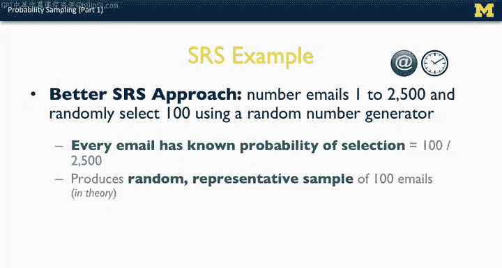

# 23：概率抽样方法（上）📊

在本节课中，我们将更详细地探讨概率抽样，并了解几种不同类型的概率样本。我们将深入探讨这种技术，并再次说明为什么概率样本对于得出关于总体的代表性结论至关重要。

上一讲我们介绍了抽样的基本概念，本节中我们来看看具体的概率抽样方法。

---

## 简单随机抽样（SRS）🎲

简单随机抽样是最基础的概率抽样方法。我们将它缩写为SRS，并会将其与本课程前面讨论过的**独立同分布**数据概念联系起来。

### 简单随机抽样的定义

进行简单随机抽样时，我们从一个已知的列表或抽样框开始。回忆上一讲的内容，总体有 **N** 个单位。**N** 代表总体的大小，单位可以是个人、家庭、企业等。我们拥有所有 **N** 个单位的列表，然后从中随机选择 **n** 个单位。**n** 是我们的样本量。

遵循这种抽样设计，**列表中的每一个单位都有相同的被选概率**。每个单位被选中的概率定义为 **n / N**。这是我们遇到的第一个**抽样分数**的例子，它代表最终被选入样本的总体比例。在简单随机抽样中，总体中每个人被纳入样本的概率是相同的，都是 **n / N**。

这也意味着，所有大小为 **n** 的可能样本被抽中的可能性是相等的。当我们使用简单随机抽样时，每一个可能被抽出的、大小为 **n** 的样本，其被选中的可能性都相同。

此外，基于从简单随机样本中收集的数据，对均值、比例、总数和其他感兴趣统计量的估计是**无偏的**。我们上一讲简单讨论了偏差。作为一种概率抽样，当我们基于简单随机样本计算估计值时，这些估计值是无偏的。这意味着，**这些估计值平均而言等于我们感兴趣的总体真实值**。回忆我们介绍的抽样分布概念，这些估计值可能存在变异性，具体取决于我们选择了哪些样本。但平均而言，在所有那些假设的样本中，这些估计值将等于感兴趣的总体值。这就是“无偏”的含义。

以下是简单随机抽样的一个图示：假设从一份包含10，000人的列表中随机抽取134人。这张体育场视图展示了随机抽样的结果，你可以看到所有的黑点代表了被随机选中的个体。可以看到，这个大小为134的随机样本代表了体育场的所有不同区域，我们从所有不同区域都抽取了一些样本。在这个小例子中，这134人是完全随机地从10，000人的更大列表中选出的。因此，通过收集这134名使用此技术随机选中的人的数据，我们可以对体育场内更大的总体做出有代表性的陈述。

### 放回与不放回抽样

简单随机抽样可以是**放回的**或**不放回的**。
*   **放回抽样**意味着当我们从大列表中选中某人后，会将其放回列表中，使其有机会再次被选中。
*   **更常见**的是进行**不放回**的简单随机抽样。一旦一个单位从给定列表中被抽样，就不能再次被抽样。

但对于这两种不同类型的简单随机抽样，**每个单位被选中的概率仍然是相同的量，即 n / N**。无论我们进行的是允许个人被多次选中的放回抽样，还是不放回抽样，被选中的概率保持不变，每个人都有 **n / N** 的机会被纳入样本。

### 简单随机抽样的实践限制

虽然简单随机抽样在概念上似乎很简单，但在实践中**很少使用**。原因如下：从一个非常大的总体中收集 **n** 个随机抽样单位的数据，成本可能高得令人望而却步。

例如，考虑一个从全美国范围内抽取1000人的简单随机样本，并且假设我们必须开车到每个被选中的家庭进行访谈。仅仅为了开车前往这些随机选中的家庭，成本就会变得极其高昂。因此，在实践中我们会考虑其他类型的概率样本，这些样本的实施成本要低得多。这对于大规模总体尤其如此。简单随机抽样通常在总体较小、数据收集更容易且成本更低时使用。

### 与IID数据的联系

现在，我们来谈谈它与本课程前面讨论过的**IID数据**概念的联系。回忆一下，IID观测值是**独立同分布**的。

**理论上**，简单随机抽样将为给定变量生成IID数据。当我们选择一个简单随机样本，然后收集该样本中所有单位的测量值时，理论上将产生之前定义的IID数据。

所有随机抽样的单位都将产生**独立**的观测值。随机抽样的单位之间没有联系，它们是彼此独立选择的，或者说它们感兴趣的测量值彼此不相关。此外，这些单位是**同分布**的，因此它们代表了某个更大总体的值分布。理论上，我们从简单随机样本中试图收集的所有测量值，都来自描述更大总体值分布的**同一个分布**。因此，我们得到了一组具有代表性的、随机选择的、彼此独立的观测单位。就抽样过程而言，这就是IID数据。

---

## 一个具体示例 📧

为了让概念更具体，这里有一个简单随机抽样的例子。

假设我们有一个客户服务数据库，包含 **N = 2500** 封在2018年收到的电子邮件请求。客户服务部门的主管希望估计**平均电子邮件响应时间**，即该部门回复这2500封邮件各花了多长时间。

你可能会觉得这很简单，直接查看所有2500封邮件就行了。但不幸的是，在这种情况下，精确计算需要手动审查每封邮件线程，并追踪回复邮件的具体时间点。因此，测量全部2500封邮件并不那么简单直接。主管要求分析团队**抽样、处理并分析一个小样本**，设 **n = 100** 封邮件，而不是试图测量每一封邮件。

我们可以通过几种不同的方法来获取这类样本。

**一种简单但欠考虑的方法是**直接处理列表上的前100封邮件。我们有一个2500封邮件的列表，就取前100封。在这种情况下，估计的平均响应时间**可能是有偏的**。例如，如果客户服务代表随着时间推移学会了更快地回复，那么邮件回复开始时可能花费的时间更长，而我们的估计均值在这种情况下可能会偏大。此外，前100个观测值也可能来自一小部分员工，即最初回复的邮件可能来自特定的个人。换句话说，这些邮件回复并不完全具有代表性，它们彼此之间并不独立（因为可能由相同的员工回复），并且它们也不是同分布的（因为它们来自与整个部门所有人不同的响应时间分布）。遵循这种方法没有按照特定概率进行随机选择，本质上我们得到的是一个**非概率样本**，这带来了重要的局限性。

**使用简单随机抽样的更好方法是**将这些邮件从1到2500编号，然后使用随机数生成器随机选择100个数字（即邮件的ID）。

在这种情况下，**每封邮件都有一个已知的被选概率**，即样本量100除以总体大小2500。遵循这种简单随机抽样方法，每封邮件都有这个已知的被选入样本的概率。此外，这将产生一个**随机的、有代表性的**100封邮件样本。理论上，这是从所有可能被回复的邮件中进行的随机选择。

在这种情况下，估计的平均响应时间也将是总体均值的**无偏估计**。正如我们讨论简单随机抽样时所说，平均而言，如果我们抽取许多许多个大小为100的样本并计算每个样本的均值，这些均值的平均值将等于真实的总体值。这是概率抽样的一个非常好的特性。

---

## 总结

本节课中，我们一起学习了概率抽样的核心方法之一——**简单随机抽样**。我们明确了其定义，即每个单位具有相同且已知的入选概率（**n / N**）。我们探讨了其能产生**无偏估计**和理论上**IID数据**的优良特性。同时，我们也认识到其在面对大规模总体时**成本高昂**的实践限制，这引出了对更复杂抽样方法的需求。最后，通过一个客户服务响应时间的例子，我们对比了非概率抽样与简单随机抽样的差异，直观地理解了后者的优势。下一节，我们将继续探讨为应对大规模抽样而设计的**复杂抽样**方法。