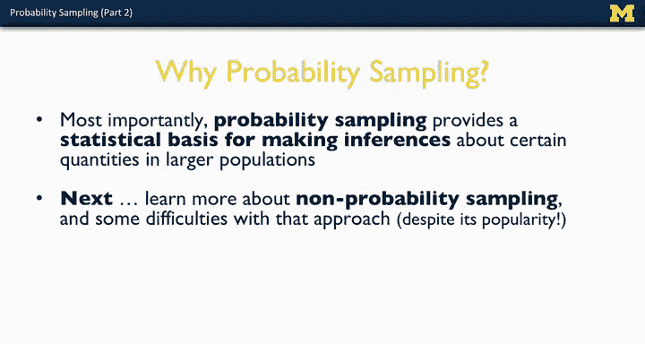

#  24：概率抽样方法（下）📊

在本节课中，我们将继续学习概率抽样方法。上一节我们介绍了简单随机抽样及其优良特性。本节中，我们将探讨更复杂的概率抽样设计，了解它们如何在实际调查中节省成本并提高效率。

## 复杂概率样本概述

简单随机抽样在实践中很少使用，因为它对于大规模总体而言成本高昂。复杂概率样本则通过特定的设计特征来节约成本并提高样本效率。与简单随机抽样不同，复杂样本的设计偏离了简单随机抽样的基本原则。

## 复杂样本的关键特征 🧩

复杂样本相对于简单随机抽样，具有几个关键的设计特征。

以下是复杂样本的主要设计方法：

*   **分层**
    首先，总体被划分为不同的层，并将部分样本分配到每个层中。这确保了每个层都有样本代表，并减少了调查估计的方差。这种技术称为分层。回想上一讲中的体育场视图，分层可以确保我们的样本来自体育场的所有四个象限，而不仅仅是其中一个。

*   **整群抽样**
    其次，复杂样本通过整群抽样来定义。在整群抽样中，我们可能首先随机选择总体单位的群，例如美国的县。每个群在各层内都有已知的选中概率。这在我们实际随机选择个人或家庭之前，首先抽样群，从而节省大量数据收集成本。

*   **多阶段抽样**
    然后，我们会在这些随机选中的群内，根据某种选中概率，随机抽样单位。例如，到达一个美国县后，我们可能会获取该县内的地址列表，并从所有可能的地址中随机选择家庭。地址列表上的每个地址都有已知的选中概率。关键区别在于，这些单位来自初始随机选择的群内的第二阶段抽样。这就是复杂抽样的核心思想。

## 单位选中概率的计算 🧮

在这些复杂样本中，一个单位的选中概率由几个因素决定。

一个单位的选中概率取决于从给定层中抽样的群数量、每个层中总体的群总数、最终从每个随机选择的群内抽样的单位数量，以及每个不同群中总体的单位总数。

以下是一个如何计算复杂样本中单位选中概率的例子：

假设我们在一个给定的层内，从 `A` 个群中随机选择 `a` 个群。然后，在每个选中的 `a` 个群内，我们从 `B` 个可能的单位中随机选择 `b` 个单位。那么，该群内每个单位的选中概率可以写为：

`P(selection) = (a / A) * (b / B)`

第一个分数 `(a / A)` 是群被随机选中的概率。第二个分数 `(b / B)` 是第二阶段抽样比例。样本设计者根据设计约束和成本限制来确定 `a` 和 `b` 的大小。

## 实例：国家健康与营养调查 🚚

为了让概念更具体，我们以国家健康与营养调查为例。

首先，我们根据地理和人口密度将美国划分为不同的区域。这些基于地理和人口密度对美国进行的划分称为层。通过将样本分配到这些不同的层，我们确保了每个层都有代表性，并最小化了“坏”的简单随机样本的风险。

接下来，我们从每个层中分配一定数量的县或县组进行抽样。这些就是群。我们随机抽样群以节省成本，这样我们就可以在一个非常小的地理区域（如一个县）内抽样家庭，而不是驱车前往从更大地理区域随机抽样的家庭。

然后，我们在这些县内以更高的比率抽样某些社会人口亚组的个体。这被称为**过抽样**。过抽样意味着不同类型的人将有不同的选中概率，在第二阶段有不同的选中率。这没关系，我们仍然有一个概率设计，并且可以使用这些概率最终对更大的总体做出有代表性的陈述。

这种多阶段抽样过程如下图所示（源自NHANES文档）：
1.  第一阶段：将美国划分为不同区域，并从每个区域中随机选择县（紫色点）。
2.  第二阶段：在选中的县内，随机选择更小的区域段（黄色区域）。
3.  第三阶段：在选中的区域段内，列出所有家庭并随机选择家庭。
4.  第四阶段：在选中的家庭内，随机选择个体。

在所有这四个阶段，我们都知道选中概率是什么，并在整个设计中保持这些概率。我们总是知道此处每个阶段不同单位的概率，这是概率抽样设计的重要特征。

在NHANES中，他们驾驶一辆载有医疗设备和工作人员的大型半挂车前往每个抽样的县和区域段。然后，他们邀请从这些家庭中随机选出的个体来到半挂车进行访谈和体检，数据便由此产生。

## 抽样权重与估计 ⚖️

在这种设计中，一个人选中概率的倒数被称为其**抽样权重**。

例如，如果根据复杂的多阶段设计，我的最终选中概率是 `1/100`，那么我的抽样权重就是 `100`。换句话说，在更大的总体中，我代表我自己和其他99个人。

这个作为选中概率函数的抽样权重，在实际数据分析中用于计算有代表性的总体估计值。因此，选中概率在基于复杂样本的计算估计中起着直接作用。

一旦我们从随机选择的个体那里收集到数据，这些权重就被用来计算感兴趣的总体数量的无偏估计，例如平均身体质量指数。如果根据样本设计对某些群体进行了过抽样，这些权重会直接考虑这些不同的选中概率。

## 概率抽样的重要性重申 ✅

最后，我们再次强调概率抽样的几个关键概念。

总体中的每个个体都有一个已知的非零选中概率。随后根据这些概率进行的随机抽样确保了总体中的所有单位都有预定义的机会被选中。一旦我们知道了这些选中概率，我们就可以为每个总体单位写下它们。

我们可以使用这些选中概率，通过抽样权重计算无偏估计。我们还可以估计抽样分布的特征——即使我们只抽取了一个样本，也可以模拟如果重复进行复杂抽样，其分布会是什么样子。这就是概率抽样的部分魅力所在：我们不需要一遍又一遍地抽样来了解估计量的分布可能是什么样子。

概率抽样为对更大总体中的某些数量进行推断提供了统计基础，这是一个非常重要的点。

## 总结

本节课中，我们一起学习了复杂概率抽样方法。我们了解了分层、整群和多阶段抽样如何帮助节省调查成本并确保代表性。我们学习了如何计算复杂设计下的单位选中概率，并通过国家健康与营养调查的实例看到了多阶段抽样的实际应用。最后，我们明确了抽样权重的作用及其在计算无偏总体估计中的重要性。概率抽样为基于样本数据对总体进行统计推断提供了坚实的理论基础。下一节，我们将探讨非概率抽样及其面临的挑战。