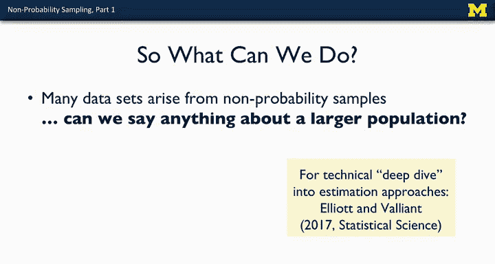

# 课程24：非概率抽样方法（上）📊

在本节课中，我们将学习什么是非概率抽样，了解其常见类型，并探讨使用此类数据时面临的挑战与可能的解决方法。

---

## 概述

上一节我们讨论了概率抽样，即每个个体都有已知的非零概率被选入样本。本节中，我们将注意力转向另一种抽样方法——**非概率抽样**。我们将首先定义非概率抽样及其关键特征，然后列举常见的例子，最后介绍两种用于从非概率样本进行总体推断的方法。

---

## 什么是非概率抽样？

与概率抽样不同，非概率抽样具有以下重要特征：

*   **无法确定选择概率**：我们无法为样本中的个体或单位计算其被选入样本的概率。
*   **没有随机选择机制**：我们无法控制最终产生样本的随机选择过程。
*   **成本相对低廉**：非概率抽样的数据收集成本通常远低于概率抽样，这是一个显著优势。

---

## 常见的非概率抽样例子

以下是几种常见的非概率抽样类型：

*   **志愿者研究**：常见于临床试验或学术机构的小型研究。研究人员发布招募信息，由感兴趣的人主动报名参加。研究者无法控制谁会被选中，也没有抽样框。
*   **网络自愿参与（拦截）调查**：当你在网站上看到调查邀请并决定参与时，就构成了这种样本。同样，没有选择概率和随机选择，数据收集者只是在寻找自愿参与者。
*   **滚雪球抽样**：样本通过参与者推荐他人而逐渐扩大。例如，一个参与者告诉朋友，朋友再告诉其他朋友。样本像滚雪球一样增长，但整个过程没有概率控制，全靠口碑传播。
*   **便利样本**：研究者出于便利性选择容易接触的群体作为样本。例如，大学教授为了进行研究，从其所教的《心理学101》大班中招募学生。这并非随机选择，只是为了方便获取大量参与者。
*   **配额抽样**：研究者设定样本子群的目标数量（配额），并尽一切努力招募足够人数以达到这些目标。例如，目标是招募1000名男性和1000名女性。达到配额是首要任务，但过程中同样没有随机选择或已知的选择概率。

这五种例子的共同点是：**都没有已知的选择概率**，研究者只是通过各种可能的方式收集数据和获取样本。

---

## 非概率抽样的核心问题

非概率抽样的一个共同且关键的特征是：在选择概率无法事先确定。这是概率抽样与非概率抽样的根本区别。

那么，为什么“是否有已知的选择概率”如此重要？

在非概率抽样中，由于我们无法控制选择概率，也不知道个体被纳入样本的随机概率，并且没有使用随机选择，因此**缺乏对样本来源的更大总体进行统计推断的数学基础**。

反之，如果我们知道选择概率（以及适用的总体分层和随机抽样的集群），我们就能估计**抽样分布**的特征。抽样分布是指，如果使用相同的概率抽样设计（已知选择概率并按此随机选择个体）抽取许多随机样本，所得到的估计值的分布。能够估计抽样分布的特征，对于对更大总体进行推断至关重要。

非概率样本的核心问题在于：
1.  **样本单位不是随机选择的**，这导致存在很高的**抽样偏差**风险。例如，一个网站上的自愿参与调查，可能只吸引对该网站感兴趣的人，这远不能代表你感兴趣的所有人。
2.  **样本通常不能代表更大的目标总体**。当我们想对总体做出陈述时，我们希望样本具有代表性。但志愿者样本或滚雪球样本等，通常无法提供来自总体的完全代表性样本，这使得做出无偏的总体陈述变得困难。

如今，我们常在媒体上听到关于大数据和分析的讨论。例如，处理数百万条推特数据的研究。许多大数据的问题在于，它们**源于非概率样本**，没有产生这些数据的概率抽样机制。这些数据通常出于便利性而产生，但人们却用它们来对更大总体做出陈述。因此，作为研究者，在分析所谓的大数据时必须非常谨慎，并充分理解数据的来源。

---

## 我们能做什么？两种推断方法

如果只能获得非概率样本，是否就无能为力了？并非如此。非概率样本成本低廉，是研究者的热门选择。那么，面对这类数据，我们能做什么呢？

许多数据集都来自非概率样本。根据这些数据，我们能否对更大的总体做出一些推断？答案是肯定的。2017年，Mike Elliott和Rick Valliant在《统计科学》期刊上发表了一篇技术性很强的文章，深入探讨了处理非概率样本时可用的不同估计方法。

以下是两种可能采用的方法：

1.  **伪随机化方法**：通过一些处理，我们将非概率样本**视为概率样本**来对待。我们将在下一部分讨论具体做法。
2.  **校准方法**：通过**加权**和其他基于模型的调整，使你的非概率样本在特征上**更接近你感兴趣的总体**。我们同样会在下一部分简要介绍如何在实践中实施这种方法。

---

## 总结

本节课我们一起学习了非概率抽样的定义与特征，了解了志愿者研究、网络调查、滚雪球抽样、便利样本和配额抽样等常见类型。我们认识到，非概率抽样的核心问题在于缺乏已知的选择概率和随机机制，这导致样本可能存在偏差且代表性不足，从而为统计推断带来挑战。然而，这并非绝境，通过伪随机化或校准等统计方法，我们仍然可以尝试从非概率样本中对总体进行有意义的推断。在下一节课中，我们将进一步探讨这些推断方法的具体应用。