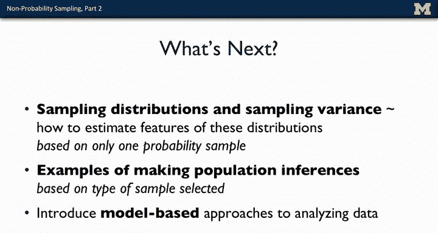

# 26：非概率抽样方法（下）📊

在本节课中，我们将继续探讨非概率抽样。我们将学习几种方法，用于在仅拥有非概率抽样数据时，对总体进行推断。这些方法旨在弥补非概率抽样缺乏已知选择概率的缺陷。

上一节我们介绍了非概率抽样的基本概念及其局限性，本节中我们来看看如何利用这些数据进行统计推断。

## 伪随机化方法

伪随机化方法的核心思想是，将非概率样本的数据与另一个概率样本的数据相结合。

以下是具体步骤：
1.  **寻找共同测量指标**：首先，需要找到非概率样本和概率样本数据集中共同测量的变量。
2.  **合并数据集**：将这两个数据集纵向堆叠在一起，形成一个组合数据集。
3.  **估计入选概率**：利用两个样本中都存在的辅助信息（如性别、年龄、教育程度等），估计每个个体被纳入非概率样本的概率。这通常通过逻辑回归模型完成。
    *   在组合数据集中，为每个个体创建一个指示变量 `A`：若个体来自非概率样本，则 `A=1`；若来自概率样本，则 `A=0`。
    *   使用逻辑回归模型：`logit(P(A=1)) = β0 + β1*X1 + β2*X2 + ...`，其中 `X1, X2, ...` 是辅助变量（如年龄、性别）。
4.  **应用概率抽样方法**：将上一步为**非概率样本个体**估计出的入选概率视为已知，然后应用之前讨论过的概率抽样分析方法（如加权）对组合数据集进行分析。

这种方法试图通过引入概率样本的结构信息，来“校正”非概率样本的选择偏差。

## 校准加权法

校准加权法通过为**非概率样本**中的每个回答单元计算权重，使加权后的样本在关键特征分布上接近已知的总体分布。

以下是其工作原理：
1.  **识别分布差异**：比较非概率样本与目标总体在某个或某些已知特征（如性别比例）上的分布。
    *   例如，非概率样本中女性占70%，男性占30%。
    *   而目标总体中，女性占50%，男性占50%。
2.  **计算调整权重**：计算权重，对样本中比例过高的群体（此例中的女性）赋予较低的权重，对比例过低的群体（此例中的男性）赋予较高的权重。
    *   目标：使加权后的样本性别比例调整为50:50，以匹配总体。
3.  **应用权重进行分析**：在后续计算估计值（如均值、比例）时，使用这些权重。

这种方法的关键在于，用于构建权重的特征（如性别）必须与研究者关心的核心变量高度相关。如果权重变量与兴趣变量无关，则无法有效减少由非概率抽样引起的偏差。

## 案例分析：推特数据推断

让我们通过分析推特数据的例子，来具体理解非概率抽样的挑战。

假设我们通过API抓取了数十万条提及特朗普总统的推文。这是一个大数据集，但本质上是一个**方便样本**：
*   **无法确定选择概率**：我们没有所有可能推文的抽样框，也未随机选择推文，只是抓取了所有可用的相关推文。
*   **推特用户不代表总体**：推特用户是自我选择的群体，通常对表达观点有较强兴趣，他们不能代表更广泛的人口总体。

接着，我们雇佣编码团队或使用算法，为每条推文标注一个二元指标：是否表达了对特朗普总统的支持。

**面临的推断问题**：
尽管我们拥有海量数据和精良的标注算法，但由于数据来源于**非概率抽样**，存在很高的**抽样偏差**风险。样本可能仅代表了那些有强烈意愿在推特上表达政治观点的人，而忽略了沉默的大多数。因此，直接根据此样本计算出的“支持率”可能严重偏离总体真实情况。

此时，前述的**伪随机化方法**或**校准加权法**就可能被应用。例如，我们可以尝试找到另一个具有全国代表性的概率抽样调查（其中也包含对特朗普的支持度问题及人口学变量），然后将两个数据集结合，使用伪随机化方法进行推断。

## 后续内容预告

在介绍了概率抽样、非概率抽样以及基于非概率样本的推断方法后，我们接下来将深入探讨两个核心概念：

*   **抽样分布与抽样方差**：我们将详细讨论，如何仅凭一个概率样本，就能估计统计量（如样本均值）的分布特征及其变异程度。这是概率抽样一个非常强大的特性。
*   **基于模型的推断方法**：我们将引入另一种统计分析范式——基于模型的推断。这种方法在一定程度上可以忽略具体的抽样机制。例如，前面提到的用逻辑回归估计非概率样本入选概率，就是一种模型辅助方法。随着课程深入，我们将更多地探讨回归模型等工具，用于分析来自各种抽样设计的数据。

理解数据来源及其背后的抽样机制，对于选择正确的分析方法和合理解读结果至关重要。

---

**本节课总结**：我们一起学习了两种处理非概率抽样数据以进行总体推断的方法：**伪随机化方法**（通过结合概率样本来估计入选概率）和**校准加权法**（通过调整权重使样本与总体在关键特征上一致）。我们还通过推特数据的案例，具体分析了非概率抽样在实际研究中的挑战与局限。最后，我们预告了接下来关于抽样分布和基于模型推断的重要主题。