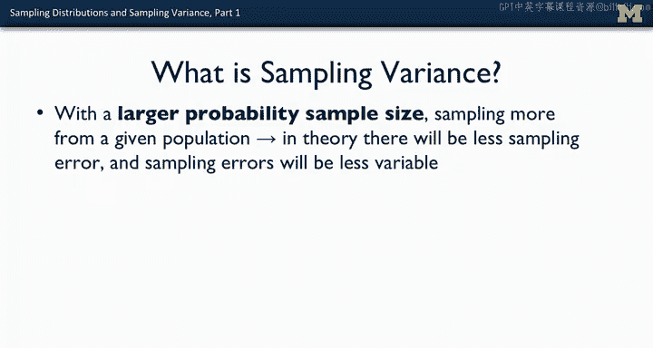

# 课程27：抽样方差与抽样分布（上） 📊

在本节课中，我们将深入探讨概率抽样的核心概念，特别是**抽样分布**和**抽样方差**。我们将学习这些工具为何对于基于概率样本进行总体推断至关重要。

---

## 什么是抽样分布？ 🤔

上一节我们介绍了概率抽样的基本思想。本节中，我们来看看**抽样分布**的具体含义。

回忆本课程早期，我们讨论过**感兴趣变量的值分布**。例如，我们简要介绍了正态分布。如果我们绘制一个变量所有可能值的直方图或密度函数，就能了解该变量值的分布情况。许多我们感兴趣的变量都可能遵循正态分布或钟形曲线。

然而，当我们选择概率样本来对更大的总体进行推断时，我们的推断是基于**抽样分布**的。这一点非常重要，必须将抽样分布与感兴趣变量的值分布区分开来。

**抽样分布**是**调查估计值的分布**，而不是变量值的分布。它描述的是：如果我们使用**相同的概率抽样设计**，反复抽取许多随机样本，并从每个样本中计算出一个估计值（例如均值或比例），那么所有这些估计值所形成的分布，就是抽样分布。

以下是抽样分布的一些关键特性：

*   **假设性**：抽样分布描述的是**如果**我们能抽取成千上万个概率样本时会看到的情况。这是一个假设性的思想实验，我们实际上不会这么做，但理论描述了这种分布的特征。
*   **外观不同**：抽样分布的外观通常与单个变量的值分布**非常不同**。
*   **趋于正态**：当概率样本的**样本量足够大**时，无论我们计算何种估计值，其抽样分布都会趋近于**正态分布**。这得益于**中心极限定理**，它指出随着样本量增大，估计值的分布会越来越趋向正态。

---

## 什么是抽样方差？ 📈

理解了抽样分布后，我们现在需要探讨**抽样方差**的概念。

**抽样方差**是由抽样分布描述的**估计值的变异性**。假设我们抽取了成千上万个使用相同设计的概率样本，并绘制了每个样本的估计值，那么描述这个抽样分布变异性的指标就是抽样方差。它衡量了在这些假设的重复样本中，我们试图计算的估计值有多大的波动。

因为我们只抽取一个样本，而不是测量总体中的每一个体，所以基于单个样本的调查估计值**不会完全等于**我们感兴趣的总体真值。这就是所谓的**抽样误差**。

在所有这些假设的重复样本中，抽样误差会随机变化：一个子样本的均值可能略低于总体均值，另一个可能略高，再一个可能非常接近。这些估计值会在假设的重复样本中“跳动”。

这些抽样误差的变异性，就描述了抽样分布的方差。如果我们观察整个样本估计值的分布，看它们围绕我们试图估计的总体真值“跳动”的程度，那就是抽样分布的方差，也就是我们所说的**抽样方差**。

---

## 为什么抽样方差对总体推断至关重要？ 🎯

上一节我们定义了抽样方差，本节中我们来看看它为何如此重要。

如果每个样本估计值都等于感兴趣的总体真值（例如，在人口普查中，我们试图测量每个人），那么就不会有抽样误差，也不会有抽样方差。但正如我们之前讨论的，普查在实践中通常非常困难且昂贵，因此我们转而使用**抽样**。

**样本量**是影响抽样方差的关键因素：

*   **更大的概率样本量**意味着**更小的抽样误差**和**更小的抽样方差**。这可以类比普查：样本量越大，我们就越接近测量总体中的每个人，误差就越小，估计值也越稳定。
*   因此，**更大的样本意味着更小的抽样方差**，我们得到的估计值**更精确**，对所做的推断性陈述也**更有信心**。
*   然而，获取更大的样本（尤其是在使用概率抽样时）**成本更高**。因此，在抽样中，经常需要在**成本**和**抽样方差**之间进行权衡。

抽样分布的“宽度”（即所有假设估计值的离散程度）会随着样本量的增大而**变小**，这意味着我们的估计值变异性更小，抽样方差更低。

---

## 模拟抽样分布示例 📊

以下是模拟抽样分布的一个图示，它展示了一个3x3的矩阵：

*   **行（从上到下）**：表示不同的样本量（500， 1000， 5000）。
*   **列（从左到右）**：表示不同的抽样设计（简单随机抽样， 包含10个单位的整群抽样， 包含50个单位的整群抽样）。

图中显示的是模拟的抽样分布，即根据这些设计反复抽取概率样本并计算估计值后，所有可能估计值的分布。

从图中可以得出两个关键结论：

1.  **样本量增大**：随着样本量增加（从上往下看行），抽样分布会**变窄**（即方差减小）。这印证了“更大样本量，更小抽样方差”的规律。
2.  **整群抽样影响**：当使用**整群抽样**（通常用于节省数据收集成本）时，抽样分布会**变宽**（即方差增大）。特别是当每个群内的单位数增加时（从左往右看列），估计值的变异性会显著增加。

图中一个有趣的对比是：一个**样本量为500的简单随机抽样**的分布宽度，与一个**样本量为5000、每群包含50个单位的整群抽样**的分布宽度**几乎相同**。这再次凸显了在概率抽样设计中，**设计选择**与**估计值变异性**之间的重要权衡。

---

## 总结 📝

本节课中，我们一起学习了：
1.  **抽样分布**是假设反复抽取相同设计的概率样本时，所得估计值的分布。它具有假设性，且在大样本下趋于正态分布。
2.  **抽样方差**衡量了抽样分布中估计值的变异性，根源在于**抽样误差**（即样本估计值与总体真值之间的差异）。
3.  抽样方差对于基于样本推断总体至关重要。**更大的样本量**可以**减小抽样方差**，提高估计精度，但也会增加成本，需要在两者间权衡。
4.  不同的抽样设计（如简单随机抽样 vs. 整群抽样）会显著影响抽样分布的宽度和抽样方差的大小。

理解这些概念是进行有效统计推断的基石。在下一部分，我们将继续探讨如何实际估计抽样方差，并利用它来构建置信区间。