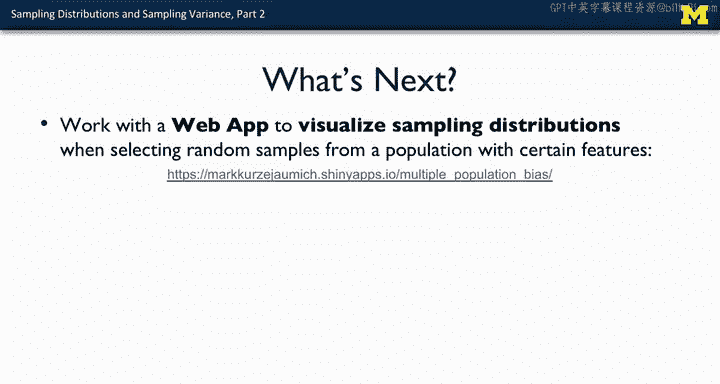

# 28：抽样方差与抽样分布（下） 📊

在本节课中，我们将继续探讨抽样分布与抽样方差。我们将了解如何仅通过一个概率样本来估计抽样分布的特征，并利用一个网络应用程序来可视化不同抽样设计下的抽样分布行为。

---

上一节我们介绍了模拟抽样分布，并讨论了样本量、聚类抽样等因素如何影响估计量的变异性。本节中，我们将探讨抽样方差的重要性，并学习如何在实际研究中应用抽样理论。

## 为什么抽样方差重要？ 🤔

在实践中，我们通常只有资源抽取一个样本。之前看到的模拟是假设性的，我们通过计算机模拟生成了许多估计量，以理解抽样分布的概念。但在现实世界的数据收集中，我们只能基于一个样本进行测量和计算估计。

重要的抽样理论，如20世纪初耶日·奈曼等人的工作，使我们能够仅基于一个样本来估计抽样分布的特征，包括其方差。这是概率抽样的一个奇妙特性：它提供了一种统计机制，让我们在只抽取一个样本的情况下，也能估计抽样分布的变异性。我们无需抽取成千上万个样本并分别计算估计量来确定抽样分布的形状。

概率抽样的“魔力”在于，我们可以选择一个概率样本，并根据该设计的特点（如不同个体的入选概率、分层、整群抽样等），仅凭这一个样本，就能了解预期抽样分布的信息——主要是其方差和均值。这使得我们能够基于一个概率样本，对总体做出有代表性的推断。

## 基于抽样分布的推断 📈

由于我们可以仅基于一个样本来估计抽样分布的方差，我们便能对基于特定抽样设计的大多数估计值可能落在何处做出推断性陈述。这告诉我们关于总体的一些信息。

我们可以对总体参数的**可能值**进行陈述，同时考虑到由随机概率抽样产生的抽样误差的变异性。我们不仅可以计算基于概率样本的总体估计（如总体均值或比例），还可以讨论这些估计的变异性有多大，即我们试图计算的估计值存在多少不确定性。能够估计抽样分布的方差，使我们能够描述所计算估计值的变异性。

## 回顾与可视化工具 🛠️

我们已经讨论了概率抽样的概念，以及如何仅基于一个概率样本（已知所有单元的入选概率以及分层、整群等设计特征）来估计抽样分布的特征。知道了这些信息，我们就可以讨论抽样分布的预期方差，从而计算总体估计并基于我们对抽样分布特征的估计来描述这些估计的变异性。概率抽样使这一切成为可能。

接下来，我们将演示一个网络应用程序，它允许我们在从具有某些特征的总体中抽取随机样本时，可视化抽样分布。您可以在本周的课程列表、应用程序和阅读材料中找到此链接。

我们将使用这个应用程序来观察：
*   随机概率抽样通常产生的抽样分布，其均值接近我们感兴趣的**真实总体值**。
*   **更大的样本**会产生方差更小的抽样分布，这与上一部分讨论的模拟类似。
*   **有偏的、非代表性的样本**如何产生误导性的抽样分布，从而对总体描绘出错误的图景。如果我们抽取的不是一个良好的代表性概率样本，而是偏向于总体的某个特定子集，那么生成的抽样分布将不会以我们感兴趣的真实总体值为中心。这种有偏的抽样机制最终会给我们一个关于总体面貌的误导性图像——基于有偏抽样机制的估计量分布，其变异性可能大致正确，但不会以真实总体值为中心，因为我们每次抽取的样本都不具有代表性。

我们将使用这个网络应用程序来具体说明这个观点。

---

本节课中，我们一起学习了抽样理论的核心价值：仅通过一个精心设计的概率样本，我们就能估计抽样分布的方差，从而对总体参数进行推断并评估估计的不确定性。我们还了解到，有偏的抽样设计会导致抽样分布偏离真实总体值，产生误导性结论。理解这些概念对于设计和解释基于样本的研究至关重要。