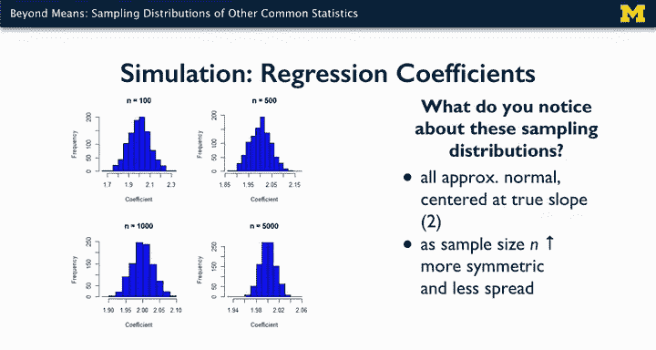

# 30：超越均值：常见统计量的抽样分布 🧮

在本节课中，我们将要学习抽样分布的核心概念，特别是如何将均值的抽样分布理论推广到其他常见统计量，如相关系数和回归系数。我们将探讨一个关键结果：在大样本下，许多统计量的抽样分布都趋向于正态分布。

欢迎回到我们第四周关于从大总体中抽样以及如何基于样本进行推断的讨论。我们继续在“数据来源”的框架下探讨抽样，这是开始分析数据前的重要步骤。

上一节我们介绍了均值的抽样分布。本节中，我们来看看一个有趣的结果：对于许多常见统计量，只要样本足够大，它们的抽样分布都惊人地趋向于正态分布。我们将讨论如何基于正态抽样分布对其他类型的统计量进行推断，并以此为基础探讨其他抽样方法。

本节课我们关注的核心结果是：当从一个总体中抽取足够大的样本时，大多数我们感兴趣的统计量的抽样分布都会趋向于正态。这个结果与输入变量自身的分布形态无关。

您在此看到的图片展示了一个抽样分布的例子，正如我们之前讨论的：在假设的重复抽样中，我们预计估计值的分布会呈现何种形态。**中心极限定理**指出，给定足够大的样本，估计值的分布会趋向于钟形曲线或正态分布。

这个基于中心极限定理的结果，推动了基于设计的统计推断（有时也称为频率派统计推断）。其核心思想是，我们可以假设抽样分布是正态的，并基于这个理论上的正态分布，对更大总体中某个统计量的真实值进行推断。

让我们考虑一个例子。本周到目前为止，我们一直在讨论均值的抽样分布，并展示了一个允许您模拟均值抽样分布的网页应用。现在，让我们考虑数据分析中另一种常见的统计量：**皮尔逊相关系数**。

皮尔逊相关系数描述任意两个连续变量之间的线性关联。本幻灯片展示了几种假设的皮尔逊相关系数示例，通过散点图展示了两个连续变量可能的相关紧密程度。

以下是相关系数取不同值时的典型散点图形态：
*   当皮尔逊相关系数为 **1** 或 **-1** 时，两个变量具有极强的线性关联。
*   当相关系数趋近于 **0** 时，变量之间基本没有相关性，散点图呈现为一片数据点云。

这与简单的均值有很大不同。均值描述样本（并可能推断总体）的中心趋势，而相关系数描述的是两个变量之间的线性关联。它是数据分析中描述变量间初始关联的常用统计量。

接下来，我们将模拟皮尔逊相关系数的抽样分布，类似于我们之前查看的网页应用。我们假设总体中的真实相关系数为 **0.7**。

这意味着我们讨论的是一个相当强的相关性，虽然不是完美的直线，但两个变量在线性意义上仍具有非常强的相关或关联。我们将从这个真实总体相关系数为 **0.7** 的总体中，抽取指定样本量（记为 **n**）的 **1000** 个样本。我们将对不同的样本量（从 **100** 到 **5000**）进行此操作，以说明不同点。

以下是这个小模拟研究的结果。您看到的是一幅抽样分布图。这些蓝色的分布是基于特定大小样本的所有模拟相关系数的分布。

需要记住的是，在真实总体中，相关系数是 **0.7**。如果我们拥有总体中所有个体的数据并计算皮尔逊相关系数，结果将是 **0.7**。图中显示，对于样本量为 **15**、**100**、**500**、**5000** 的情况（即每个样本都具有特定大小，我们基于该简单随机样本中的模拟数据计算相关系数），这些就是会出现的相关系数分布。

关于这些抽样分布，有几个关键点需要注意。首先，所有分布都近似正态。您可以看到，基于一千个样本的估计值分布都呈现钟形曲线，并且它们都以真实相关系数为中心。

这意味着简单随机抽样平均而言为我们提供了该相关系数的无偏估计。所有这些估计值的平均值将等于 **0.7**，即真实的总体参数。您可以看到所有分布都以大约 **0.7** 为中心，并且都近似正态分布。因此，几乎无论样本量大小，它们都遵循这些正态分布。

但我们注意到，随着样本量 **n** 的增加，分布变得更加对称，且离散程度减小。如果您观察这四个不同图的X轴，会发现对于样本量为 **100** 的情况，那些大小为 **100** 的样本的估计相关系数范围大约在 **0.55** 到 **0.85** 之间。但随着样本量增大，这个范围缩小了。在重复样本中，估计值的分布离散度更小。

当每个样本的样本量达到 **5000** 时，估计的相关系数范围大约在 **0.69** 到 **0.73** 之间，同样以 **0.7** 为中心。这说明中心极限定理在起作用：我们得到了这些漂亮的正态分布，并且随着样本量增大，我们对总体参数的估计更加精确。对于样本量为 **5000** 的情况，范围在 **0.69** 到 **0.73** 之间，抽样分布的离散度更小。这就是“更大样本带来更精确估计”这一概念的来源。

我们来看另一个模拟。刚才我们看了相关系数的案例。数据分析中另一种非常常见的统计量是**回归系数**。

回归分析使我们能够评估多个变量之间的关系，我们将在本专项课程中详细讨论。这张图再次展示两个变量之间的估计关系，我们现在关注的是估计的斜率，即预测变量 **x** 每变化一个单位时，因变量 **y** 的估计变化量，它描述了两个连续变量之间的线性关系。

与仅提供简单相关性描述的相关系数分析不同，在线性回归中，我们实际上可以估计这个斜率参数。我们旨在估计描述 **y** 随 **x** 单位变化而变化的斜率。该图展示了针对一系列假设数据点拟合的简单线性回归模型，描述了二者之间的线性关系。

我们将以相同的思路进行模拟：针对不同大小的样本，多次计算回归斜率，以观察这些抽样分布的变化。

我们将假设在我们感兴趣的总体中，真实的线性关系由以下回归方程描述：
`Y = 2 * X + ε`
（其中 **ε** 代表随机误差）

因此，我们通过抽样试图估计的真实斜率实际上是 **2**。我们将再次抽取 **1000** 个指定样本量 **n** 的样本，并对同一组四个不同的假设样本量（**100**、**500**、**1000**、**5000**）进行此操作。

这是这些抽样分布的另一张图。您首先观察到的是，它看起来和上一张幻灯片非常相似。所有分布都看起来非常正态且相当对称。同样，随着样本量增加，您可以看到那些估计回归系数的离散范围再次缩小。因此，在不同假设样本之间，估计值的变异性减小了。

所有这些不同的分布都近似正态，并以真实斜率（2）为中心。随着样本量 **n** 的增加，它们变得更加对称，离散度更小。

就抽样分布的性质而言，许多常用统计量的抽样分布（无论其复杂性如何）往往具有以下性质：趋向于正态、趋向于对称、以真实值为中心。更大的样本量意味着估计值的变异性更小。

这里传达的关键点是：**我们可以仅基于一个样本来估计这些正态分布的方差**。这使我们能够在考虑抽样变异性的同时，对更大的总体进行推断。

在本专项课程后续部分，我们还将处理非正态的抽样分布。并非所有统计量都像我们目前看到的均值、相关系数和回归系数那样具有正态抽样分布。在这些情况下，需要进行更专门的程序来进行总体推断。

我们将讨论像贝叶斯方法这样的思想。本专项课程后面会讨论的一个很酷的例子是**方差成分**统计量（在多层次建模的背景下）。这些统计量的抽样分布通常不是正态的，我们将讨论在这些情况下如何进行推断。

那么接下来是什么？我们究竟如何基于一个样本进行总体推断？我们已经讨论了很多关于抽样分布的内容，现在我们要迈出下一步：基于仅仅一个样本，我们最终将如何进行总体推断？我们可以基于那个样本来估计抽样分布的特征，但如何从这一点出发，最终做出总体推断呢？

本节课中我们一起学习了抽样分布的核心原理，特别是中心极限定理如何使许多常见统计量（如相关系数和回归系数）的抽样分布在大样本下趋向于正态。我们通过模拟观察到，这些分布以真实参数为中心，且随着样本量增大，其离散度减小、估计更精确。我们还了解到，仅凭一个样本即可估计抽样分布的方差，这是进行统计推断的基础。最后，我们简要提及了非正态抽样分布的存在，为后续更高级的推断方法做了铺垫。