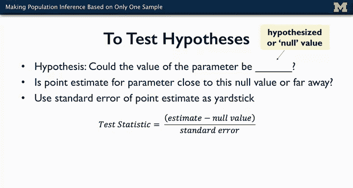

# 课程31：基于单样本的总体推断 📊

在本节课中，我们将学习如何仅基于一个实际样本，对总体参数进行统计推断。我们将探讨两种核心方法：构建置信区间和进行假设检验，并理解抽样设计对推断过程的影响。

---

## 概述

在之前的课程中，我们讨论了抽样分布的概念，即在特定抽样设计下，理论上可以抽取成千上万个样本，并模拟所有可能估计值的分布情况。然而在实践中，我们通常只有一个样本。本节课的目标，就是学习如何基于这一个样本来对总体进行推断。

我们将介绍两种通用的总体推断方法：一是为感兴趣的总体参数估计一个**置信区间**，二是对感兴趣的参数进行**假设检验**。同时，我们会探讨抽样设计如何影响这些推断过程。

我们所说的“感兴趣的参数”，是数据分析的最终产物。它可能是总体均值、比例、回归系数或比值比等。这些统计量用于回答研究问题，描述总体的某个特征，无论是关系还是描述性统计量。

---

## 核心假设：抽样分布的正态性

进行推断的一个关键假设是抽样分布的**正态性**。无论是构建置信区间还是进行假设检验，都假设这些估计值的抽样分布近似服从正态分布。

根据中心极限定理，对于各种相对适中的样本量，只要样本量足够大，抽样分布往往呈现正态形态。这里的“抽样分布”，指的是在假设的重复抽样中，某个参数估计值的所有可能取值的分布。我们的推断正是基于这个分布的形状来进行的。

一个常见的问题是：如果抽样分布实际上不近似正态，我们还能使用这些推断方法吗？答案是，在本课程后续部分，我们将讨论适用于这些情况的替代推断方法。然而，许多常见的统计量确实服从正态抽样分布，本节课将主要讨论这种情况下的方法。

---

## 推断步骤详解

### 第一步：计算点估计

我们首先需要计算一个**点估计**，即对总体感兴趣参数的一个估计值。

**什么是无偏点估计？**
这意味着，在假设的重复抽样中，该点估计所有可能取值的平均值（也称为该点估计的**期望值**）等于真实的参数值。我们说一个估计是无偏的，就是指在假设的重复抽样中，其所有可能值的平均值等于真实参数值。

幻灯片上的图示说明了这一点：红色分布代表无偏估计的抽样分布，其中心位于真实参数值（直线所示）。这意味着，平均而言，这些假设样本产生的估计值会给出真实的参数值。而蓝色分布代表有偏估计，其分布中心偏离了真实参数值。

因此，我们努力设计能产生无偏估计的样本。这意味着，在给定的抽样设计下，我们计算出的总体参数估计值应是无偏的。例如，如果样本中个体的入选概率不相等，就需要在计算有限总体参数估计时使用**权重**。如果不使用权重，我们的抽样分布就会发生偏移，导致估计有偏。

所以，第一步是根据需要，使用权重计算出一个**无偏的点估计**。

---

### 第二步：估计抽样方差

接下来，我们需要估计与该点估计相关的**抽样方差**。这相当于估计抽样分布的方差。我们无法抽取成千上万个样本来计算方差，因此必须基于这一个样本来估计。

类似于计算参数的无偏点估计，我们也希望得到抽样方差的一个**无偏估计**。一个无偏的方差估计能正确描述在所用抽样设计下，抽样分布的变异性。

幻灯片图中的蓝色箭头指示了我们试图基于单个样本估计的变异性。一旦我们有了这个变异性的良好无偏估计，我们就具备了推断总体参数值所需的工具。

**一个关键点：标准误**
我们试图估计的方差的平方根，称为点估计的**标准误**。标准误本质上是抽样分布的标准差。我们估计抽样分布的方差，取其平方根得到标准差，即标准误。我们使用这个标准误来对总体参数进行推断。

---

## 推断方法一：构建置信区间

第一种推断方法是构建**置信区间**。其做法是：取我们最好的估计（无偏点估计），然后加上或减去一个**误差范围**。这样，我们在描述总体中该参数的合理取值时，就考虑到了抽样变异性。

*   **最佳估计**：参数的无偏点估计。
*   **误差范围**：通常是估计标准误的若干倍。这个“若干倍”是一个来自适当分布的乘数，取决于所需的置信水平和相应的抽样设计。

例如，常用的**95%置信水平**对应0.05的显著性水平。这意味着，以这种方式构建的区间中，有95%会覆盖真实的总体参数。如果我们取最佳估计，加减大约两倍的标准误，那么以这种方式构建的区间中，有95%会覆盖我们感兴趣的真实参数。

**图示理解**
图中，黑色向下的箭头代表真实参数值。每条水平线代表一个以此方式构建的置信区间（最佳估计 ± 2倍标准误）。可以看到，在假设的重复抽样中，绝大多数这样构建的区间都覆盖了真实参数值（黑线），但也有一些没有。

**重要提醒**
要做出正确的总体推断，必须确保以下三点都正确：
1.  用于构建区间的最佳估计确实是**无偏点估计**。
2.  误差范围使用了**正确的乘数**（例如，对于95%置信区间，通常使用2）。
3.  误差范围使用了**标准误的无偏估计**。

如果任何一点出错，置信区间将无法达到所宣称的覆盖真实参数的概率（例如，名义上是95%，实际可能只有90%或80%）。

置信区间为我们提供了总体参数的合理取值范围。如果某个假设的总体参数值落在置信区间之外，我们通常认为没有足够的统计证据在相应的显著性水平上支持该值。

---

## 推断方法二：假设检验

第二种推断总体参数的方法是**假设检验**。

我们的假设可能是：参数的值等于某个特定值（即**零假设**或原假设值）。我们通过检验来回答这个问题：参数的点估计是接近这个零值，还是相距甚远？这里，我们再次使用**标准误**作为衡量尺子。

一个常见的检验统计量形式是：
`检验统计量 = (无偏点估计 - 零假设值) / 标准误`

这个公式衡量了我们的估计值与零假设值之间的距离，除以标准误后标准化，告诉我们证据反对零假设的强度。

如果零假设为真，我们可以计算看到如此极端或更极端检验统计量的概率。如果这个概率很小，我们就有理由拒绝零假设。

---

## 重要前提：概率抽样

**所有这些推断程序的有效性，都建立在使用了概率抽样的基础上。** 我们描述的所有技术都依赖于概率样本的理念。

如果数据来自**非概率样本**，推断方法通常需要依赖建模。即通过拟合统计模型来对估计值下结论，而不能依赖概率抽样框架所提供的、已知抽样分布形态的“安全保障”。我们也可以将数据与其他概率样本结合，使用混合方法进行推断。

---

## 总结

在本节课中，我们一起学习了如何基于单个样本对总体进行统计推断。核心内容包括：

1.  **核心前提**：依赖于抽样分布近似正态的假设，以及中心极限定理的支持。
2.  **关键步骤**：首先计算参数的**无偏点估计**，然后估计其**抽样方差**并得到**标准误**。
3.  **两种主要方法**：
    *   **置信区间**：通过“点估计 ± 误差范围（乘数 × 标准误）”构建，提供一个参数的可能取值范围（如95%置信区间）。
    *   **假设检验**：通过计算标准化后的“（点估计 - 假设值）/ 标准误”作为检验统计量，评估证据反对零假设的强度。
4.  **根本基础**：所有这些经典推断方法的有效性都依赖于**概率抽样设计**。对于非概率样本，需要采用不同的建模或数据融合策略。

掌握这些概念，是理解如何从样本数据得出关于总体可靠结论的基础。