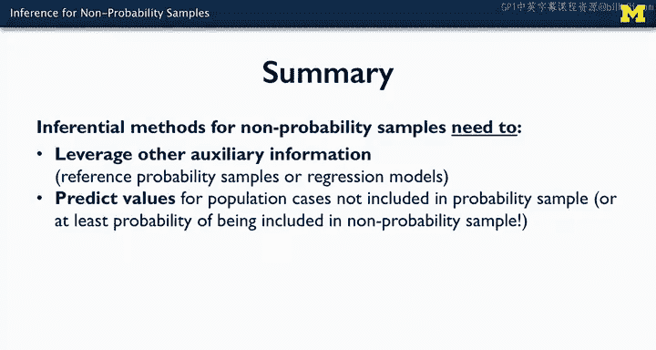

# 课程32：非概率样本的统计推断 📊

在本节课中，我们将学习如何基于非概率样本对总体参数进行统计推断。我们将探讨两种主要方法：准随机化法和总体建模法，并理解它们如何克服非概率样本缺乏传统抽样理论支持的局限性。

---

## 概述

上一节我们讨论了如何基于单一概率样本来推断总体参数。本节中，我们来看看当数据并非来自概率样本，而是来自非概率样本（如志愿者样本、滚雪球样本）时，应如何进行统计推断。核心问题在于，非概率样本无法依赖传统的抽样分布理论，因此需要借助其他统计方法。

---

## 准随机化法

准随机化法的核心思想是，将非概率样本的数据与另一个收集了相同测量变量的概率样本数据相结合。通过这种方式，我们利用概率样本的已知信息来“校准”非概率样本，从而进行推断。

以下是实施此方法的关键步骤：

1.  **数据合并**：将非概率样本数据集与一个独立的概率样本数据集纵向合并。两个数据集必须包含一些共同的测量变量（例如年龄、血压）。
2.  **创建指示变量**：在合并后的数据集中创建一个新变量（例如 `NP_sample`），用于标识每条记录是来自非概率样本（值为1）还是概率样本（值为0）。
3.  **拟合逻辑回归模型**：以共同变量（如年龄、血压）为自变量，以 `NP_sample` 为因变量，拟合一个逻辑回归模型。拟合时，非概率样本的个案权重设为1，概率样本的个案则使用其原有的调查权重。
4.  **计算预测概率与权重**：使用拟合好的模型，预测每个个案出现在非概率样本中的概率。然后，取该概率的倒数，作为该个案在新的加权分析中的“调查权重”。
5.  **进行加权分析**：使用这些新计算的权重，对非概率样本中我们真正感兴趣的变量进行标准的加权分析（如计算加权均值）。

**核心公式/代码概念**：
逻辑回归模型预测个体 `i` 属于非概率样本的概率：
`P(NP_sample_i = 1 | X_i) = exp(βX_i) / (1 + exp(βX_i))`
其中，`X_i` 是共同变量向量，`β` 是模型系数。随后，分析权重为：
`weight_i = 1 / P(NP_sample_i = 1 | X_i)`

---

## 方差估计的挑战与复制法

准随机化法的一个关键挑战是如何估计抽样方差。对于概率样本，我们可以直接计算标准误。但对于使用上述方法生成的新权重，没有明确的数学公式来估计其抽样分布。

文献中建议使用**复制法**来解决此问题：

1.  **从原始数据中重复抽样**：对合并后的数据集进行多次有放回的再抽样（例如自助法），生成多个复制样本。
2.  **重复整个过程**：对每个复制样本，重复执行准随机化法的所有步骤：合并数据、拟合模型、计算新权重、得出目标变量的估计值（如均值）。
3.  **构建经验抽样分布**：将所有复制样本计算出的估计值收集起来，它们的分布就模拟了该估计量的经验抽样分布。
4.  **计算方差**：基于这个经验分布，我们可以计算估计值的方差和标准误。

这种方法通过计算机模拟，绕过了复杂的理论推导，为基于非概率样本的推断提供了可行的方差估计途径。

---

## 总体建模法

总体建模法是另一种处理非概率样本的思路。它不依赖于另一个概率样本，而是利用总体中所有个体都具备的辅助信息，通过预测模型来填补非样本个体的信息空缺。

以下是此方法的实施步骤：

1.  **数据基础**：我们有一个包含总体中所有个体的数据集，其中每个人都有丰富的辅助信息（如人口统计学变量、消费记录等）。但只有非概率样本中的个体，才被测量了我们关心的核心变量（如对某产品的满意度）。
2.  **拟合预测模型**：在非概率样本子集上，以核心变量为因变量，以辅助信息为自变量，拟合一个回归预测模型（如线性回归、决策树等）。
3.  **预测总体值**：使用拟合好的模型，对总体中**未被**纳入非概率样本的所有个体，预测其核心变量的值。
4.  **计算总体估计**：现在，对于总体中的每个人，我们都有了一个值：非样本个体是**预测值**，样本个体是**观测值**。利用这些值，我们可以计算总体参数的估计。例如，总体均值的估计为：
    `总体均值估计 = (所有个体的预测值/观测值之和) / 总体大小`

**核心公式/代码概念**：
假设我们拟合了一个线性回归模型：`Y = α + γZ + ε`，其中 `Y` 是核心变量，`Z` 是辅助变量。
对于非样本个体 `j`，其预测值为：`Ŷ_j = α̂ + γ̂Z_j`。
总体总值估计为：`T̂ = Σ_(i∈样本) Y_i + Σ_(j∉样本) Ŷ_j`
总体均值估计为：`μ̂ = T̂ / N`，其中 `N` 是总体大小。

---

## 两种方法的比较与总结

本节课我们一起学习了两种基于非概率样本进行统计推断的主流方法。

*   **准随机化法** 的核心是**结合概率样本**，通过建模预测个体“进入”非概率样本的概率，并以此生成分析权重。它要求有一个收集了相同变量的概率样本作为基准。
*   **总体建模法** 的核心是**利用总体辅助信息**，通过建模预测未受访个体的核心变量值。它不要求额外的概率样本，但要求拥有覆盖总体的、高质量的辅助信息。

两种方法都严重依赖于**高质量的辅助信息**和**优秀的预测模型**。无论是预测入样概率还是预测变量本身，模型的准确性直接决定了推断的可靠性。在缺乏此类信息的情况下，基于非概率样本做出有效的总体推断将变得异常困难。

对于方差估计，两种方法都可以借助**复制法**（如自助法）来获得经验标准误，从而构建置信区间或进行假设检验。

---

**总结**：非概率样本虽然获取成本低、方式灵活，但进行统计推断需要更复杂的方法和更强的假设（主要是模型假设）。准随机化法和总体建模法为我们提供了两条可行的路径，但它们都要求我们拥有并善用样本之外的额外信息来弥补非随机抽样带来的缺陷。