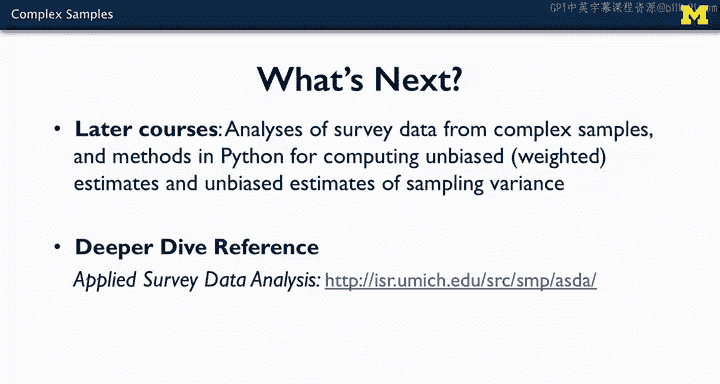

# 课程 32：复杂样本处理方法 🧮

在本节课中，我们将深入学习复杂样本。我们将探讨复杂样本的设计特征，以及基于此类样本进行总体推断时需要考虑的关键因素。理解这些概念对于正确分析调查数据至关重要。

---

## 概述

复杂样本是指任何设计上比简单随机抽样更复杂的概率样本。我们将深入回顾复杂样本，并讨论基于这些样本进行总体推断时的重要考量。

---

## 复杂样本的特征

上一节我们介绍了概率抽样和非概率抽样的基本概念。本节中，我们来看看复杂概率样本的几个关键设计特征。

### 分层

分层是指将总体样本分配到不同层或总体中互斥的划分中。例如，在美国的一项全国性调查中，可以将美国划分为四个不同的地理区域作为分层。

以下是分层中一种常见的分配方案示例：

*   **比例分配**：假设总体中70%的单位属于层1，30%属于层2。那么，总体样本的70%将分配给层1，30%分配给层2。这意味着，如果我想抽取100个个体，其中70个来自层1，30个来自层2。

分层设计有一个非常吸引人的特性：它能从总体抽样方差中**消除层间方差**。因为在我们所有假设的重复抽样中，每个样本都严格按照相同的比例从各层抽取，这确保了每个层在所有样本中都有代表。如果不进行分层，我们可能会抽到某些层完全没有代表的随机样本。

因此，在数据分析中考虑分层非常重要。如果实际使用了分层抽样，但在分析时没有考虑，我们估计的标准误可能会比实际应有的更大，导致置信区间过宽，推断过于保守。

### 整群抽样

整群抽样是指对更大的群体单元（群）进行随机抽样，可能涉及多个阶段。例如，在一项全国性调查中，我们可能首先随机抽取一些县，然后在抽中的县内随机抽取区域段，最后在区域段内抽取家庭。

整群抽样在实践中用于**降低数据收集成本**。访问一个广泛分布总体中的随机分散单元非常昂贵，而访问集中的群则方便得多。

然而，整群抽样往往会**增加我们估计值的抽样方差**。这是因为来自同一群的个体在感兴趣的变量上往往具有相似或相关的值，我们获得的信息独特性降低。如果不同群之间的差异很大，我们的估计值就会更分散。

因此，与分层类似，在分析调查数据时考虑整群抽样至关重要。否则，我们的推断可能会变得过于“自由”，置信区间可能过窄，因为我们忽略了增加估计变异性的设计因素。

### 加权

复杂样本（例如，在分层内进行多阶段整群抽样，或对某些亚群进行过度抽样）可能导致不同总体单元具有**不相等的入样概率**。

为了基于这种样本做出无偏的总体推断，我们需要使用**权重**来调整这些不相等的概率。权重通常定义为个体入样概率的倒数。

**公式**：`权重 = 1 / (入样概率)`

例如，如果我的入样概率是1/100，那么我的权重就是100。这意味着在总体中，我代表我自己和另外99个个体。

权重还可能针对不同亚群的不同调查应答率进行调整。例如，如果我的初始权重是100，但我所属的亚群（如白人男性）应答率只有50%，那么我的调整后权重可能变为 `100 * (1 / 0.5) = 200`，以代表那些未被抽中或未应答的相似个体。

在分析中使用权重对于计算无偏的点估计至关重要。如果不使用权重，可能会导致严重的估计偏差，特别是当权重或应答概率与感兴趣的变量相关时。

然而，使用权重（尤其是变异性很大的权重）的缺点是，它往往会**增加加权估计值的抽样方差**，带来更多的不确定性。

---

## 设计效应

将上述思想综合起来，就引出了**设计效应**的概念。设计效应衡量的是复杂样本设计对我们感兴趣的总体抽样方差的净乘性影响。

*   **分层**倾向于**降低**抽样方差（减少标准误）。
*   **整群抽样**和**加权**倾向于**增加**抽样方差（增大标准误）。

设计效应就是所有这些复杂样本设计特征对估计量方差的净影响，相对于简单随机抽样而言。它为样本设计者提供了如何改进设计以最小化方差增加的思路。

在分析方面，大多数统计软件中的调查分析程序都提供了工具，可以利用最终调查权重计算无偏的点估计，并计算能反映所用分层、整群和加权设计的无偏抽样方差估计。关键在于，我们需要在分析中指明这些特征（如权重变量、分层代码、整群代码），而不是完全忽略它们。

---

## 分析误差与数据文档

在数据分析中未能识别和考虑复杂样本的这些特征，通常被称为**分析误差**。许多调查数据的二次分析者没有将这些抽样特征考虑在内。

这可能导致基于调查数据的推断出现严重偏差。如果数据提供了权重，我们至少需要在计算点估计时考虑它们。如果使用了分层和整群抽样，我们必须在估计抽样方差时加以考虑。

因此，在开始分析任何调查数据之前，**仔细阅读数据文档**至关重要。你需要了解：
*   使用了哪种抽样方法？（概率、非概率、复杂样本？）
*   是否进行了加权、分层或整群抽样？
*   数据中哪些变量对应权重、分层代码和集群代码？

在文档中寻找诸如“多阶段抽样”、“权重”、“分层”、“整群抽样”、“设计效应”等关键词。对文档的仔细评估，始终是理解数据来源和如何进行正确分析的基础。

---

## 总结与后续

本节课中，我们一起学习了复杂样本处理的核心概念。我们探讨了复杂样本的三个关键特征：**分层**（可降低方差）、**整群抽样**（可降低成本但增加方差）和**加权**（用于调整不等概率，确保无偏但可能增加方差）。我们引入了**设计效应**来衡量复杂设计对抽样方差的净影响，并强调了在分析中考虑这些特征以避免**分析误差**的重要性。理解数据来源并仔细阅读文档是进行任何优质分析的第一步。

在本专业的后续课程中，我们将具体介绍如何使用Python分析来自复杂样本的调查数据，包括计算加权估计、估计抽样方差以及进行各种推断分析。对数据来源的深刻理解，将始终是你提高分析质量的关键。

> 如需深入了解复杂样本，可参考《Applied Survey Data Analysis》第二版等相关书籍和资源。