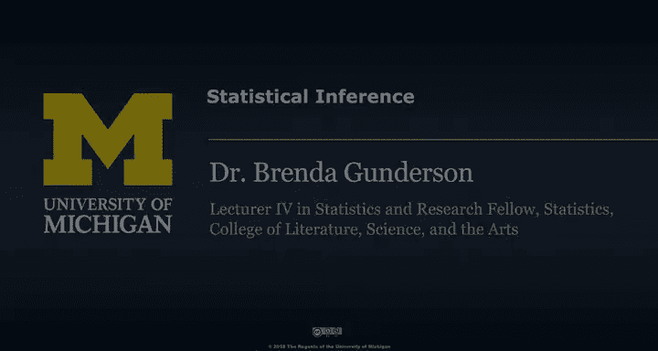

# 34：欢迎来到《使用Python的统计学》🎓

在本节课中，我们将要学习《使用Python的统计学》系列课程的第二门课——统计推断分析。这门课程将建立在第一门课的基础上，帮助你全面理解统计学，并学会使用Python应用所学知识。

## 课程概述 📋

欢迎来到《使用Python的统计推断分析》。这是《使用Python的统计学》系列专项课程中的第二门课。每门课程都建立在前一门课程的基础上，让你对统计学有一个全面而深入的理解，并能够使用Python应用所学内容。

## 课程结构 🏗️

第二门课程包含四个部分。以下是各部分内容的简要介绍。

### 第一部分：课程预览与基础活动

在课程的第一部分，我们将预览推断技术以及我们将要探索的研究问题。你将有机会与我们分享你在生活中观察到的研究问题。我们会进行一个“大A或大B”活动，帮助我们更好地理解如何利用数据在竞争理论之间做出决策。我们还会进行一些“这个或那个”活动，让我们对课程中将要用到的一些术语和符号更加熟悉。在编程方面，我们将使用Jupyter笔记本，并学习一些中级Python概念。

### 第二部分：参数估计与置信区间

上一节我们介绍了课程的整体结构，本节中我们来看看第二部分的核心内容。我们将开始探讨“参数值是多少？”这个问题。我们将学习如何用置信度来估计参数。我们将超越最佳估计值，引入正负误差范围，从而得到一个我们相当有信心的、合理的参数值范围。

### 第三部分：假设检验与P值

接下来，我们将转向回答“是否存在显著差异？”这类性质的问题。我们将学习假设检验技术，即获取数据、将其转换为检验统计量、并计算出相应的P值，以帮助我们在竞争理论之间做出决策。我们将围绕P值、P值操纵以及进行研究时的一些良好实践展开有趣的讨论。你将参与一个与巧克力相关的有趣活动——一项旨在决定是否应在自行车运动员的饮食中引入巧克力以帮助他们提高表现的实验。

### 第四部分：应用、深入探索与结果沟通

在第四部分，我们将开始学习应用，并对其他一些概念进行更深入的探讨。我们将重点练习如何更好地沟通推断结果。我们将处理复杂的抽样设计，并简要讨论一些其他的推断方法。

## 学习支持与资源 💡

在整个课程中，我们将为你提供评估学习成果的机会。课程资源允许你对其他一些主题进行更深入的探索。你还可以通过一些网络小程序进行动手实践，当然，还有你的Python教程。你将有机会听到我们多位团队成员的分享，我们将与你分享我们对统计推断的观点和见解。

## 总结 ✨

本节课中，我们一起学习了《使用Python的统计推断分析》课程的总体介绍和结构。我们了解到本课程是系列专项课程的第二部分，包含四个主要模块：课程预览与基础、参数估计、假设检验以及高级应用与沟通。课程将结合理论讲解、实践活动和Python编程，帮助你掌握使用数据进行统计推断的核心技能。