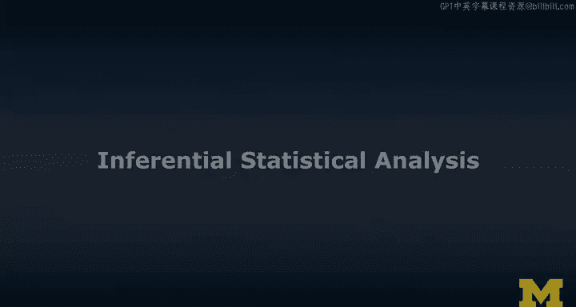
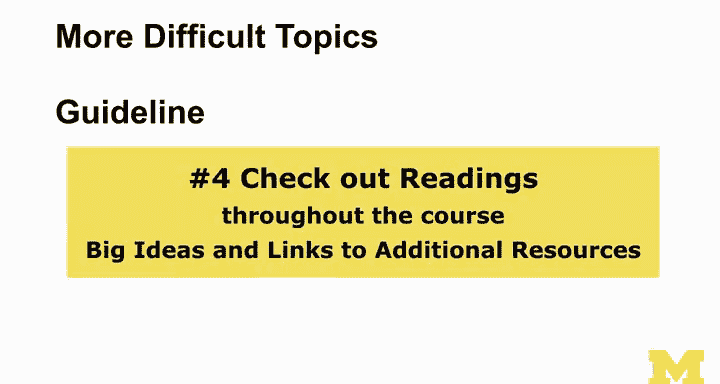
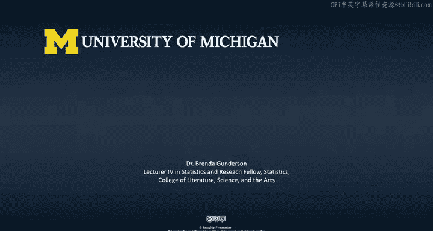

# 课程指南 P35：基于Python的统计推断学习指南 📘

在本节课中，我们将学习如何高效地从《使用Python的统计学》课程中获取知识。课程将重点介绍如何结合视频讲座与Jupyter Notebook进行学习，并提供关于课程结构、学习方法以及如何寻求帮助的实用建议。

---

## 课程结构与学习方法 🧩

上一节我们介绍了课程的整体目标，本节中我们来看看课程的具体结构以及推荐的学习方法。

本课程严重依赖Jupyter Notebook来演示和说明使用Python讲解的统计概念。通常，Notebook会安排在一系列讲座、练习和每周测验之后。

以下是第一周课程内容的示例：
*   一系列视频讲座。
*   一些阅读材料。
*   一个讨论主题。
*   在每周内容末尾，可以找到相关的Notebook。

Notebook通常与视频成对出现。我们强烈建议你不要等到看完所有讲座后才打开Notebook。

## 同步学习策略 💻

上一节我们了解了课程材料的位置，本节中我们来看看如何有效地同时使用它们。

我们鼓励你在观看各种讲座时，同步打开相应的Notebook。你可以在讲座暂停时，立即在Notebook中尝试刚学到的内容。

使用大显示器或多个显示器有助于你更方便地实施这种学习方式。以往的学习者发现，这种方法能最大限度地提高信息吸收效率，并增强你将所学知识应用于Python的实践感。

以下是我在学习第一周部分内容时的工作空间快照：
*   在一个屏幕上，播放着团队成员讲解Python函数概念及如何定义函数的视频。
*   在另一个屏幕上，我打开了Notebook，准备尝试视频中演示的相同步骤。

## 统计推断内容概览 📊

在第二、三、四周，我们将为你介绍各种统计推断技术的示例。

你将初步了解针对几种总体参数的置信区间估计和假设检验思想。对于总体比例的推断，会有更多视频供你深入学习。对于后续的其他参数，我们会提供一个优质示例让你熟悉该类型场景。

我们不会深入讲解你将看到的所有推断方法的复杂细节，也无法涵盖你可能想了解的所有推断方法。

因此，我们对这几周的学习建议是：充分利用你已掌握的基础内容。

以下是具体建议：
*   不要跳过阅读材料。它们将为你提供关于这些推断技术实质的坚实基础。
*   作为学习者，你将有能力通过自主研究来掌握那些复杂细节和相关技术。
*   你可以超越课程涵盖的内容去学习更多知识，使这些概念更加具体。你将准备好持续学习。

## 提问与互动渠道 ❓

接下来，我们讲师欢迎你就课程内容提出个人问题。

虽然这些问题可能无法立即得到解答，但当问题被回答后，它们将作为常见问题（FAQ）提供，以供未来的学习者参考，从而提升他们的学习体验。

大多数问题会在讨论区得到快速解答。但你也完全可以提出更复杂的问题，这些问题会被转交给讲师处理。

## 利用课程资源 📚

最后，我们也在向你们学习。过去，有些学习者发现某些主题更难掌握。

例如，在第四周，你将了解如何考虑复杂抽样设计对推断过程的影响。我们鼓励你充分利用贯穿整个课程的阅读材料，其中许多材料包含核心思想总结和额外资源的链接。

---

## 总结 ✨

本节课中，我们一起学习了如何高效学习《使用Python的统计学》课程。我们了解了课程材料的结构，掌握了同步观看视频与操作Notebook的学习策略，预览了统计推断部分的学习重点，并知道了如何通过提问和利用阅读材料来深化理解。希望这些指南和技巧能帮助你在学习后续极具价值的内容时更加得心应手。