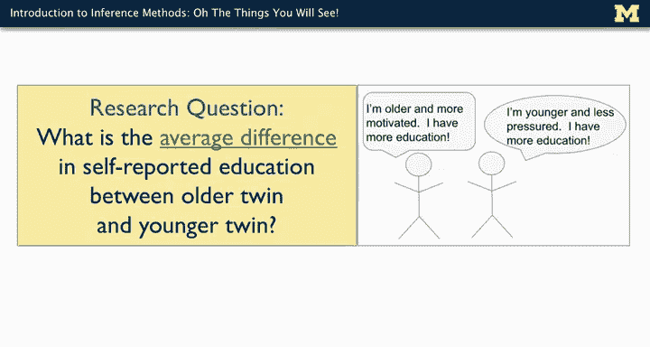

#  36：统计推断方法导览 🧭

在本节课中，我们将对后续课程中将要遇到的几种统计推断方法进行介绍。我们将学习如何利用数据，通过置信区间来估计感兴趣的参数，或者对这些参数的相关理论进行假设检验。

## 参数估计：从比例到均值

上一节我们介绍了统计推断的基本目标。本节中，我们来看看几种具体的参数估计场景。

以下是几种常见的估计目标：

*   **估计总体比例**：例如，我们想知道“所有幼儿家长中，报告在出行时始终使用儿童安全座椅的比例是多少？”这里的关注点是**比例**，我们希望通过数据来估计这个未知的总体比例。
*   **估计总体均值**：例如，我们想了解“所有成年人侧手翻的平均距离是多少？”这里的关注点是**平均值**或**均值**，我们同样希望估计这个总体均值。
*   **估计配对总体均值差**：例如，在研究双胞胎数据时，我们想了解“年长双胞胎与年幼双胞胎在自我报告教育年限上的平均差异是多少？”这里的测量值是**配对**的（每一对双胞胎），关注点仍然是**平均差异**。

## 假设检验：验证理论与比较群体

在学会了如何估计参数后，我们还需要学习如何检验关于这些参数的假设或理论。

以下是几种常见的假设检验场景：

*   **比较两个独立群体的均值**：例如，我们感兴趣的问题是“居住在美国的墨西哥裔成年男性，其平均身体质量指数是否显著高于女性？”这里我们有两个独立的群体（男性和女性），目标是检验一个群体的均值是否显著高于另一个。
*   **检验总体比例的变化**：例如，过去约有52%的家长认为电子产品和社交媒体是导致青少年睡眠不足的原因。我们想知道“如今这个比例是否上升了？即是否有更多家长认同这一观点。”这里我们将当前的观测比例与一个已知的历史比例（52%）进行比较，检验关于**总体比例**的理论。

## 总结

本节课中，我们一起学习了统计推断的两大核心任务：**参数估计**与**假设检验**。我们通过几个例子，预览了后续课程中将深入探讨的具体方法，包括对总体比例、总体均值、配对均值差进行置信区间估计，以及对总体比例变化和两个独立总体均值差异进行假设检验。这些方法将帮助我们利用数据，对更广泛总体的情况做出有依据的推断。