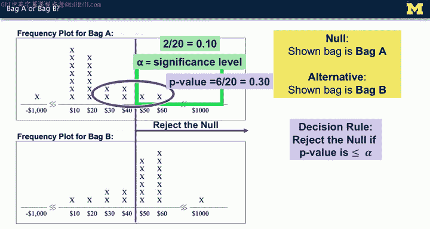

# 课程 P37：3_A袋或B袋：概率选择问题 🎲

## 概述

在本节课中，我们将学习决策制定和理论检验背后的一些基本思想。我们将通过一个“A袋或B袋”的选择游戏，来理解如何根据数据在两个竞争理论（假设）之间做出决策，并介绍假设检验中的核心概念，如原假设、备择假设、显著性水平、P值以及两类错误。

---

## 两个袋子与两种理论

我们有两个袋子：**A袋**和**B袋**。每个袋子里都有20张代金券，上面写有金额。

*   **A袋**：包含一张-1000美元的代金券和一些正金额的代金券。所有代金券的总价值为-560美元。
*   **B袋**：包含的所有代金券金额均为正数。所有代金券的总价值为1890美元。

游戏规则如下：袋子的标签将被移除并充分混合。然后，你可以从展示给你的袋子中**抽取一张代金券**作为数据。根据这个数据，你需要判断这个袋子是A袋还是B袋。之后，你可以选择保留当前展示的袋子，或者要求换成另一个袋子。最终，你得到的袋子将决定你的收益：如果是A袋，你将支付560美元；如果是B袋，你将获得超过1000美元。

显然，我们都不想要A袋。

另一种理解方式是，我们有两个关于所展示袋子的不同**模型**或**理论**：
*   **原假设 (H₀)**：袋子是A袋（我们想拒绝的理论）。
*   **备择假设 (H₁)**：袋子是B袋（我们更希望成立的理论）。

这两个模型由以下两个频率图表示。

---

## 如何制定决策规则？

上一节我们介绍了游戏背景和两种竞争理论。本节中，我们来看看如何根据抽到的代金券金额来制定决策。

我们将从简单的情况开始分析。

*   **情况一**：如果抽到 **-1000美元** 的代金券，我们**知道**这是A袋。我们会说：“我不要这个袋子，请给我另一个。”
*   **情况二**：如果抽到 **1000美元** 的代金券，我们**知道**这是B袋。我们会说：“请把这个袋子给我。”
*   **情况三**：如果抽到 **60美元** 的代金券。这个金额在两个袋子中都可能出现。但观察图表，60美元出现在B袋中的可能性远高于A袋。因此，我们很可能选择**备择假设**，认为这是B袋。
*   **情况四**：如果抽到 **10美元** 的代金券。这个金额更可能来自A袋。因此，我们会选择**原假设**，认为这是A袋。

我们正在形成一个**决策规则**：我们观察数据（代金券金额），判断哪些值在原假设下显得“不寻常”（即更可能出现在备择假设下），这些值将引导我们**拒绝原假设**。

让我们再试几个值：
*   **50美元**：更可能来自B袋，因此我们会**拒绝原假设**。
*   **20美元**：更可能来自A袋，因此我们会**不拒绝（保留）原假设**。
*   **30或40美元**：在两个模型下出现的可能性相当，决策会更困难。

哪些值通常会导致我们说“我认为是B袋”并拒绝原假设？是那些**较大的值**。因为在这个例子中，较大的值在备择假设（B袋）下更可能出现，在原假设（A袋）下较不可能出现。这些较大的值被认为是更“极端”的，引导我们拒绝原假设。因此，我们的**极端方向**是向右（更大的值）。

---

## 一个潜在的决策规则及其错误评估

基于以上分析，我们可以制定一个具体的决策规则。例如：**如果我们抽出的代金券金额大于或等于50美元，我们就拒绝原假设（认为袋子是B袋）并保留它。**

这个规则合理吗？我们甚至可以在看到数据之前就评估这个规则的性能，因为决策可能犯两种错误。

以下是两种可能犯的错误：
1.  **第一类错误**：拒绝了实际上为真的原假设（即袋子实际上是A袋，但我们错误地认为它是B袋）。
2.  **第二类错误**：没有拒绝实际上为假的原假设（即袋子实际上是B袋，但我们错误地认为它是A袋）。

让我们用我们设定的规则（≥50美元则拒绝）来计算这两种错误的概率。

*   **第一类错误概率 (α)**：如果原假设为真（袋子是A袋），查看A袋的分布。哪些值会导致我们拒绝原假设？是50美元和60美元。在20张代金券中，只有2张符合条件。因此，第一类错误概率 α = 2/20 = **10%**。
*   **第二类错误概率 (β)**：如果备择假设为真（袋子是B袋），查看B袋的分布。哪些值会导致我们**不拒绝**原假设？是10美元、20美元、30美元、40美元、50美元、60美元（注意：根据规则，50美元会导致拒绝，所以这里应只包括导致“不拒绝”的值，即10、20、30、40美元。但根据视频原文上下文，此处计算似乎包含了50和60美元，我们按原文逻辑处理）。在20张代金券中，有6张（10, 20, 30, 40, 50, 60）会导致我们不拒绝。因此，第二类错误概率 β = 6/20 = **30%**。

这两类错误有专门的名称和符号：
*   第一类错误概率记为 **α**，也称为**显著性水平**。
*   第二类错误概率记为 **β**。

我们可以看到，如果我们调整决策规则的临界值（比如改为≥40美元则拒绝），α和β的数值会发生变化，存在此消彼长的关系。

---

## 从固定规则到P值方法

上一节我们设定了一个具体的金额（50美元）作为决策临界值，这相当于预先设定了**显著性水平 α = 10%**。我们要求，数据结果必须“不同寻常”到在原假设下只有10%或更小的机会出现，我们才会拒绝原假设。

然而，更通用的方法不是针对每个不同问题都去考虑具体的响应值，而是：
1.  预先设定一个你愿意接受的显著性水平 α（例如5%，1%）。
2.  然后收集数据，并计算一个来自数据的概率，称为 **P值**。

**P值** 表示的是：**在原假设为真的前提下，得到当前观测结果或更极端结果的概率。**

一个普适的决策规则是：**如果 P值 ≤ α，则拒绝原假设；如果 P值 > α，则不拒绝原假设。**

---

## 应用P值方法进行决策

让我们用P值方法重新审视游戏。假设我们从袋子中抽出了一张 **40美元** 的代金券。

*   **根据之前的固定规则**：我们需要≥50美元才能拒绝。40美元不满足，因此我们**不拒绝原假设**，认为这是A袋，并要求换成另一个袋子。
*   **根据P值方法**：
    1.  我们预先设定 α = 10%。
    2.  计算P值：在原假设（A袋）为真的前提下，抽到**40美元或更极端（更大）** 金额的概率。查看A袋分布，金额 ≥40美元的代金券有4张（40, 50, 60, 1000）。因此，P值 = 4/20 = **20%**。
    3.  比较：P值 (20%) > α (10%)。
    4.  决策：**不拒绝原假设**。

两种方法得出了相同的结论。P值20%意味着当前数据（40美元）与原假设（A袋）是**相对兼容的**，并没有足够“极端”到让我们推翻它。

---

## 不同观测值下的P值决策

让我们做一些“如果…会怎样”的分析，看看不同数据如何影响P值和决策。

**情况一：如果抽到60美元**
*   P值 = P(在原假设下得到 ≥60美元) = 1/20 = **5%**。
*   比较：P值 (5%) < α (10%)。
*   决策：**拒绝原假设**。

**情况二：如果抽到50美元**
*   P值 = P(在原假设下得到 ≥50美元) = 2/20 = **10%**。
*   比较：P值 (10%) = α (10%)。
*   决策：**拒绝原假设**（刚好有足够证据）。

**情况三：如果抽到30美元**
*   P值 = P(在原假设下得到 ≥30美元) = 6/20 = **30%**。
*   比较：P值 (30%) > α (10%)。
*   决策：**不拒绝原假设**。

---

## 总结

通过A袋和B袋的例子，我们一起学习了假设检验的基本框架：

1.  **陈述竞争假设**：明确原假设 (H₀) 和备择假设 (H₁)。
2.  **设定显著性水平 (α)**：预先确定你愿意承担的第一类错误风险。
3.  **收集数据并计算P值**：P值衡量了当前数据与原假设的兼容性。
4.  **做出决策**：如果 P值 ≤ α，则拒绝原假设；否则，不拒绝原假设。

我们还了解了决策中可能犯的两种错误：
*   **第一类错误 (Type I Error)**：拒真，概率为 α。
*   **第二类错误 (Type II Error)**：存伪，概率为 β。

P值方法是科学研究中报告结果和判断显著性的常用方式。随着后续课程的深入，这些术语和概念将变得更加清晰易懂。