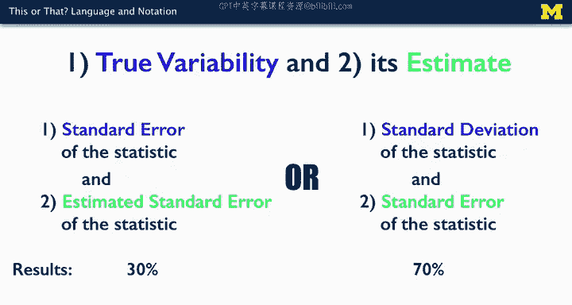

# 38：统计学术语与符号规范 📚

在本节课中，我们将学习统计学中常用的术语与符号规范。理解这些规范对于阅读教材、理解统计输出以及进行有效沟通至关重要。虽然不同教材或教授可能使用略有差异的符号，但核心概念是相通的。我们将介绍一些关键符号及其含义，并解释如何在不同语境下使用它们。

---

## 统计符号的多样性

上一节我们提到了统计符号的重要性。本节中我们来看看，即使是基础概念，其表示方法也可能存在不同观点。

统计符号和术语很重要，但有时也可能让人困惑。有些符号相当通用，但另一些则不那么标准化。我们想与大家分享一些统计符号和术语，这些内容在后续课程材料中会更多地出现。

我设计了一些关于如何表示不同统计概念及术语的“二选一”问题。我将这些问题发给了课程开发团队，以便他们投票选择。

我先提了几个关于冰淇淋和体操动作的有趣问题。第一个问题是：如果必须选择一种冰淇淋口味，你会选香草味还是巧克力味？结果我们的团队成员平分秋色。我站在香草味一边，尽管我喜欢在香草冰淇淋上撒点巧克力糖果来提升风味。

第二个问题与体操动作有关，这与我们将在一些示例中看到的侧手翻数据集相呼应。如果此刻必须表演一个前滚翻（或我称之为“翻筋斗”）或侧手翻，你会选择哪一个？询问团队成员后，我们发现更多人喜欢前滚翻胜过侧手翻。我站在侧手翻一边，有时当我的课堂学生在复习题上表现非常好时，我会为他们表演一个侧手翻。

---

## 均值的表示方法

现在，让我们转向一些更统计学的概念。首先，当我们谈论想要了解总体均值响应时，如果我们有一个感兴趣的总体且响应是定量数据，我们通常用希腊字母 **μ** 来表示真实的均值响应。

大多数时候，我们可能不知道这个量，因为我们没有整个总体的全部数据，因此最终不得不抽取样本。那么问题来了，我们应该如何表示这个样本均值——这个总体参数的统计量或估计值？

有些人认为，对于任何参数，只需在其上方加一个“帽子”符号，就得到了它的估计值。因此，当询问我们的团队成员，表示样本均值的首选符号是什么时，是 **μ̂** 还是 **x̄**？70%的人选择了 **x̄**，这是你在统计计算器和一些软件中可能看到的符号。30%的人则认为，只要谈论参数的估计值，就给它加上帽子。

---

## 标准差的表示与一个有趣的故事

如果我们转向变异性方面。现在我们有一个感兴趣的总体，响应是定量数据。当我们谈论该总体中响应的变异性或标准差时，经典做法是使用希腊符号 **σ** 来表示该标准差。

在讨论表示这个总体标准差估计值的不同方法之前，有一个由布雷迪·韦斯特分享的关于 **σ** 的小故事要告诉大家。

我想分享一个几年前密歇根大学统计学课上的小故事。这是一门关于抽样的课程，抽样是我们在第一门课和本课程中学到的内容。这位统计学教授经常书写希腊符号或希腊字母 **σ**，并用 **σ** 来指代标准差。我们引入了感兴趣变量数值标准差的概念，这位教授就像我们在这里看到的那样使用 **σ** 来指代标准差。但这是一门入门课程，很多学生以前没有见过用希腊符号表示统计量，所以学生们只是接受了教授的说法，课程继续进行。

关于 **σ** 的一点是，不同的教授，甚至不同的手稿、不同的教员，**σ** 符号的写法可能不同。这是一种写法，也是我通常的写法。这是另一种写法，我看到有些教员甚至一些教材可能在 **σ** 的尾部用了更多的曲线，所以你会看到这种写法有点弯曲，但仍然指代相同的东西，通常指代感兴趣变量数值的标准差。

有些教员在板书上书写时，或者在手稿中，可能会把 **σ** 符号弯曲得更多一点，所以你看这个真的有点倾斜了，但教员可能仍然打算用它来表示标准差或 **σ**。

结果在这门统计学课上，授课的教员倾向于这样写 **σ**。每当这位教员在黑板上写 **σ** 时，他指的是感兴趣变量数值的标准差。但班上有一个学生整个学期都对这到底是什么意思感到怀疑，在课堂上从未真正说过什么，只是随大流。课程结束后，这个学生来到教授的办公室拜访，说：“教授，您在课堂上讲解所有例子并在黑板上写标准差时，我真的很困惑这个概念。”学生说：“教授，为什么您总是把标准差设为6？”

原来，学生没有认出教授使用的是希腊符号 **σ**，但由于教授在黑板上书写的方式（可能看起来像这样），学生以为每次黑板上出现标准差时，教授只是在写数字6，并假设标准差等于6。所以整个学期，学生都假设任何感兴趣变量的标准差都等于6。

这在统计学中很大程度上取决于符号的含义。我们正在讨论解释不同符号的不同方式，以及它们如何可能指代相同的事物。但无论何时使用符号，无论何时使用希腊符号或其他符号来指代这类概念，都必须非常清楚这些符号的含义，并确保你的听众和阅读你作品的人知道，如果你这样书写，你所说的 **σ** 是什么意思。这只是一个关于不同的人如何以不同的方式看待符号，以及不同的符号如何可能用来指代同一事物的有趣小故事。但通常，当你看到 **σ** 时，它指的是感兴趣变量的标准差。

好的，总体标准差是 **σ**，不是6，是 **σ**。

---

## 标准差估计值的表示

如果我们要估计那个总体标准差，首选是什么？是给它加上帽子，用 **σ̂**，还是用 **S** 表示样本标准差？

我们有一些人在均值问题上站在 **x̄** 一边，现在则说，让我们给它加上帽子吧，用 **σ̂** 来表示估计值或统计量，而不是用 **S**。然而，**S** 是你在计算器和一些计算机输出中经常看到的。

---

## 比例的表示

让我们转向比例。现在我们的响应不是定量数据。我们谈论的是均值响应，但现在是一个分类结果。我们可能想了解我们总体中回答“是”的真实比例是多少。

然后使用我们的数据来得出那个真实比例的估计值。环顾四周，有几种不同的观点。有些人喜欢用 **π** 来表示总体比例，然后用 **π̂** 表示估计值。所以坚持使用希腊字母这边。

另一些人用 **P** 表示总体比例，仍然在上面加个帽子来表示统计量或估计值。

对我们的团队成员进行投票后，绝大多数人使用 **P** 和 **P̂** 符号来表示总体中回答“是”的真实比例，与基于某些数据的估计值相对。你实际上会在即将到来的材料中很快看到 **P** 和 **P̂**。

---

## 置信区间与乘数

让我们继续讨论置信区间的概念，这将是我们第一个要更详细研究的推断技术。

我们在前面的介绍中讨论过，它是你的最佳猜测，加上或减去一个误差幅度，我们向两边延伸以形成这个参数的合理值区间。

那个误差幅度由两个主要部分组成：一个乘数，一个反映我们对该过程希望有多自信的数字；以及我们统计量抽样变异性的某种度量。

让我们关注那个观点，那个“自信”的概念。你可能记得，我们通常喜欢使用95%的置信水平。

当我们讨论经验法则时，向两边延伸一个、两个标准差大约能给我们中间95%的区域。

因此，当询问我们的团队成员，在95%置信区间中使用的乘数时，你是用2，还是用那个能精确产生中间95%的确切值1.96？1.96还是2？

有些人喜欢用2，另一些人则说，我们就用1.96吧，它成了一个印在你脑海里的数字，在我们即将到来的材料中构建95%置信区间时，你会看到1.96被用作我们的乘数。

---

## 统计量的变异性：术语辨析

现在让我们转向误差幅度内的另一个概念，即我们统计量的变异性概念。

你可能记得，统计量因为基于数据，所以会从一个样本到下一个样本发生变化。如果你重复相同的过程，你可能会得到那个估计值（那个统计量）的不同值。所以，你的统计量有一个可能值的分布，而这个分布的宽度反映了该统计量的变异性。

现在我们要讨论一点术语：我们如何称呼那个真实的变异性度量？然后，我们给那个变异性的估计值起什么名字？因为通常我们最终在误差幅度中使用的是基于我们数据的这个变异性的估计值。

关于这一点，大致有两种阵营。有些人说，既然我们现在谈论的是不同事物的变异性（一个统计量，而不是响应的单个值，而是一个统计量，是所有那些响应的汇总），那么现在就叫它那个统计量的**标准差**，称之为该统计量的**标准误**。

然后，由于你经常需要填入你对它的最佳猜测，你对它的估计，就称之为**估计标准误**。另一方面，我们有些人说，嗯，你谈论的只是你统计量的标准差，那只是现在变化的东西。所以就叫它你统计量的标准差，并给那个估计值起名为标准误。

所以你可以看到这可能有点令人困惑：我们统计量的标准误是指真实的变异性，还是代表该统计量的估计变异性？

对我们的课程开发团队成员进行了投票。我们大多数人站在“标准差”然后“标准误”表示估计值这一边。

但我们也引发了一些很好的讨论，并决定为本课程提出并使用第一种方法：统计量的**标准误**现在代表这种概念（一个估计量或统计量）中的变异性。然后，当你使用你的数据代入那个标准误时，你称之为**估计标准误**。

这就是我们将在本课程中使用的约定。

---

## 总结与建议

所以你可以看到，并非所有人都同意使用什么符号和术语。但只要我们提供我们所使用的定义，并且在这些定义上保持一致，我们就没有问题。事实上，我们已经为你们提供了一个很好的总结，列出了你们在即将到来的课程中会看到的一些符号和术语，以便你们在需要时参考。

当然，这些术语和符号很有帮助，因为它们能让我们在解释如何进行一些统计分析时更有效率，也可能在理解我们可能看到的一些统计输出或一些更技术性的报告时更有效率。

然而，我们也将关注文字。我们将讨论如何书写解释，这将是我们在本课程中讨论的更重要的特点之一。因此，当你撰写结果总结时，写“样本均值”是可以的，而不是使用 **x̄** 或 **μ̂**，无论你偏好什么符号。

再次强调，我们为你提供了一些在本课程中你将使用的常见符号和术语的总结，所以不会太难。我们可以处理一点符号和术语，因为它将帮助我们未来的学习之旅。

---

## 本节课总结

在本节课中，我们一起学习了统计学中关键的术语与符号规范。我们探讨了均值（**μ** vs. **x̄**）、标准差（**σ** vs. **S** vs. **σ̂**）和比例（**π** vs. **P**）的不同表示方法，理解了95%置信区间常用乘数1.96的来源，并重点辨析了“标准差”与“标准误”这两个核心概念的区别与联系（统计量的**标准差**其估计值称为**估计标准误**）。记住，清晰的定义和一致的使用是有效沟通的关键。在后续课程中，我们将继续运用这些规范来理解和表达统计概念。