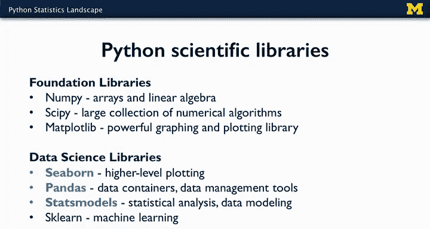

# 39：Python统计生态再探 🐍📊

在本节课中，我们将要学习Python用于数据分析的生态系统概览，了解其核心库及其在数据处理、可视化和建模中的作用。

大家好，我是Kirby Shedon，密歇根大学的统计学教授。本课程将使用的编程语言是Python。

本次内容将简要介绍可用于数据分析的Python工具生态。

Python自1991年诞生以来已存在很长时间。它被认为易于学习且广受欢迎，因为其代码易于阅读，并且不使用大量晦涩的语法。

Python还拥有一个庞大的标准库，使得编写简短脚本来完成许多常见任务变得容易。

与R、Matlab和SAS等特定领域语言不同，Python是一种通用语言，并非专门为数据分析而设计。

然而，通过将Python与一些非常强大的库结合使用，Python可以成为分析数据的理想环境。

虽然Python易于学习，但其速度并不特别快，而在进行数据分析时，速度可能是一个重要的考量因素。

为了解决这个问题，用于数据分析的Python库实际上是用C语言编写的，但可以通过Python调用。Python的普通用户可以在不了解任何C语言的情况下使用这些库，并可以利用这些高度优化库的速度。

本课程将使用的库是由独立的程序员团队在过去25年中开发的，他们大多来自开源社区。这些库涵盖了数据管理、数值计算、绘图和统计建模等多个领域。

这些库相当成熟和稳定，可以信赖其在研究和工业工作中产生准确且有意义的成果。

本课程将使用的库列在本幻灯片上。前三个库NumPy、SciPy和Matplotlib提供了基础。这些库会被你将使用的其他库调用，但通常你不会在自己的代码中直接使用这些库。

蓝色列出的库是你将在本课程所有工作中直接使用的库。

具体来说，Seaborn是一个用于图形和数据可视化的高级库。

Pandas是一个用于数据操作和管理的强大库。

Statsmodels提供了广泛的统计建模工具。

最后，我们在此列出了另一个名为Scikit-learn的库。这是在本课程之外你可能想要考虑的众多库之一。Scikit-learn提供了许多用于机器学习和预测分析的工具。

在整个课程中，你将看到Python如何用于数据分析的示例。

我们将详细讨论此处提到的核心Python语言及其相关库。

通过在Jupyter Notebook中使用这些工具，你将能够专注于语言和工具本身，而无需担心安装和配置问题。

本节课中我们一起学习了Python数据分析生态系统的核心组成部分，包括NumPy、SciPy、Matplotlib等基础库，以及Seaborn、Pandas、Statsmodels等直接应用库。理解这些工具的角色和关系，是高效使用Python进行统计分析和数据科学工作的第一步。