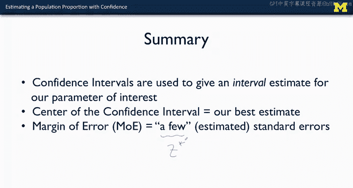

# 课程名称：密歇根大学《使用Python的统计学》第40讲：基于置信度的总体比例估计 📊

## 概述

在本节课中，我们将学习如何为一个总体比例计算置信区间。我们将回顾置信区间的基本概念，并通过一个具体实例，一步步演示如何计算和解释一个95%置信区间。

---

## 回顾置信区间

上一节我们介绍了置信区间的概念。本节中我们来看看如何具体计算它。

一个置信区间通常由两部分构成：最佳估计值（点估计）加减误差幅度。

其通用公式可以表示为：
**置信区间 = 最佳估计值 ± 误差幅度**

对于总体比例的情况：
*   **最佳估计值** 是我们无偏的点估计，称为样本比例 $\hat{p}$。
*   **误差幅度** 定义为“几个”估计标准误。这里的“几个”是一个基于置信水平的乘数。

---

## 实例背景：儿童安全座椅使用情况

为了应用这些概念，我们来看一个来自密歇根大学C.S. Mott儿童医院的全国性调查实例。该调查关注儿童健康相关问题。

以下是调查背景：
Mott医院询问了“有多大比例的家长报告他们在与幼儿的所有出行中都使用汽车安全座椅”。

在进行统计推断前，我们首先需要明确两个要素：
1.  **研究总体**：所有拥有幼儿的家长。
2.  **感兴趣的参数**：总体比例，我们用小写字母 $p$ 表示。

基于此，我们的目标是：**为“报告在与幼儿的所有出行中都使用汽车安全座椅的家长”的总体比例，构建一个95%的置信区间。**

Mott医院进行了这项调查，他们抽样了659名拥有幼儿的家长，并询问是否在与幼儿的所有出行中都使用安全座椅。其中，有540名家长回答“是”。

---

## 计算置信区间

现在，我们回到置信区间的基本公式：**最佳估计值 ± 误差幅度**。这是计算任何置信区间的起点。

### 第一步：计算最佳估计值（$\hat{p}$）

首先，我们需要计算最佳估计值，即样本比例 $\hat{p}$。

计算样本比例的公式很简单：
$\hat{p} = \frac{x}{n}$
其中，$x$ 代表回答“是”的数量，$n$ 代表样本总量。

将我们的数据代入公式：
$\hat{p} = \frac{540}{659} \approx 0.85$

因此，我们的最佳估计值 $\hat{p}$ 为 0.85（或85%）。

### 第二步：计算误差幅度

现在我们有了 $\hat{p}$，接下来需要计算公式中“±”右侧的误差幅度。

误差幅度 = **几个 × 估计标准误**

1.  **“几个”（乘数）**：因为我们构建的是95%置信区间，这个乘数通常为 **1.96**（也有人使用2，依个人偏好而定）。95%的置信水平对应5%的显著性水平，这在后续学习中会很有用。
2.  **估计标准误**：对于单个比例，其估计标准误的计算公式为：
    $SE_{\hat{p}} = \sqrt{\frac{\hat{p}(1 - \hat{p})}{n}}$

### 第三步：代入计算

现在，我们将所有已知值代入完整的置信区间公式：
$\hat{p} \pm \text{乘数} \times \sqrt{\frac{\hat{p}(1 - \hat{p})}{n}}$

具体计算如下：
$0.85 \pm 1.96 \times \sqrt{\frac{0.85 \times (1 - 0.85)}{659}}$

计算后，我们得到置信区间为：**0.8227 到 0.8773**。

---

## 解释置信区间

在继续分析之前，我们首先要理解这个置信区间的含义：我们到底计算出了什么？

一个置信区间是我们所关注的参数（此处为总体比例 $p$）的一个合理取值范围。

因此，我们可以这样解释：
**我们有95%的信心认为，在与幼儿的所有出行中都使用汽车安全座椅的家长总体比例，估计在82.27%到87.73%之间。**

这个区间（82.27%， 87.73%）是我们认为参数 $p$ 最可能存在的范围。参数可能在这个区间内，也可能不在，我们无法完全确定。但基于我们的样本和计算方法，我们有95%的置信度认为它很可能在此区间内。

另外需要注意，置信区间的中心始终等于我们的最佳估计值 $\hat{p}$（0.85），因为区间正是围绕它构建的。我们只是从中心点加上和减去了误差幅度。

---

## 总结

本节课中我们一起学习了如何为总体比例计算置信区间。

我们通过使用最佳估计值 $\hat{p}$ 和误差幅度，计算了第一个置信区间。这为我们感兴趣的参数提供了一个区间估计。我们利用统计量 $\hat{p}$ 来推断参数 $p$ 可能的值。

我们了解到：
*   置信区间的中心总是等于最佳估计值。
*   误差幅度定义为 **“几个” × 估计标准误**。
*   在单比例的情况下，这个“几个”（乘数）通常被称为 $z^*$，然后乘以所需的估计标准误即可。

通过本讲的学习，你已经掌握了构建和解释总体比例置信区间的基本方法。