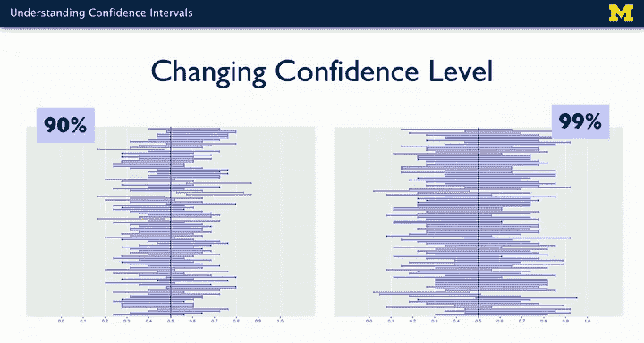

# 课程 7：置信区间原理详解 📊

在本节课中，我们将深入学习置信区间。我们将探讨如何正确解释置信区间、置信水平的真正含义，以及如何调整置信水平（例如，从95%变为99%）。通过理解这些概念，你将能够更准确地使用统计推断来估计未知的总体参数。

---

## 概述

上一节我们介绍了如何构建置信区间。本节中，我们将更深入地探讨如何正确解释置信区间、理解置信水平的含义，以及如何根据需求调整置信水平。

## 置信区间的解释

首先，我们来看一个背景案例，以便更好地理解上下文。

在一项针对659名幼儿家长的抽样调查中，约有540人（约85%）表示他们在所有出行中都使用儿童安全座椅。根据这些结果，计算出的置信区间大约从82.3%到87.7%。

那么，这个置信区间告诉我们什么？我们应如何解释这个区间？

为了更好地理解，我们首先需要问一个问题：我们为谁构建置信区间？思考一下，我们是为参数还是为统计量构建置信区间？

我们是为**参数**构建置信区间。在这个例子中，我们可以说这个区间是针对“所有幼儿家长中，报告经常使用儿童安全座椅的总体比例”这一参数的置信区间。

我们使用样本比例来构建这个区间，但我们不称这个区间为“样本比例的置信区间”。它是一个数值范围，旨在帮助我们以较高的置信度估计我们认为的总体比率可能是什么。

以下是两种良好的陈述方式：

1.  我们以95%的置信度估计，报告在所有出行中都使用儿童安全座椅的幼儿家长的总体比例介于82.27%到87.73%之间。
2.  基于我们对659名幼儿家长的抽样调查，我们有95%的置信度估计，在所有此类家长中，有82.3%到87.7%的人报告他们在所有出行中都使用儿童安全座椅。

这两种陈述都包含了所使用的置信水平（即“以95%的置信度”），并传达了我们是使用数据来估计总体参数（此处是总体比例）。第二种陈述还巧妙地包含了样本量，这是理解研究结果的一个非常重要的特征，但常常被忽略。

因此，我们得到了一个合理的数值范围，用于估计可能的总体比例。例如，83%落在这个区间内，因此它可能是总体比率的一个合理值，我们的数据无法反驳它。86%也可能是真实比率。基于我们从目标总体中抽取的一个样本，我们得到了该参数的一系列合理值。

## 理解置信水平

我们如何更好地理解“以95%的置信度”这个短语的真正含义？

让我们思考一下：我们得到的这个从82%到87%的区间，是否包含了样本中报告在所有出行中都使用儿童安全座椅的家长比例？当然包含。我们以最佳估计值（85%）为中心构建了区间，并向两边扩展了一个误差范围。因此，每个区间都会包含相应的样本统计量，最佳估计值正好在中间。

但下一个问题呢：我们的置信区间是否包含了“所有幼儿家长中，报告在所有出行中都使用儿童安全座椅的总体比例”？我们必须回答：我们不知道。为了能回答“是”或“否”，我必须知道那个总体比例的值。总体比例是一个固定但未知的值。我不知道它是什么，这正是我们设计研究、收集代表性数据以估计其值的原因。因此，我无法告诉你这个已经计算好的特定区间是否包含了真实比例。

这引出了一个常见的错误解释：我们不应将置信水平理解为“总体比例在我们刚刚构建的区间内的概率为95%”。区间已经计算完成，它是固定的。总体真实比率也是一个固定数字。它要么落在这两个值之间，要么不在。从某种意义上说，概率要么是1，要么是0，我们只是不知道是哪一个。

置信水平指的是我们对**构建区间所使用的统计过程**的信心，而不是区间构建完成后事件发生的概率。

让我们通过一个模拟来理解这一点。假设有一个总体，我们知道其中回答“是”的总体比例是50%（通常这是未知的，但我们需要知道正确答案以评估过程的效果）。

我们从该总体中抽取一个大小为25的样本，计算样本比例作为最佳估计，并围绕它构建一个区间。我们重复这个过程很多次，比如100次。每次从同一总体抽取相同大小的样本，并创建一个置信区间。

我们可能会看到：第一个区间（图中最顶部的线）显示，估计值略低于50%的真实比率，但当我们围绕最佳估计值向两边扩展时，区间仍然包含了0.5的真实比例，因此它被标记为蓝色，是一个“好”区间。下一个区间也包含了真实比例。再往下，我们看到另一个不同颜色的区间，它来自一个估计值过高的样本，以至于其周围的区间未能捕获50%的真实比率。

在这100个生成的区间中，有96个包含了真实比例，4个没有。每个特定的区间要么包含，要么不包含。如果我们再重复100次，结果会因样本不同而变化，但长期来看，我们期望大约95%的区间会包含真实参数。

因此，这个95%的置信水平是我们长期期望的结果：使用我们所采用的这种方法构建的区间中，预计约有95%会包含真实值。这就是我们对所构建的那个区间充满信心的原因。我们只进行一次抽样（如果可能，确保其代表性且样本量足够大），生成我们的区间。我们对该结果有信心，因为这个过程保证了使用该方法构建的区间中，预计有95%会包含真实值。

## 调整置信水平

最后，我们来看看如何改变置信水平。如果你希望有99%的置信度，或者可能只需要90%的置信度，该怎么办？

如果你还记得我们构建区间的方式：**最佳估计值 ± 若干倍估计标准误**。其中的“若干倍”这个乘数反映了你的置信度。

因此，如果你想更有信心，就需要调整所使用的乘数。对于95%的置信度，乘数大约是1.96或2。如果我们想达到99%的置信度，乘数可能需要增加到大约2.576。

**公式：置信区间 = 样本统计量 ± (临界值 × 标准误)**

我们希望越有信心，乘数就越大，区间也就越宽。这是一种权衡：不需要那么高的置信度时，你的区间可以更精确（更窄）；希望更有信心时，你需要更宽的“网”来确保区间有更高的可能性包含真实值。

回到幼儿家长的案例，我们会看到90%置信水平的区间误差范围更小。而随着我们变得更有信心（如99%），区间确实变得更宽。下图展示了基于相同数据生成的90%置信区间和99%置信区间，99%的置信区间通常比对应的90%置信区间更宽。

---

## 总结

本节课中，我们一起学习了如何更好地解释置信区间，更深入地理解了置信水平的真正含义，并了解了如何根据需求调整所需的置信水平。记住，置信区间提供了对未知总体参数的一个估计范围，而置信水平反映了构建该区间的方法的长期可靠性。