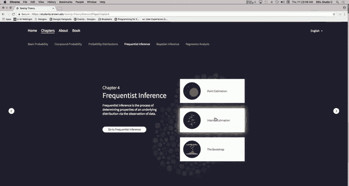
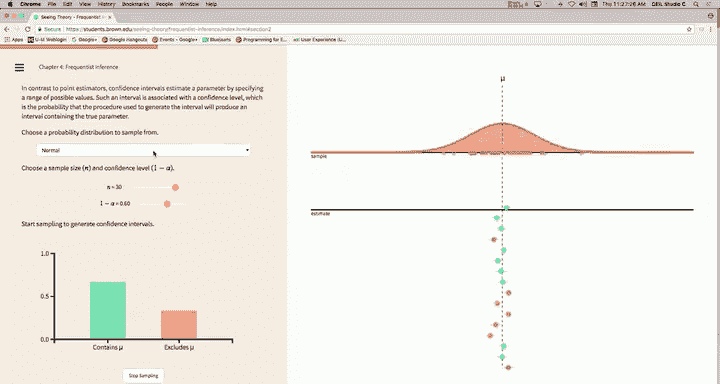

# 课程名称：密歇根大学《使用Python的统计学》第42课 - 置信区间理论可视化演示 🎯

在本节课中，我们将学习如何使用“Seeing Theory”交互式应用来理解置信区间的核心概念。该应用通过可视化演示，帮助我们直观地掌握置信区间的工作原理及其影响因素。

## 应用简介与访问

大家好，欢迎回来。我是Mark。今天我将向大家展示如何使用“Seeing Theory”应用。该应用由布朗大学的本科生Daniel Coonan创建，旨在通过交互式可视化让统计学更易于理解。本节课我们将专注于他创建的关于置信区间的交互式可视化。

要开始使用，可以点击提供的链接，或者在网页浏览器中输入“Seeing Theory Brown University”进行访问。无论使用哪种方式，您都应该看到一个类似这样的页面：Student.brown.edu/seeingtheory。

到达该页面后，请点击左上角的“Chapters”选项。为了找到我们需要的章节，请点击“Frequentist Inference”。您可以在页面顶部附近看到列出的六个章节，请点击其中的第四个。

进入该章节后，请点击中间白色的“Interval Estimation”方框。

点击后，您将进入我们所需的应用界面。

## 界面与初始设置

在界面左侧，有几个我们将在今天课程中调整的输入参数。右侧则是交互式可视化的展示区域。

首先，我们需要选择一个用于抽样的分布。应用列出了几个不同的分布，我们将从正态分布开始。现在您可以在右侧看到一个正态分布图，其总体参数位于中心，由一条虚线标示。

接下来，我们可以为将要创建的置信区间选择样本量和置信水平。然后我们就可以开始抽样了。在第一次尝试中，我们将保持样本量为5，置信水平为90%。

## 理解置信水平

那么，90%的置信水平意味着什么？它意味着，如果我们从同一总体中重复抽取相同大小的样本（此处样本量为5），那么在所有生成的区间中，我们预计有90%的区间会包含我们想要估计的真实总体参数。

让我们开始抽样。您可以看到，我们正在从上面的分布中抽取大小为5的样本。这些样本会落下并形成一个区间，区间中心是我们的最佳估计值，加减一定的误差范围。

应用会自动为那些包含或覆盖了真实总体参数的区间标上绿色，而不包含的则标为红色。在左侧，您可以看到一个清晰的条形图，它显示了当前已生成的区间中，包含与不包含真实参数的百分比。

再次强调，随着时间的推移，由于我们设置了90%的置信水平，我们应该看到这个条形图最终会稳定在大约90%（包含）和10%（不包含）的比例。

## 探索影响因素

现在，让我们看看改变样本量和置信水平会如何影响这些区间。

首先，让我们改变样本量。将样本量n从5滑动到其最大值30。我们会发现，区间的宽度变得比之前窄得多。

观察这个变化，由于我们没有改变置信水平，我们仍然应该看到条形图的比例大约在90%和10%附近。目前是91%和8%，如果持续观察，长远来看它会稳定在90%和10%左右。

最后，让我们改变置信水平。将滑动条向左移动一些，比如到0.6（即60%）。此时应用操作可能需要一些耐心。好的，现在置信水平是60%。

我们仍然保持样本量为30。但如果我们观察新生成的区间中绿色和红色的比例，现在应该只有大约60%的新区间包含真实的总体参数。

这很好地阐释了置信水平的含义。一个置信区间只是屏幕上移动下来的单个区间。而置信水平则表明，如果您重复抽取相同样本量的样本，从长远来看，我们预计有60%的生成区间会包含真实的总体参数。我们现在看到的情况大致符合这个预期。

## 自由探索与总结

现在，您可以自由地更改分布类型、样本量或置信水平，自行探索这个应用。但这已经让您对置信区间、置信水平以及影响它们的参数有了很好的理解。

本节课中，我们一起学习了如何使用“Seeing Theory”交互式应用来可视化理解置信区间。我们了解了置信水平（如90%）的长期频率解释，并通过调整样本量（`n`）和置信水平（如 `1 - α`）观察了它们对区间宽度和覆盖概率的影响。核心在于，置信区间是一个基于样本的估计范围，而置信水平描述了在重复抽样下，该方法产生包含真实参数区间的长期概率。