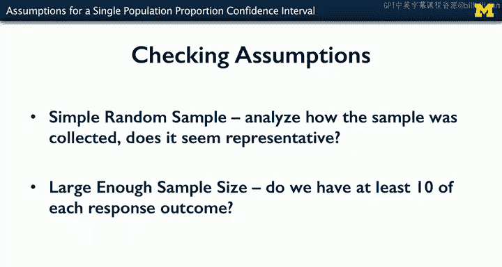

# 课程9：单总体比例置信区间的前提假设 📊


在本节课中，我们将学习构建单总体比例置信区间所需满足的前提假设。理解这些假设是确保置信区间有效且可靠的关键。

---

## 概述

置信区间用于估计总体比例。其中心点是样本比例（点估计），我们在此基础上加减一个误差幅度。这个误差幅度反映了样本估计中预期的变异性。然而，在计算置信区间之前，我们必须验证两个核心前提假设是否成立。

---

## 前提假设一：简单随机样本

首先，我们需要确保数据样本是一个**简单随机样本**。

简单随机样本是指从目标总体中抽取的一个代表性子集。这意味着总体中的每个个体或每个观测值都有**同等**的概率被选中。获得简单随机样本能确保我们得到总体一个可靠的“缩影”，从而为置信区间提供一个良好的中心点。

为了检查此假设，我们需要分析样本的收集方式，确保其能代表目标总体。在本课程中，我们通常假设样本是简单随机样本。更复杂的抽样设计可以通过加权等技术处理，但本课程主要关注简单随机样本的情况。

---

## 前提假设二：足够大的样本量

上一节我们介绍了简单随机样本的重要性。本节中我们来看看第二个关键假设：**足够大的样本量**。

为什么需要足够大的样本量？因为当样本量足够大时，我们才能用**正态曲线**来近似**样本比例的抽样分布**。在计算误差幅度时，我们会使用一个**临界z值**（z乘数），这个值来源于标准正态分布。

那么，什么是“足够大”呢？对此有多种观点。但无论如何，样本量越大，近似效果越好。随着样本量 `n` 的增加，抽样分布会越来越接近钟形（正态分布），而这正是我们所需要的。

对于**单总体比例的置信区间**，我们定义“足够大”为：样本中每种回答结果（通常是“是”和“否”）的数量都**至少为10**。即，我们需要至少有10个“是”和10个“否”。

用公式表示，若样本量为 `n`，样本比例为 `p̂`，则需要满足：
```
n * p̂ >= 10
且
n * (1 - p̂) >= 10
```

---

## 如何验证假设

以下是验证两个前提假设的步骤：

**1. 验证简单随机样本**
   *   分析数据收集过程。
   *   确认抽样方法确保了每个个体被选中的概率均等，且样本能代表目标总体。

**2. 验证足够大的样本量**
   *   计算样本中每种回答类别的数量。
   *   确认“是”和“否”（或其它二元结果）的数量都至少为10。

---

## 总结

本节课中，我们一起学习了构建单总体比例置信区间前必须检查的两个前提假设：
1.  **样本是简单随机样本**：确保样本对总体具有代表性。
2.  **样本量足够大**：确保每种回答结果至少有10个，从而允许我们使用基于正态分布的临界z值。



只有当这两个条件都满足时，我们构建的置信区间才能有效地估计真实的总体比例。