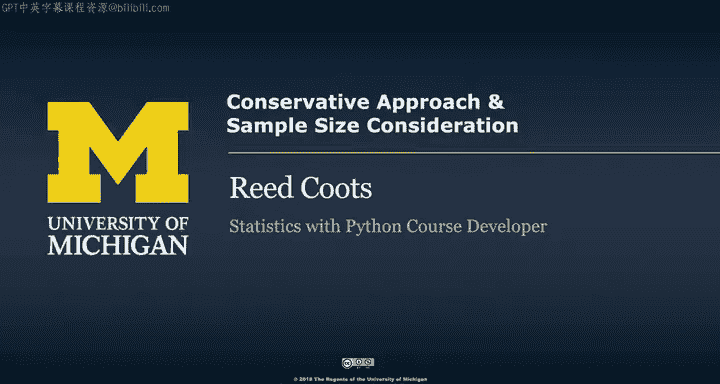
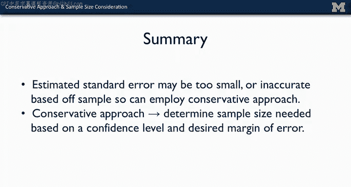

# 44：保守估计与样本量考量方法 📊




在本节课中，我们将学习一种更稳健的置信区间构建方法——保守估计法，并探讨如何根据期望的置信区间宽度（边际误差）来反推所需的样本量。

上一节我们介绍了置信区间的基本概念，它由最佳估计值加减边际误差构成。本节中，我们将看看如何通过一种更“安全”的方法来构建置信区间，并利用它来规划研究所需的样本量。

## 回顾：置信区间公式

置信区间通常表示为：**最佳估计值 ± 边际误差**。

其中，边际误差由两部分相乘得到：一个乘数（通常称为Z值）和最佳估计值的**估计标准误**。

对于一个比例的95%置信区间，其公式为：
```
CI = p̂ ± 1.96 * SE(p̂)
```
其中，估计标准误 `SE(p̂)` 的计算公式为：
```
SE(p̂) = sqrt( p̂ * (1 - p̂) / n )
```

## 引入保守估计法

我们之前使用的估计标准误依赖于样本比例 `p̂`。但有时我们可能会担心 `p̂` 不够准确，或者样本可能存在偏差。

为了解决这个问题，统计学家提出了一种**保守估计法**。其核心思想是：在计算标准误时，使用能使标准误最大化的 `p̂` 值，即 `p̂ = 0.5`。

将 `p̂ = 0.5` 代入标准误公式：
```
SE_conservative = sqrt( 0.5 * 0.5 / n ) = 1 / (2 * sqrt(n))
```

使用这个**保守标准误**构建的置信区间会更宽，这意味着我们对参数真实值所在范围的估计更加“安全”和谨慎。

## 保守置信区间的应用

我们回到密歇根儿童医院（Mott Children‘s Hospital）的汽车安全座椅调查案例。

*   样本量 `n = 659`
*   样本比例 `p̂ = 0.85` (540/659)

使用保守标准误，并为了计算简便，在95%置信水平下使用乘数 `2` 代替 `1.96`，我们得到新的边际误差公式：
```
边际误差 = 2 * [1 / (2 * sqrt(n))] = 1 / sqrt(n)
```

因此，保守的95%置信区间简化为：
```
CI_conservative = p̂ ± 1 / sqrt(n)
```

对于本例：
```
边际误差 = 1 / sqrt(659) ≈ 0.039 (约4%)
CI = 0.85 ± 0.039 = (0.811, 0.889)
```

可以看到，这个区间 `(0.811, 0.889)` 比之前用常规方法计算的 `(0.823, 0.877)` 更宽，体现了“保守”的特性。

## 基于边际误差确定样本量

保守估计法的一个巨大优势是，边际误差只依赖于**置信水平**（决定Z值）和**样本量**。这使我们能够反过来，根据期望的边际误差来计算所需的样本量。

假设我们希望在95%置信水平下，获得一个边际误差仅为3%的保守置信区间。

根据公式 `边际误差 = 1 / sqrt(n)`，我们可以解出 `n`：
```
n = (1 / 边际误差)^2
```

将边际误差 `MOE = 0.03` 代入：
```
n = (1 / 0.03)^2 ≈ 1111.11
```

由于样本量必须是整数，并且更大的样本量会带来更小的边际误差（更精确），我们**总是向上取整**。因此，需要至少 `1112` 个样本才能保证边际误差**不超过**3%。

## 不同置信水平下的样本量计算

如果我们想要更高的置信度，例如99%，同时仍保持3%的边际误差，该如何计算样本量？

这时我们需要使用完整的保守边际误差公式：
```
边际误差 = z* / (2 * sqrt(n))
```
其中 `z*` 是99%置信水平对应的Z值（约为2.576）。

解出 `n`：
```
n = (z* / (2 * 边际误差))^2
```

代入数值计算：
```
n = (2.576 / (2 * 0.03))^2 ≈ 1843.27
```

同样，向上取整，得到所需样本量 `n ≥ 1844`。

以下是不同场景下所需样本量的快速参考：

*   **目标**：95%置信水平，3%边际误差
    *   **所需样本量**：`n ≥ 1112`
*   **目标**：99%置信水平，3%边际误差
    *   **所需样本量**：`n ≥ 1844`
*   **目标**：95%置信水平，4%边际误差（如原始案例）
    *   **所需样本量**：`n ≥ 625` （计算：`(1/0.04)^2 = 625`）

可以看到，要求更高的置信度或更小的边际误差，都需要显著增加样本量。

## 总结

本节课中我们一起学习了保守估计法与样本量规划。



1.  **保守估计法**：为了应对样本估计可能不准确的情况，我们在计算标准误时使用 `p̂ = 0.5`，从而得到最宽（最保守）的置信区间。其核心公式简化为 `CI = p̂ ± 1 / sqrt(n)`（针对95%置信水平）。
2.  **样本量考量**：利用保守估计法中边际误差与样本量的明确关系，我们可以根据研究事先设定的**置信水平**和可接受的**边际误差**，反推出需要收集的**最小样本量**。计算公式为 `n = (z* / (2 * MOE))^2`，并记住结果必须向上取整。

这种方法在临床试验、社会调查等需要提前规划资源的研究中非常实用，确保了研究结果能达到预期的精度。