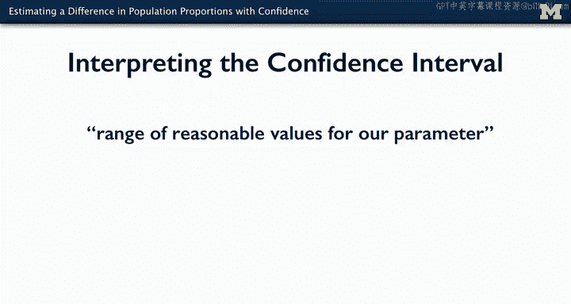

# 45：双总体比例差异的置信估计 📊

在本节课中，我们将学习如何为两个总体比例之间的差异构建置信区间。我们将通过一个关于儿童游泳课程的调查案例，来理解并应用这一统计方法。

---

## 概述

本节课的核心目标是：**使用样本数据，估计两个独立总体比例之间的差异，并构建一个置信区间**。我们将以一个具体的民意调查为例，探讨白人儿童与黑人儿童的父母报告孩子上过游泳课程的比例差异。

---

## 研究背景与参数定义

上一节我们介绍了单总体比例的置信区间。本节中，我们来看看如何处理两个总体的情况。

研究问题源自CS Mott儿童医院的一项全国性民意调查。该调查询问了关于儿童水上安全和游泳课程的情况。

我们的具体研究问题是：**在6至18岁儿童的父母中，报告孩子上过游泳课程的白人儿童父母与黑人儿童父母，其总体比例差异是多少？**

我们关注两个总体：
*   **总体1**：所有6至18岁白人儿童的父母。
*   **总体2**：所有6至18岁黑人儿童的父母。

因此，我们感兴趣的参数是**两个总体比例之差**。用符号表示为：
**参数 = P₁ - P₂**
在本例中，我们指定：
*   **P₁**：白人儿童父母中报告孩子上过游泳课程的总体比例。
*   **P₂**：黑人儿童父母中报告孩子上过游泳课程的总体比例。

我们的目标是：**为P₁ - P₂构建一个95%的置信区间。**

---

## 样本数据

以下是调查获得的样本结果：

*   我们抽取了 **988名** 白人儿童父母的样本，其中 **543人** 报告孩子上过游泳课程。
*   我们抽取了 **247名** 黑人儿童父母的样本，其中 **91人** 报告孩子上过游泳课程。

仅凭这些数字很难直观回答我们的研究问题。因此，我们需要借助置信区间。

---

## 置信区间公式推导

回忆置信区间的基本结构：**最佳估计值 ± 边际误差**。

对于单比例，我们知道如何计算。对于两个比例之差，我们沿用此结构，但需进行调整。

首先，考虑**最佳估计值**。我们的参数是P₁ - P₂，很自然地用样本比例之差来估计它：
**最佳估计值 = P̂₁ - P̂₂**

其次，考虑**边际误差**。在95%置信水平下，边际误差是“几个”标准误。我们使用1.96作为这个“几个”值。

因此，双比例差异的置信区间公式为：
**置信区间 = (P̂₁ - P̂₂) ± 1.96 × SE(P̂₁ - P̂₂)**

其中，**标准误SE(P̂₁ - P̂₂)** 的计算公式如下：
**SE(P̂₁ - P̂₂) = √[ P̂₁(1 - P̂₁)/n₁ + P̂₂(1 - P̂₂)/n₂ ]**
这个公式看起来很像单比例标准误公式的扩展，只是将两组的信息相加后再取平方根。

---

## 计算置信区间

现在，我们将使用样本数据来计算这个置信区间。

**步骤1：计算样本比例P̂**
*   P̂₁ = 543 / 988 ≈ 0.55 (55%)
*   P̂₂ = 91 / 247 ≈ 0.37 (37%)

**步骤2：计算最佳估计值（点估计）**
*   点估计 = P̂₁ - P̂₂ = 0.55 - 0.37 = 0.18 (18%)
这意味着，在样本中，白人儿童父母报告孩子上过游泳课程的比例，比黑人儿童父母高出约18个百分点。

**步骤3：计算标准误**
将数值代入标准误公式：
SE = √[ (0.55×0.45/988) + (0.37×0.63/247) ]
SE ≈ √[ 0.0002505 + 0.0009437 ]
SE ≈ √0.0011942 ≈ 0.0346 (3.46%)

**步骤4：计算边际误差并确定置信区间**
*   边际误差 = 1.96 × 0.0346 ≈ 0.0678 (6.78%)
*   置信区间下限 = 0.18 - 0.0678 ≈ 0.1122 (11.22%)
*   置信区间上限 = 0.18 + 0.0678 ≈ 0.2478 (24.78%)

因此，**P₁ - P₂的95%置信区间约为 (0.11， 0.25) 或 (11%， 25%)**。

---

## 结果解读

以下是置信区间的解读方法：

一个置信区间是我们的参数（此处为P₁ - P₂）的一个合理取值范围。

具体到本例，我们可以这样解释：
**我们有95%的信心认为，白人儿童父母中孩子上过游泳课程的总体比例，比黑人儿童父母中的总体比例高出大约11%到25%。**

这意味着，真实的总体差异很可能落在这个区间内。点估计值18%是我们的最佳猜测，但考虑到抽样误差，真实值可能在11%到25%之间的任何位置。

---

## 总结

本节课中我们一起学习了：
1.  **定义了参数**：双总体比例之差 P₁ - P₂。
2.  **理解了公式**：置信区间 = (P̂₁ - P̂₂) ± z* × √[ P̂₁(1-P̂₁)/n₁ + P̂₂(1-P̂₂)/n₂ ]。
3.  **进行了计算**：通过一个关于游泳课程的调查案例，我们计算出了比例差异的点估计（18%）和95%置信区间（11%， 25%）。
4.  **学会了解读**：我们能够将这个统计结果转化为关于研究问题的、有意义的陈述。

在下一节课中，我们将更深入地探讨如何解读置信区间，以及在计算此类置信区间前需要检查哪些基本假设。