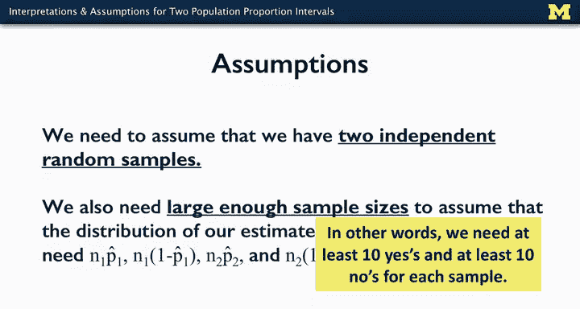

# 46：双总体比例区间的解释与假设条件 📊

在本节课中，我们将学习如何解释两个总体比例之差的置信区间，并了解在计算该区间前需要检查哪些假设条件。

上一节我们介绍了如何计算两个总体比例之差的置信区间。本节中，我们来看看如何解释这个区间，并讨论在计算前必须验证的关键假设。

## 置信区间的回顾

首先，让我们回顾一下置信区间的定义。

该置信区间是我们参数合理取值的范围。

我们以95%的置信度发现，白人儿童家长中上过游泳课的比例，比黑人儿童家长中上过游泳课的比例高出约11%到约25%。

## 如何解释置信区间

现在我们来思考一下。这两个总体比例似乎存在差异吗？

为了理解两个总体比例是否存在差异，我们可以观察我们的参数。当我们查看差异的区间时，可以考虑这两个参数之间是否存在差异。

如果两个参数相等，意味着我们两个参数的差为0，即 **p1 - p2 = 0**。

如果这两个参数不相等，则意味着差值 **p1 - p2 ≠ 0**。

由于我们的置信区间是参数合理取值的范围，我们需要查看0是否在这个合理取值范围内。

如果0在我们的置信区间内似乎是合理的，那就意味着两个参数可能相等，即两个总体比例之间确实没有差异。

如果0不在该置信区间内，则表明我们的参数很可能不相等，它们看起来并不相似或相同。这表明我们正在研究的两个总体比例可能存在差异。

## 计算前的假设条件

在计算置信区间之前，还需要检查一些假设。我们在上一节视频中跳过了这些，是为了先展示区间的计算方法。但在实际计算区间之前，检查这些假设非常重要。

以下是计算前需要检查的假设条件：

首先，我们需要假设我们有两个独立的随机样本。这实际上取决于抽样方案，因此需要事先告知您是否已经做到这一点。一旦您获得了样本信息，就没有直接的方法来检查这一点。

其次，我们还需要足够大的样本量，以确保我们估计量的分布是正态的。具体来说，这意味着我们需要满足以下四个条件：
*   **n1 * p̂1 ≥ 10**
*   **n1 * (1 - p̂1) ≥ 10**
*   **n2 * p̂2 ≥ 10**
*   **n2 * (1 - p̂2) ≥ 10**

用更易懂的话来说，这意味着在每个样本中，我们至少需要有10个“是”（成功）和10个“否”（失败）。您可以通过将数字代入上述四个公式来计算验证，也可以直接检查每个样本中是否至少有10个“是”和10个“否”。

## 总结

本节课中我们一起学习了如何解释两个总体比例之差的置信区间，以及计算前必须验证的假设条件。

我们回顾了上一节中计算置信区间的方法。在我们的例子中，置信区间表明白人儿童中上过游泳课的比例，比黑人儿童中上过游泳课的比例高出约11%到25%。

我们还讨论了如何解释这个置信区间：在本案例中，白人儿童上过游泳课的总体比例确实似乎高于黑人儿童。