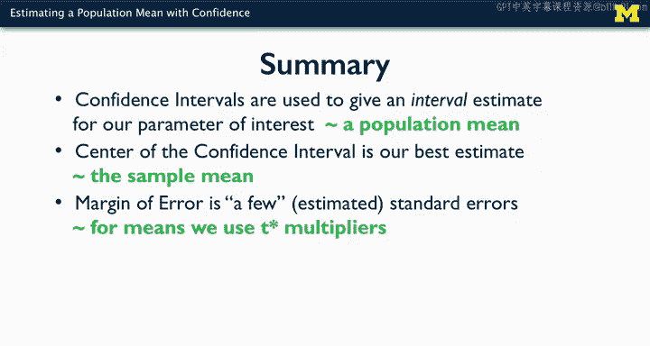

# 课程13：总体均值的置信估计 📊

在本节课中，我们将学习如何对**总体均值**进行置信估计。我们将使用一个关于侧手翻距离的实际数据集，通过构建**95%置信区间**来估计成年人的平均侧手翻距离。我们将介绍相关的核心概念、计算公式以及如何解释结果。

---

## 数据与研究问题

上一节我们介绍了对分类变量（比例）的置信估计。本节中，我们来看看当响应变量是**定量数据**（如距离、身高）时，如何估计总体均值。

我们的研究问题是：**成年人的平均侧手翻距离（英寸）是多少？**
*   **总体**：所有成年人。
*   **参数**：总体均值（用希腊字母 **μ** 表示）。
*   **目标**：使用样本数据，构建总体均值 μ 的95%置信区间。

我们拥有25名成年人的侧手翻距离测量数据。

---

## 数据探索：图形与数值摘要

在进行分析之前，我们首先需要了解数据的基本特征。

以下是数据可视化结果：
*   **直方图**显示，侧手翻距离大致在70英寸到110英寸以上，分布略呈右偏。
*   **QQ图**进一步证实了分布尾部（低端）略有偏离。

为了进行有效的置信区间估计，我们通常希望总体数据服从正态（钟形）分布。虽然我们的样本分布略有偏斜，但样本量（n=25）已足够大，可以依赖**中心极限定理**，即样本均值的分布近似正态。

接下来，我们查看数值摘要：
*   样本量 **n = 25**
*   样本均值 **x̄ = 82.48 英寸**
*   样本标准差 **s = 15.06 英寸**
*   最小值：63英寸
*   最大值：115英寸

样本均值82.48英寸是我们对总体均值μ的最佳点估计。

---

## 理解样本均值的变异性

我们知道，如果重复抽样，每次得到的样本均值x̄会有所不同。这种变异性由**样本均值的抽样分布**来描述。

抽样分布有两个关键特征：
1.  **中心**：所有可能样本均值的平均值等于总体均值 μ。这意味着 x̄ 是 μ 的**无偏估计**。
2.  **散布**：抽样分布的标准差称为**标准误**，它衡量了样本均值的变异性或精确度。

总体均值的标准误公式为：
`标准误 = σ / √n`
其中，**σ** 是总体标准差，**n** 是样本量。

然而，我们永远无法得知真实的 σ。因此，我们使用样本标准差 **s** 来估计它，从而得到**估计标准误**：
`估计标准误 = s / √n`

---

## 构建总体均值的置信区间

置信区间的通用结构是：**点估计 ± 边际误差**。

对于总体均值：
*   **点估计** = 样本均值 **x̄**
*   **边际误差** = **t* × (s / √n)**

这里出现了一个新元素 **t***。当我们用 s 估计 σ，且样本量可能不大时，不能再使用之前比例估计中的1.96这个乘数。我们需要使用 **t 分布**来找到合适的乘数 **t***。t* 的值取决于我们选择的**置信水平**（如95%）和**自由度**，自由度通常为 **n - 1**。

对于我们的数据（n=25，95%置信水平），自由度 df=24，对应的 **t* ≈ 2.064**。

现在，我们可以计算置信区间：
1.  点估计：x̄ = 82.48
2.  估计标准误：s / √n = 15.06 / √25 = 15.06 / 5 = 3.012
3.  边际误差：t* × 估计标准误 = 2.064 × 3.012 ≈ 6.22
4.  95% 置信区间：82.48 ± 6.22 = **(76.26, 88.70) 英寸**

---

## 结果的解释与说明

计算出置信区间后，正确解释其含义至关重要。

**区间解释：**
我们可以这样陈述：“我们有95%的信心认为，所有成年人的平均侧手翻距离在76.26英寸到88.70英寸之间。” 这个区间提供了总体均值μ的一个合理取值范围。

**置信水平的含义：**
“95%置信度”指的是我们使用的**方法**的可靠性。它意味着，如果我们重复多次抽样（每次抽取25人），并每次都计算一个95%置信区间，那么长期来看，这些区间中将有大约95%会包含真实的总体均值μ。我们当前的区间（76.26, 88.70）只是这众多可能区间中的一个，我们对其包含μ有95%的信心。

---

## 前提假设与总结

为了使总体均值的置信区间有效，需要满足以下假设：
1.  **数据代表性**：样本数据应能代表目标总体（可视为随机样本）。
2.  **正态性**：总体响应值（这里是所有成年人的侧手翻距离）的分布模型应是正态（钟形）的。
    *   **补充说明**：如果总体分布不严格正态，但只要样本量足够大（通常 n ≥ 30），根据**中心极限定理**，样本均值的分布仍会近似正态，从而使置信区间方法依然可靠。我们的样本量（n=25）处于边界，但结合图形观察，方法基本合理。

本节课中我们一起学习了如何估计总体均值。
*   我们使用**样本均值 x̄** 作为点估计。
*   我们使用**估计标准误 (s/√n)** 和来自 **t 分布** 的乘数 **t*** 来计算边际误差。
*   我们构建并解释了**置信区间**，理解了“95%置信度”的含义。
*   我们回顾了该方法有效的关键**假设**。

置信区间为我们提供了关于总体参数的区间估计，结合了估计的不确定性，是统计推断中一个非常强大的工具。