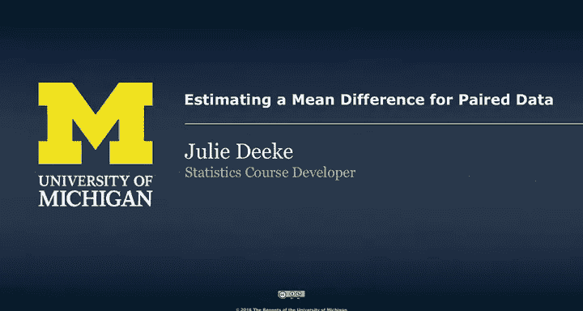
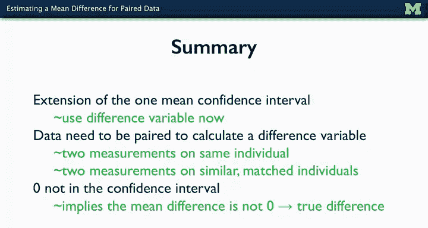

# 课程14：配对数据均值差异估计 📊

在本节课中，我们将学习如何为配对数据估计均值差异。我们将从理解什么是配对数据开始，然后学习如何计算和解释配对数据均值差异的置信区间。

## 什么是配对数据？🤔

上一节我们介绍了统计推断的基本概念，本节中我们来看看一种特殊的数据类型：配对数据。

配对数据是指两组观测值之间存在某种自然匹配或关联的数据。它们不能被视为独立的样本，因为每个数据点都与另一个数据点成对出现。

以下是配对数据可能出现的几种情况：

*   **同一个体的两次测量**：例如，测量一个人用药前和用药后的血压。
*   **匹配个体的测量**：例如，研究双胞胎（如本课案例）、夫妻或根据年龄、性别等特征匹配的个体。
*   **相关个体的测量**：例如，测量父子或祖孙的身高。

在每种情况下，我们都需要创建一个新的变量：**配对内测量值的差异**。这样我们就能直接比较两个相关联的观测值。

## 案例研究：双胞胎教育水平 👯

我们的研究问题是：**年长双胞胎和年轻双胞胎自我报告的教育年限的平均差异是多少？**

*   **总体**：所有同卵双胞胎。
*   **感兴趣的参数**：总体均值差异，记为 **μ_D**。这里，我们定义差异为 **年长双胞胎的教育年限 - 年轻双胞胎的教育年限**。
*   **目标**：为同卵双胞胎自我报告教育年限的均值差异构建一个95%的置信区间。

## 数据与差异计算 📈

我们首先查看一个数据样本。关键步骤是计算每对双胞胎教育年限的差值（年长 - 年轻）。

以下是数据示例：

| 年长双胞胎教育年限 | 年轻双胞胎教育年限 | 差值 (D) |
| :--- | :--- | :--- |
| 16 | 16 | 0 |
| 18 | 16 | 2 |
| ... | ... | ... |
| 14 | 16 | -2 |

从数据摘要中，我们得到：
*   观测数 (n): 340
*   差值均值 (x̄_D): 0.08 年
*   差值标准差 (s_D): 0.76 年

## 构建置信区间 🧮

现在，我们来构建均值差异的置信区间。其基本形式与单均值置信区间相同。

置信区间的通用公式为：
**最佳估计值 ± 边际误差**

对于配对数据的均值差异，具体公式为：
**x̄_D ± t* × (s_D / √n)**

其中：
*   **x̄_D** 是样本差值均值。
*   **s_D** 是样本差值的标准差。
*   **n** 是配对数量（差值数量）。
*   **t*** 是t分布中与置信水平（如95%）和自由度 **(n-1)** 对应的临界值。

将我们的数据代入公式：
*   x̄_D = 0.08
*   s_D = 0.76
*   n = 340， 自由度 df = 339， 对于95%置信区间， t* ≈ 1.967
*   标准误 (SE) = s_D / √n = 0.76 / √340 ≈ 0.0412

计算边际误差：
边际误差 = t* × SE = 1.967 × 0.0412 ≈ 0.0810

因此，95%置信区间为：
下限：0.08 - 0.0810 = -0.0010 ≈ **0.00 年**
上限：0.08 + 0.0810 = 0.1610 ≈ **0.16 年**

（注：视频中计算结果为[0.0025, 0.1652]，因中间计算四舍五入略有差异，原理完全一致。）

## 解释置信区间 💡

我们如何解释这个置信区间 **[0.00, 0.16]** 年？

我们有95%的信心认为，总体中**年长双胞胎比年轻双胞胎自我报告的教育年限的平均差异**在0.00年到0.16年之间。

关键点在于：
1.  整个区间都是**正数**。这表明我们确信，平均而言，年长双胞胎的教育年限略高于年轻双胞胎。
2.  区间非常接近**零**。虽然存在差异，但这个差异很小（平均最多多0.16年，约2个月）。

## 假设检验的视角：零值在区间内吗？ ❓

我们常常关心“两组是否有差异？”这个问题。在统计上，这等价于问：**总体均值差异 μ_D 是否等于0？**

*   如果**0包含在置信区间内**，则0是一个合理的值，我们没有足够证据表明存在总体均值差异。
*   如果**0不包含在置信区间内**（如本例），则0不是一个合理的值，我们有证据表明存在总体均值差异。

在我们的案例中，置信区间为[0.00, 0.16]。区间下限正好是0（或根据视频计算为0.0025 > 0），因此**0不在区间内部**。这为“双胞胎之间的教育水平存在差异”提供了统计证据，尽管差异很小。

## 需要检查的假设 ✅

在计算此置信区间前，我们需要确保一些条件得到满足：
1.  **随机样本**：我们拥有同卵双胞胎对的随机样本。
2.  **正态性**：差值构成的总体应近似正态分布。我们可以通过差值的直方图来检查。对于大样本（如 n=340），中心极限定理通常能保证样本均值的分布近似正态，因此此条件可以放宽。
3.  **独立性**：每对双胞胎之间的差值应相互独立。这通常由随机抽样来保证。

## 总结 📝

本节课中我们一起学习了如何处理配对数据：
*   我们**将单均值的置信区间方法扩展到了配对数据**，核心是创建并分析**差值变量 (D)**。
*   配对数据主要产生于**同一个体的两次测量**或**匹配个体的测量**。
*   我们通过计算**差值均值的置信区间**来推断总体均值差异。
*   通过检查**零是否落在置信区间内**，我们可以判断两组是否存在显著的均值差异。在本案例中，零不在区间内，表明双胞胎的教育水平存在微小但显著的差异。

---
**课程名称**：密歇根大学《使用Python的统计学》- P48：配对数据均值差异估计