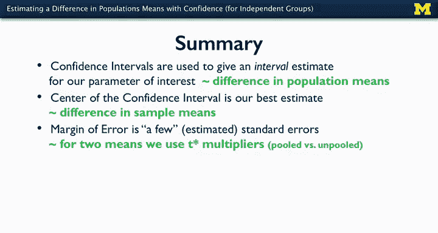

# 49：独立样本的总体均值差异置信估计 📊


## 概述
在本节课中，我们将学习如何为两个独立的群体，构建总体均值差异的置信区间估计。我们已经学习过如何为一个总体均值和一个总体比例构建置信区间，现在我们将深入探讨如何比较两个群体及其总体。

## 研究问题
考虑居住在美国的18至29岁墨西哥裔美国成年人，男性和女性在平均身体质量指数上是否存在显著差异？

首先，我们需要明确我们的总体。这里指定的总体是居住在美国的18至29岁墨西哥裔美国成年人。由于我们要比较两个独立的总体（男性和女性），我们需要从整体的NHANES数据集中根据性别进行抽样，以获取我们感兴趣的两个总体。

我们感兴趣的参数是身体质量指数，通常称为BMI，其单位为千克/平方米。这是一种量化人体组织质量并帮助将其分类为体重过轻、正常或超重的方法。

我们将使用符号 **μ₁** 和 **μ₂** 来表示这个参数。我们想要找到它们之间的差异，因此我们将使用 **μ₁ - μ₂**。

在NHANES数据集中，性别被标记为1（男性）和2（女性）。因此，在本讲座中，下标1代表男性总体，下标2代表女性总体。从我们筛选出的几行样本数据（种族仅为墨西哥裔美国人，年龄仅包括18至29岁）中可以看到，BMI列在第二列，精确到小数点后一位。

运行一些基本的数值摘要，我们可以得到男性和女性子组的均值、标准差、最小值、最大值和样本量。右侧还显示了箱线图。在这个比较中，我们真正感兴趣的是这两个总体的均值。我们目前只有样本均值，这将是我们开始的最佳估计。

## 抽样分布与标准误
样本均值会因样本而异，这将有助于创建我们的抽样分布。请注意，“两个样本均值的差异”这个说法有时会显得冗长，因此如果我提到“样本统计量”，这将指代两个样本均值的差异。

对于我们的样本统计量的抽样分布，它会因样本而异，并围绕真实的总体均值差异 **μ₁ - μ₂** 波动。如果两个总体的响应模型都近似正态，或者我们的样本量足够大，那么样本均值差异的分布也将近似正态。

标准误是一个值，它平均告诉我们样本统计量会落在离真实参数多远的地方，其计算公式如下：

**标准误公式：**
```
SE = sqrt(σ₁²/n₁ + σ₂²/n₂)
```

不幸的是，我们不知道这些总体方差（用σ表示）的真实值。因此，我们能做的最好方法是用样本方差来估计它。所以，我们有 **S₁²** 和 **S₂²**，分别代表男性组和女性组的方差。

## 构建置信区间
正如我们之前所见，置信区间将以我们的最佳估计作为中点，并向两侧加减一个误差范围。

最佳估计将是我们无偏的点估计。在这个场景中，最佳估计是我们的样本均值差异，即 **x̄₁ - x̄₂**。

误差范围，或者我喜欢将其视为考虑抽样分布变异性的“摆动空间”，将是几个估计的标准误。我们所说的“几个”是指一个乘数，这个乘数将基于所需的置信水平从一个特定的分布中获取。对于两个均值，我们将使用t分布。在本例中，我们将使用95%的置信水平，这相当于假设检验中5%的显著性水平。

在计算这个误差范围时，对于两个均值有两种不同的方法。

## 两种置信区间方法
以下是构建置信区间的两种主要方法。

### 1. 合并方差法
如果两个总体的方差足够接近，我们将假设它们相等。由于我们不知道这些真实方差，我们可以查看样本方差和每个样本的分布，以判断这个假设是否成立。

### 2. 未合并方差法
如果我们认为这个假设不成立，我们可以简单地使用未合并方差法并放弃这个假设。

让我们从未合并置信区间的计算开始。同样，我们有我们的最佳估计加减误差范围。最佳估计是样本均值的差异，由 **x̄₁ - x̄₂** 给出。我们已经展示了标准误公式，即男性组样本方差除以男性组样本量，加上女性组样本方差除以女性组样本量，然后取平方根。

现在，“几个”是什么意思？这将是我们的乘数，为此我们将使用一个 **t\*** 乘数，它来自具有特定自由度的t分布。要计算确切的自由度，可以使用韦尔奇近似法。不过，这个公式可能有点复杂。如果技术手段不便，需要手工计算，可以使用一个简单保守的方法：取两个样本量中较小的一个，然后减去1。

另一种方法是合并置信区间计算。这是指在我们的样本中方差足够接近，以至于我们可以假设总体的方差相似，然后将方差合并。同样，我们有相同的样本均值差异，然后加减几个估计的标准误。合并的估计标准误现在会发生变化。我们不再使用原来的计算，而是将合并的标准差放在前面，然后乘以样本量倒数之和的平方根。同样，我们将使用相同的 **t\*** 乘数，但自由度不同。在合并版本中，我们只需将两个样本量相加并减去2。同样，这种方法仅在我们能假设总体方差相等时使用。

## 回到示例：检查假设
现在让我们回到我们的示例并进行计算。

首先，我们需要检查几个假设。第一个假设是，我们的两个总体（男性和女性群体）都有简单随机样本。鉴于NHANES的创建方式，为了本示例的目的，我们将假设我们获得了简单随机样本。本讲座之外我们还会讨论其他复杂的抽样设计，但这里我们只假设简单随机样本。

我们还需要这两个样本彼此独立。这里我们也假设情况如此，男性和女性不能以任何方式具体匹配或配对，因此我们假设两个样本彼此独立。

下一个需要检查的假设是正态性假设。我们之前说过，两个总体的响应模型需要近似正态。一种方法是查看左侧显示的直方图或右侧显示的分位数-分位数图。左侧的直方图都应呈现近似钟形，这能告诉我们是否为正态分布。右侧的QQ图将我们的样本分位数与正态分布的分位数进行比较。我们真正要看的是所有这些点、所有这些数据点是否都落在中间那条线上。穿过图表中心的那条中线代表正态分布，因此我们离那条线越近，就越接近正态分布。

从这两张图可以看出，它们都相当接近正态，但存在一些轻微到中度的偏斜，尤其是在女性组中，从分位数-分位数线的偏离可以看出。我们确实需要两个总体的模型都是正态的，但这里因为我们的样本量很大，我们可以应用中心极限定理并继续进行分析。这种双样本t检验的方法相当稳健，尤其是样本量越大越稳健。这里，因为我们的两个样本量都远超过200，我们将继续应用CLT并向前推进。我们将在后续课程中看到处理非正态数据的不同方法。

另一个需要检查的假设是方差假设，这将告诉我们使用合并法还是未合并法。我们可以查看箱线图的两组四分位距，也可以查看我们拥有的样本标准差。样本标准差看起来非常相似，箱线图的箱体部分高度也看起来非常相似。因此，我们可以说它们足够相似，可以做出总体方差相等的假设，所以我们将使用合并法。

## 计算置信区间
如果我们使用之前幻灯片中的合并法方程，我们可以开始代入我们的值。最重要的是 **t\*** 乘数，我们将使用值 **1.98**。随着样本量的增加，自由度增加，这个值将接近1.96。我们确实有相当大的样本量，但为了保守起见，我们将使用值1.98。这个值可以从在线的多个t表中找到，同样取决于你的自由度和置信水平。这里我们使用95%的置信水平。

让我们开始代入一些值。我们可以看到方程左侧的样本均值差异，我们讨论过的 **t\*** 乘数，以及最右侧的估计标准误。当我们开始解这个方程时，我们看到样本均值确实存在微小差异，并且右侧附加了一些摆动空间。

我们最终要构建的置信区间是 **-0.385 千克/平方米 到 +1.865 千克/平方米**。

## 稳健性检查：未合并法
现在我们将做一个快速的互动测验。我们向您展示了使用合并法，但现在我们想检查一下，如果总体方差相等的假设确实不成立，未合并法会是什么样子。如果使用未合并法，我们的区间与这里找到的区间匹配，那么我们就发现结果相当稳健。现在请花点时间计算这个问题的未合并方差版本，即未合并置信区间。

正如您刚刚计算的未合并置信区间所示，我们得到的两个区间非常、非常相似。它们偏差不大。因此，我们可以说，无论我们是否假设方差相等，我们的结果都相当稳健。

## 解释置信区间
现在我们如何解释刚刚找到的区间？这个区间是从 **-0.385 到 +1.865**。这是什么意思？这个区间是我们的参数合理值的范围。同样，我们试图找到总体均值的真实差异，而我们刚刚根据样本得到了这个估计。

因此，我们可以这样说：我们有95%的置信度估计，对于所有居住在美国的18至29岁墨西哥裔美国成年人，男性和女性之间平均BMI的差异在 **-0.385 千克/平方米** 和 **+1.865 千克/平方米** 之间。这个范围给出了基于我们刚刚使用的程序，我们预期参数可能取的所有值。

那么，在陈述开头提到的“95%置信度”是什么意思？这是我们的置信水平，基本上我们是在说，如果我们一次又一次地重复这个程序，取相同的样本量，获取不同的样本，并且每次我们都为那些样本创建一个新的置信区间，我们预计95%的结果区间会包含总体平均BMI的真实差异。因此，我们对我们使用的过程有95%的把握，认为我们捕捉到了我们追求的真实值。

## 总结
在本节课中，我们一起学习了如何为两个独立样本的总体均值差异构建置信区间。

置信区间用于为我们感兴趣的参数提供一个合理值的范围，在这个例子中，我们的参数是两个总体均值的差异。

这个区间的中心将是我们的最佳估计，这始终来自我们的样本统计量，这里就是我们的样本均值差异。

误差范围或我们为考虑变异性所需的“摆动空间”将是几个估计的标准误，这两者都取决于我们使用的方法，是合并法还是未合并法。

执行此分析时需要检查的假设是：我们需要两个简单随机样本，并且它们需要彼此独立。



我们还需要这些响应的总体是正态的。如果我们没有正态性，大样本量会有所帮助，我们可以像在我们的示例中看到的那样，应用中心极限定理继续前进。

然后我们检查方差相等的假设，这有助于我们决定是使用合并法还是未合并法。

最后，知道如何解释你找到的区间及其背后的置信水平，两者之间存在细微差别，这在未来的分析中很重要。