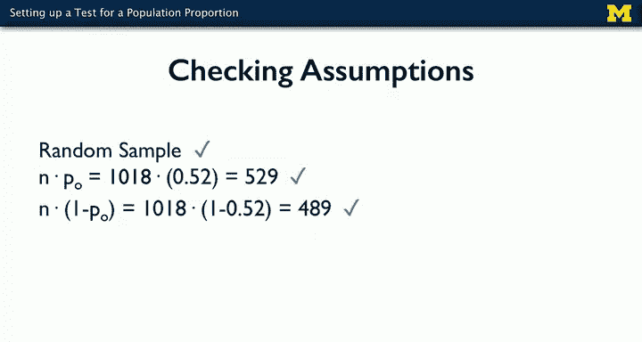

# 课程16：单总体比例检验框架构建 📊

在本节课中，我们将学习如何构建一个完整的单总体比例假设检验框架。我们将通过一个关于青少年睡眠问题的具体案例，一步步理解假设检验的流程、核心概念和计算方法。

---

## 概述

假设检验是统计学中用于判断关于总体参数的某个主张是否得到数据支持的方法。我们通常从一个问题开始，例如“某个参数的值可能是某个特定值吗？”，然后利用收集到的数据来支持或反驳这个主张。

本节课我们将通过一个具体案例，来运行一个单总体比例假设检验。这个案例基于一项关于儿童健康，特别是睡眠习惯的全国性民意调查。

---

## 案例背景：青少年睡眠问题

一项针对13至18岁青少年父母的全国性民意调查显示，在过去的年份中，有52%的父母认为电子产品和社交媒体是他们孩子睡眠不足的原因。

我们的研究问题是：**如今，是否有更多的父母认为他们青少年的睡眠不足是由电子产品和社交媒体引起的？**

---

## 第一步：定义参数与总体

在进行任何检验之前，我们必须明确研究对象。

*   **总体**：所有拥有13至18岁青少年的父母。
*   **感兴趣的参数**：总体比例 **P**。
    *   **P** 代表总体中相信电子产品和社交媒体导致其青少年睡眠不足的父母比例。

我们的主要目标是：检验相信此观点的父母比例是否存在**显著增加**。

---

## 第二步：建立假设

假设是在收集数据**之前**就设定的，以确保我们的信念不会影响对数据的解读。

以下是建立假设的步骤：

1.  **零假设 (H₀)**：通常代表“没有变化”或“现状”。基于背景信息，我们设定 H₀: **P = 0.52**。
2.  **备择假设 (Hₐ)**：代表我们想要寻找证据支持的猜测。由于研究问题是寻找“显著增加”，因此我们设定 Hₐ: **P > 0.52**。
3.  **明确参数含义**：完整的假设陈述应说明 P 的含义。P 是“总体中相信电子产品和社交媒体导致其青少年睡眠不足的青少年父母比例”。
4.  **设定显著性水平 (α)**：这是一个阈值，用于判断结果是否具有统计显著性。通常设定为 **α = 0.05**。如果后续计算出的 P 值小于 0.05，我们就认为结果显著。

---

## 第三步：收集数据并检查条件

我们收集了数据。调查结果显示，在随机抽取的 1018 名青少年父母中，有 56% 的人认为电子产品和社交媒体是孩子睡眠不足的原因。

在进一步分析之前，我们必须检查一些前提条件是否满足，以确保我们的检验方法有效。

以下是需要检查的条件：

*   **随机样本**：我们的样本必须是随机抽取的。案例中已说明这是随机样本，满足条件。
*   **样本量足够大**：这确保了样本比例的抽样分布近似正态分布。检查方法是计算 **n * p₀** 和 **n * (1 - p₀)**，两者都应至少为 10。
    *   这里，**p₀** 是零假设下的比例值，即 0.52。
    *   **n** 是我们的样本量 1018。
    *   计算：`1018 * 0.52 = 529.36`， `1018 * (1 - 0.52) = 488.64`。两者都远大于 10，条件满足。

---

## 过渡

至此，我们已经设定了假设，并检查了数据是否满足进行检验的前提条件。接下来，我们将进入检验的核心部分：计算检验统计量和 P 值，以判断结果是否显著。

---

## 第四步：进行检验与决策

（*注：原视频内容在此处暂停，后续步骤通常包括计算标准误、Z 分数和 P 值，最后将 P 值与显著性水平 α 比较并做出统计决策。*）

---

## 总结

在本节课中，我们一起学习了构建单总体比例假设检验的完整框架。我们从明确研究问题和定义总体参数开始，逐步建立了零假设和备择假设，并设定了显著性水平。随后，我们利用案例数据检查了随机抽样和样本量足够大这两个关键前提条件。这个过程为后续实际计算检验统计量、评估证据强度并得出最终结论奠定了坚实的基础。掌握这个框架是理解所有类型假设检验的第一步。