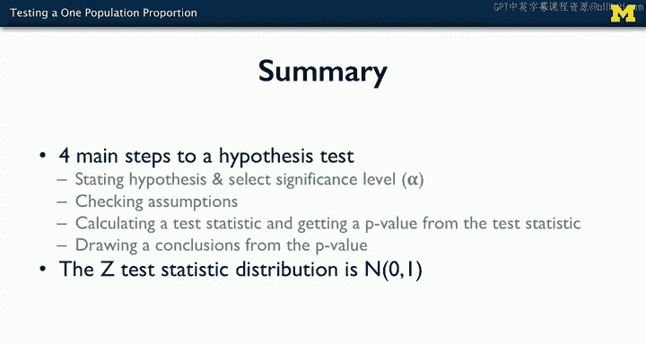

# 课程17：单总体比例假设检验 📊

在本节课中，我们将学习如何对一个总体比例进行完整的假设检验。我们将通过一个具体案例，从建立假设开始，逐步完成检验统计量的计算、P值的获取，并最终得出统计结论。

---

## 概述

假设检验是统计学中用于根据样本数据对总体参数做出推断决策的重要方法。本节课，我们将聚焦于**单总体比例**的假设检验。我们将学习完整的四步流程：1）陈述假设并选择显著性水平；2）检查假设条件；3）计算检验统计量并获取P值；4）根据P值得出结论。

---

## 第一步：陈述假设与选择显著性水平

上一节我们介绍了假设检验的基本概念，本节中我们来看看如何具体应用。首先，我们需要明确研究问题和对应的统计假设。

我们的研究问题是：**是否有多于52%的青少年父母认为电子产品和社交媒体是导致孩子睡眠不足的原因？**

基于此，我们建立以下假设：
*   **零假设 (H₀)**：总体比例 **p = 0.52**。
*   **备择假设 (Hₐ)**：总体比例 **p > 0.52**。

这里的 **p** 代表所有青少年父母中，持上述观点的真实比例。

接下来，我们选择显著性水平 **α**。这是一个阈值，用于判断结果是否具有统计显著性。通常我们选择 **α = 0.05**。

根据一项针对 **n = 1018** 位父母的民意调查，我们得到的样本比例最佳估计值为 **p̂ = 0.56**。

---

## 第二步：检查假设条件

在计算之前，我们必须确保数据满足进行比例假设检验的条件。以下是需要检查的关键条件：

*   **独立性**：样本观察值需要相互独立。这通常通过随机抽样来保证。
*   **样本量条件**：样本量需要足够大，以确保样本比例的抽样分布近似正态分布。这要求满足 **np₀ ≥ 10** 且 **n(1 - p₀) ≥ 10**，其中 **p₀** 是零假设中的比例值（0.52）。

---

## 第三步：计算检验统计量与P值

现在我们已经建立了假设并验证了条件，本节中我们来计算检验统计量。

检验统计量的通用公式是：
**检验统计量 = (最佳估计值 - 假设值) / 估计值的标准误**

对于单比例检验，具体公式为：
**Z = (p̂ - p₀) / SE(p̂)**

其中，标准误 **SE(p̂)** 在零假设下的计算公式为（称为**零标准误**）：
**SE(p̂) = √[ p₀ * (1 - p₀) / n ]**

将我们的数据代入计算：
*   p̂ = 0.56
*   p₀ = 0.52
*   n = 1018
*   SE(p̂) = √[0.52 * 0.48 / 1018] ≈ 0.0157

因此，Z检验统计量为：
**Z = (0.56 - 0.52) / 0.0157 ≈ 2.555**

这个Z值意味着：我们观察到的样本比例（0.56）比零假设假设的总体比例（0.52）高出约 **2.555个零标准误**。

### Z检验统计量的分布

Z检验统计量本身也是一个随机变量，它服从**标准正态分布（均值为0，标准差为1）**，记作 **N(0, 1)**。这是因为我们从原始的正态分布数据中减去了假设的均值（中心化），并除以其标准误（标准化）。

### 获取P值

P值是在零假设成立的前提下，得到当前观测结果或更极端结果的概率。由于我们的备择假设是 **p > 0.52**，我们需要计算Z值大于等于2.555的概率。

在标准正态分布曲线上，2.555位于右侧尾部。通过查Z表或使用统计软件，我们可以找到对应的右侧尾部面积，即P值。

**P值 ≈ 0.0053**

---

## 第四步：得出结论

最后一步，我们将P值与预先设定的显著性水平α进行比较，并得出最终结论。

我们得到 **P值 (0.0053) < α (0.05)**。这意味着，如果零假设（p=0.52）成立，我们观察到样本比例为0.56或更高的概率非常小（小于5%）。因此，我们有足够的证据拒绝零假设。

结论陈述如下：
**有充分的证据表明，认为电子产品和社交媒体是导致青少年睡眠不足原因的家长比例大于52%。**

---

## 总结

本节课中，我们一起学习了单总体比例假设检验的完整流程。我们回顾一下关键的四个步骤：

1.  **陈述假设与选择α**：明确零假设、备择假设和显著性水平。
2.  **检查条件**：确保数据的独立性和足够的样本量。
3.  **计算检验统计量与P值**：使用公式 **Z = (p̂ - p₀) / SE(p̂)** 计算Z值，并找到对应的P值。
4.  **得出结论**：比较P值与α，决定拒绝或无法拒绝零假设，并给出实际意义的结论。

我们还了解了Z检验统计量服从标准正态分布 **N(0, 1)** 的原因。在未来的课程中，我们将会遇到其他类型的检验统计量，例如T检验统计量，但其核心逻辑是相通的。