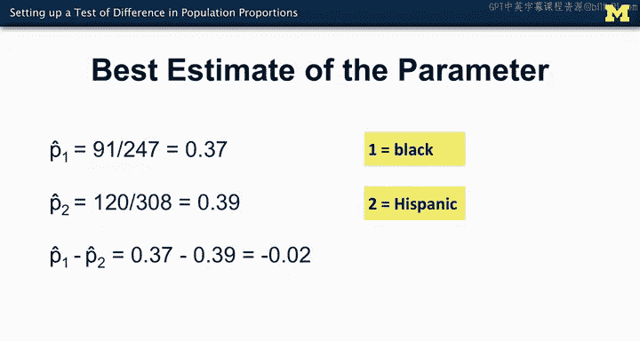

# 课程名称：密歇根大学《使用Python的统计学》- P52：双总体比例差异检验框架构建 📊


## 概述

在本节课中，我们将学习如何为两个总体比例之间的差异构建假设检验的框架。我们将使用一个关于儿童游泳课程的真实调查数据作为例子，逐步完成检验的设定工作。

## 检验背景与问题

上一节我们介绍了假设检验的基本概念。本节中，我们来看看如何将其应用于比较两个不同群体的比例。

CS Mot儿童医院进行了一项关于儿童健康与安全的全国性调查。本次调查关注水上安全，特别是游泳课程。

我们的研究问题是：报告其孩子曾上过游泳课程的黑人儿童父母的比例，与西班牙裔儿童父母的比例之间，是否存在显著差异？

## 定义总体与参数

首先，我们需要明确所研究的总体。

*   第一个总体：所有6至18岁黑人儿童的父母。
*   第二个总体：所有6至18岁西班牙裔儿童的父母。

我们感兴趣的参数是这两个总体比例之间的差异，即 **P1 - P2**。在本视频中，我们指定：
*   组1（P1）：黑人儿童的父母。
*   组2（P2）：西班牙裔儿童的父母。

我们将以10%的显著性水平，检验这两个总体比例是否存在显著差异。请注意，显著性水平必须在查看任何数据之前设定。

## 建立假设

接下来，我们建立原假设和备择假设。

原假设必须包含我们感兴趣的参数（P1 - P2），并且必须包含等号。对于比例差异检验，原假设值通常为0，即 **H0: P1 - P2 = 0**。

备择假设则反映我们想要验证的研究问题。它可以是“大于”、“小于”或“不等于”0。以下是备择假设的三种可能形式：

*   **Ha: P1 - P2 > 0** （检验组1比例是否显著高于组2）
*   **Ha: P1 - P2 < 0** （检验组1比例是否显著低于组2）
*   **Ha: P1 - P2 ≠ 0** （检验两组比例是否存在显著差异，不关心方向）

在本案例中，研究问题只关心是否存在差异，而不指定方向。因此，我们应选择“不等于”符号。完整的假设为：
*   **H0: P1 - P2 = 0**
*   **Ha: P1 - P2 ≠ 0**
*   显著性水平 **α = 0.10**

## 查看样本数据

现在，我们来看CS Mot儿童医院提供的调查结果数据。

*   样本1：调查了247名6至18岁黑人儿童的父母，其中91人报告其孩子曾上过游泳课程。
*   样本2：调查了308名6至18岁西班牙裔儿童的父母，其中120人报告其孩子曾上过游泳课程。

这些数据为我们计算样本比例差异提供了基础。

## 检验条件

在进行计算之前，我们需要验证两个重要条件是否满足。

第一个条件是样本独立性。我们需要确信调查机构收集的是两个独立的随机样本。这通常依赖于研究设计的描述，无法从现有数据中直接验证。

第二个条件是样本量足够大，以确保抽样分布近似正态。具体来说，我们需要计算一个**合并样本比例（p_hat_pool）**，并检查以下四项是否都至少为10：
*   n1 * p_hat_pool
*   n1 * (1 - p_hat_pool)
*   n2 * p_hat_pool
*   n2 * (1 - p_hat_pool)

首先，计算合并样本比例。公式为总“是”的回答数除以总受访人数。

```python
# 计算合并样本比例 p_hat_pool
total_yes = 91 + 120
total_n = 247 + 308
p_hat_pool = total_yes / total_n  # 结果为 0.38
```

计算得到合并比例约为0.38。接着，我们验证条件：

*   247 * 0.38 ≈ 94 > 10
*   247 * (1 - 0.38) ≈ 153 > 10
*   308 * 0.38 ≈ 117 > 10
*   308 * (1 - 0.38) ≈ 191 > 10

所有四项均大于10，因此正态性条件满足。如果此条件不满足，可以使用其他不依赖该假设的检验方法，这将在后续课程中讨论。

## 计算点估计值

我们的参数是总体比例差异 **P1 - P2**。其最佳点估计值是样本比例差异 **p_hat1 - p_hat2**。

首先，计算各自的样本比例：

```python
# 计算样本比例
p_hat1 = 91 / 247  # 黑人儿童父母组样本比例，约为 0.37
p_hat2 = 120 / 308 # 西班牙裔儿童父母组样本比例，约为 0.39
```

然后，计算点估计值（样本比例差异）：
```python
point_estimate = p_hat1 - p_hat2  # 约为 -0.02
```

计算结果显示，样本比例差异约为-0.02，意味着在本样本中，黑人儿童父母报告孩子上过游泳课程的比例略低于西班牙裔儿童父母的比例。

## 总结



本节课中，我们一起学习了为双总体比例差异构建假设检验框架的完整步骤。我们明确了研究问题与参数，建立了原假设和备择假设，查看了样本数据，并验证了进行检验所需的条件。最后，我们计算了参数的点估计值。

至此，检验的框架已搭建完毕。在下一节课中，我们将基于这个框架，进行具体的检验统计量计算、P值计算，并最终得出统计结论。