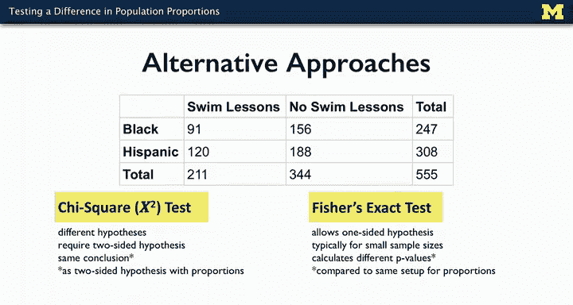

# 53：双总体比例差异检验 📊

在本节课中，我们将学习如何对两个总体的比例差异进行假设检验。我们将完成上一节视频中开始的假设检验，以判断黑人儿童和西班牙裔儿童的父母中，报告孩子上过游泳课的比例是否存在显著差异。

上一节我们介绍了如何建立假设。本节中我们来看看如何计算检验统计量、P值，并得出最终结论。

## 概述与回顾

我们的零假设是：两个总体的比例没有差异，即 `P1 - P2 = 0`。
我们的备择假设是：两个总体的比例存在差异，即 `P1 - P2 ≠ 0`。

我们将在显著性水平 `α = 0.1` 下进行检验，并将P值与这个α值进行比较。

根据样本数据，我们计算得到：
*   黑人儿童样本比例 `P_hat1 = 0.37`
*   西班牙裔儿童样本比例 `P_hat2 = 0.39`
*   两个样本比例之差为 `-0.02`
*   合并样本比例 `P_hat = 0.38`

## 计算检验统计量

检验统计量的一般公式为：
`Z = (最佳估计值 - 假设估计值) / 估计值的标准误`

在我们的案例中：
*   最佳估计值是 `P_hat1 - P_hat2`。
*   根据零假设，假设估计值 `P1 - P2 = 0`。
*   估计值的标准误公式为：
    `SE = sqrt( P_hat * (1 - P_hat) * (1/n1 + 1/n2) )`

以下是计算过程：
我们将已知数值代入公式。样本比例之差为 `-0.02`。将 `P_hat`、`n1` 和 `n2` 的值代入标准误公式，计算得到标准误约为 `0.041`。

因此，检验统计量 `Z = (-0.02) / 0.041 ≈ -0.48`。

这个检验统计量的含义是：我们观察到的样本比例差异，位于假设的总体比例相等（差值为0）的均值下方约 `0.48` 个估计标准误处。

## 计算P值并做出决策

由于我们得到的是Z统计量，它服从标准正态分布。我们的备择假设是双侧的（`P1 - P2 ≠ 0`），因此我们需要计算Z统计量绝对值两侧尾部的面积。

以下是P值的计算与比较：
在标准正态分布曲线上，`Z = -0.48` 对应的双侧P值约为 `0.63`。这个值可以通过查表、公式卡或计算机软件得到。

现在，我们将P值 `0.63` 与显著性水平 `α = 0.1` 进行比较。由于 `0.63 > 0.1`，我们**无法拒绝零假设**。这并不意味着我们接受零假设，只是表明我们没有足够的证据反对它。

因此，我们得出结论：没有显著证据表明黑人儿童和西班牙裔儿童的父母中，报告孩子上过游泳课的比例存在差异。这两个群体的比例看起来大致相当。

## 其他检验方法

除了我们使用的双总体比例差异Z检验，还有两种替代方法，适用于不同的情况或数据呈现形式。

以下是两种主要的替代检验方法：

1.  **卡方检验**
    *   当样本数据以双向列联表形式呈现时（例如，行是种族，列是“是否上过游泳课”），可以使用卡方检验。
    *   它的假设表述略有不同，通常检验两个分类变量是否独立，或两个总体的分布是否存在差异。
    *   **重要限制**：卡方检验本质上只适用于双侧备择假设。如果备择假设是单侧的（大于或小于），则不能直接使用卡方检验。在双侧假设下，其结论应与Z检验一致。

2.  **费希尔精确检验**
    *   当样本量较小时，Z检验或卡方检验所依赖的正态近似可能不准确，此时可以使用费希尔精确检验。
    *   它可以直接计算精确的P值，而不依赖于大样本的分布假设。
    *   它既可以用于双侧检验，也可以用于单侧检验。
    *   对于大样本，计算可能非常耗时，但结论通常与Z检验非常接近。

## 总结

本节课中我们一起学习了如何执行双总体比例差异的假设检验。通过一个具体案例，我们计算了检验统计量和P值，并基于P值与显著性水平的比较做出了“无法拒绝零假设”的决策，得出结论认为黑人儿童与西班牙裔儿童的上游泳课比例没有显著差异。

我们还简要介绍了卡方检验和费希尔精确检验这两种替代方法，它们分别适用于数据以列联表形式呈现或样本量较小的情况。掌握多种检验方法有助于你根据不同的数据和假设条件选择最合适的分析工具。