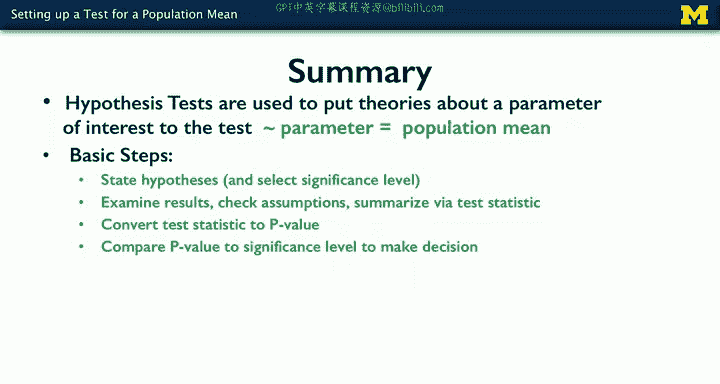

# 55：基于置信度的单总体均值检验 📊


在本节课中，我们将学习如何对总体参数（特别是总体均值）进行假设检验。我们将通过一个具体的例子，学习从提出假设、检查数据、计算检验统计量到得出结论的完整流程。

---

## 概述

我们将使用一个关于“侧手翻距离”的研究数据作为例子。研究问题是：成年人的平均侧手翻距离是否大于80英寸？我们将通过假设检验来回答这个问题，并学习如何解读结果。

---

## 第一步：建立假设与显著性水平

上一节我们介绍了假设检验的基本概念，本节中我们来看看如何为我们的研究问题建立具体的假设。

首先，我们需要明确两个相互竞争的理论：**零假设**和**备择假设**。

*   **零假设 (H₀)**：总体均值等于某个特定值。在本例中，即成年人的平均侧手翻距离等于80英寸。
    *   **公式**：`H₀: μ = 80`
*   **备择假设 (Hₐ)**：研究者的猜想。在本例中，研究者认为平均距离大于80英寸。
    *   **公式**：`Hₐ: μ > 80`

接下来，我们需要设定**显著性水平 (α)**，它决定了我们需要多少证据才能拒绝零假设。通常我们设定为5%。

*   **公式**：`α = 0.05`
*   这意味着，如果零假设为真，我们观察到的结果（或更极端的结果）出现的概率小于或等于5%时，我们才有足够证据拒绝零假设。

---

## 第二步：检查数据与假设

在开始计算之前，我们必须先审视我们的数据，并检查进行检验所需的前提条件是否满足。

我们有一个包含25名成年人侧手翻距离的样本。以下是数据的数值摘要：

*   样本均值 `x̄ = 82.48` 英寸
*   样本标准差 `s` （用于估计总体标准差σ）
*   样本量 `n = 25`

虽然样本均值82.48大于80，但我们需要判断这个差异是否显著，还是仅仅是抽样波动造成的。

进行单样本t检验有两个主要前提条件：

1.  **随机性**：样本可以视为来自总体的一个简单随机样本。
2.  **正态性**：总体数据分布近似正态（钟形曲线）。如果样本量足够大（通常n≥30），根据中心极限定理，即使总体不呈正态分布，样本均值的分布也会近似正态。我们的样本量为25，属于中等偏小，因此需要检查数据分布。

通过绘制数据的直方图和Q-Q图，我们发现数据分布略有偏斜，但考虑到样本量，我们可以认为中心极限定理在一定程度上适用，允许我们继续进行t检验。

---

## 第三步：计算检验统计量与P值

现在，我们将数据总结为一个**检验统计量**，它衡量了我们的样本数据与零假设的兼容程度。

我们使用**t统计量**，其计算公式如下：

```
t = (x̄ - μ₀) / (s / √n)
```

其中：
*   `x̄` 是样本均值（82.48）
*   `μ₀` 是零假设中的总体均值（80）
*   `s` 是样本标准差
*   `n` 是样本量（25）
*   `s / √n` 称为**估计标准误**，是衡量样本均值波动性的“尺子”。

将我们的数据代入公式，计算出的t统计量约为 **0.82**。

这个值意味着：我们的样本均值比零假设值（80英寸）高出0.82个估计标准误。这个差距并不大，甚至不到1个标准误。

为了判断这个t值是否“不寻常”，我们将其转换为**P值**。P值表示：**在零假设为真的前提下，得到当前观测结果（或更极端结果）的概率**。

由于我们的备择假设是“大于80”（右尾检验），因此P值对应的是t分布中大于等于0.82的那部分面积。

我们的t统计量服从自由度为 `n-1 = 24` 的t分布。查表或使用软件计算后，得到P值约为 **0.21**。

---

## 第四步：做出决策与结论

现在，我们将P值与预先设定的显著性水平α进行比较，并做出决策。

决策规则非常简单：
*   如果 **P值 ≤ α (0.05)**，则拒绝零假设。
*   如果 **P值 > α (0.05)**，则未能拒绝零假设。

在我们的例子中，P值（0.21）远大于α（0.05）。因此，我们**未能拒绝零假设**。

结论可以表述为：基于当前样本数据（平均距离82.48英寸），我们没有足够的证据支持“成年人的平均侧手翻距离大于80英寸”这一理论。

---

## 第五步：与置信区间关联

假设检验的结果可以通过**置信区间**来验证。一个90%的置信区间（因为我们的检验是单侧5%，相当于双侧10%）给出了总体均值可能取值的合理范围。

计算得到的90%置信区间大约为 **(77.2， 87.7)** 英寸。

请注意：
*   零假设值 **80英寸落在这个区间内**。这意味着80是一个合理的总体均值估计值。
*   置信区间并没有完全位于80以上，这再次支持了我们“未能拒绝μ=80”的结论。

---

## 第六步：关于假设的稳健性与非参数方法

我们之前注意到数据分布略有偏斜，这可能会让人对t检验的正态性假设产生疑虑。为了检验我们结论的**稳健性**，我们可以使用不依赖于正态分布假设的**非参数检验**。

一种常用的替代方法是**Wilcoxon符号秩检验**，它检验的是总体中位数（而非均值）是否等于某个值。

对该数据执行Wilcoxon检验，得到的P值同样远大于0.05，结论与t检验一致：未能拒绝零假设。这表明，即使正态假设不完全满足，我们基于t检验得出的结论仍然是可靠的。



---

## 总结

本节课中，我们一起学习了如何进行关于单总体均值的假设检验。我们回顾了整个流程：

1.  **建立假设**：明确零假设（H₀）和备择假设（Hₐ），并设定显著性水平（α）。
2.  **检查数据**：审视样本数据，验证随机性和正态性（或样本量足够大）等前提条件。
3.  **计算统计量**：计算t检验统计量，衡量数据与零假设的差距。
4.  **求解P值**：根据t分布求出P值，它代表了在H₀为真时得到当前结果的概率。
5.  **做出决策**：比较P值与α。若P值小，则拒绝H₀；若P值大，则未能拒绝H₀。
6.  **得出结论**：用通俗的语言，结合研究背景，解释统计结论的含义。
7.  **关联与验证**：使用置信区间来辅助理解和验证假设检验的结果。
8.  **考虑假设**：了解检验的前提条件，并在必要时考虑使用更稳健的非参数方法。

核心在于理解，假设检验是一种基于概率的反证法：我们假设零假设成立，然后看数据是否出现了小概率事件。如果没有，我们就维持原假设；如果出现了，我们就有理由怀疑原假设不正确。