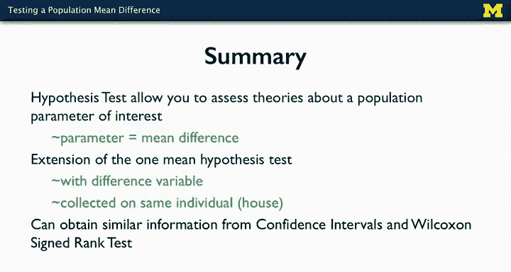

# 课程 22：总体均值差异检验 📊

在本节课中，我们将学习如何检验总体均值差异，即分析配对数据。我们将通过一个厨房橱柜报价的例子，来理解整个假设检验的流程、计算和结论。

---

## 概述

我们将研究20个家庭在厨房改造时，从两个供应商（A和B）获得的橱柜报价。我们的目标是判断这两个供应商的报价是否存在平均差异。由于每个家庭都提供了两个报价，数据是配对的。我们将通过检验**差异变量**（供应商A报价 - 供应商B报价）的均值是否为零，来回答这个问题。

---

## 研究问题与假设

我们的研究问题是：两个供应商的橱柜报价是否存在平均差异？这等价于检验差异的总体均值 `μ_D` 是否为零。

我们定义差异为：`D = 供应商A报价 - 供应商B报价`。

*   **零假设 (H₀):** `μ_D = 0`。两个供应商的平均报价没有差异。
*   **备择假设 (H₁):** `μ_D ≠ 0`。两个供应商的平均报价存在差异。
*   **显著性水平 (α):** 0.05。

由于我们没有预先设定哪个供应商更贵，因此使用双侧检验。

---

## 数据探索与假设检查

在开始检验之前，我们需要检查数据并验证假设。

### 数据配对性

数据是配对的，因为每个家庭（同一个体）都提供了两个测量值（供应商A和B的报价）。因此，我们的分析单位是每个家庭的报价差异。

### 检验假设

进行检验前，需要满足两个关键假设：

1.  **随机样本：** 我们假设这20个家庭是随机抽取的，因此其报价差异也构成一个随机样本。
2.  **正态性：** 我们假设**差异的总体**服从正态分布。当样本量较大（通常 n ≥ 25）时，此假设可以放宽。本例中 n=20，接近25，我们可以通过Q-Q图来评估。

观察Q-Q图，数据点大致围绕一条直线分布，没有严重偏离。因此，我们有理由认为差异总体近似正态分布，可以进行后续的t检验。

---

## 描述性统计

让我们先查看差异数据的分布和摘要统计量。

以下是差异数据的直方图和关键统计量摘要：

*   **样本量 (n):** 20
*   **均值 (x̄_D):** $17.30
*   **标准差 (s_D):** $28.50
*   **中位数:** $13.50
*   **最小值:** -$30 (供应商A比B便宜$30)
*   **最大值:** $90 (供应商A比B贵$90)

直方图显示数据大致呈钟形分布。均值和中位数均为正数，初步提示供应商A的平均报价可能更高。

---

## 执行假设检验

现在，我们使用样本数据来检验零假设。

### 计算检验统计量

我们使用t检验统计量，其公式为：
`t = (x̄_D - μ₀) / (s_D / √n)`

其中，`μ₀` 是零假设中的值，此处为0。

代入我们的数值：
`t = (17.30 - 0) / (28.50 / √20) ≈ 2.72`

这个结果意味着，我们观察到的样本均值差异（$17.30）比零假设值（0）高出约2.72个估计标准误。

### 计算P值并做出决策

我们的备择假设是 `μ_D ≠ 0`，因此需要计算双侧P值。t统计量 `2.72` 服从自由度为 `n-1 = 19` 的t分布。

我们需要找出t分布中，绝对值大于等于 `|2.72|` 的总面积（即 `t ≥ 2.72` 和 `t ≤ -2.72` 的区域）。

通过计算或查表，得到 **P值 ≈ 0.014**。

**决策：** 将P值 (0.014) 与显著性水平 α (0.05) 比较。因为 `0.014 < 0.05`，我们**拒绝零假设**。

### 结论

有足够的统计证据表明，供应商A和B的橱柜报价存在显著的平均差异（在α=0.05水平下）。基于样本均值 `$17.30`，可以推断供应商A的平均报价显著高于供应商B。

---

## 置信区间分析

为了更深入地了解差异的大小和方向，我们可以计算总体均值差异的95%置信区间。

置信区间的公式为：
`x̄_D ± t* × (s_D / √n)`

其中，`t*` 是自由度为19，对应95%置信水平的临界值，约为 `2.093`。

代入计算：
`17.30 ± 2.093 × (28.50 / √20) ≈ 17.30 ± 13.33`

因此，95%置信区间为 **($3.97， $30.63)**。

**解读：** 我们有95%的信心认为，总体均值差异（供应商A - 供应商B）落在这个区间内。因为整个区间都是正数，且不包含0，这进一步支持了我们的假设检验结论：供应商A确实更贵，且差异具有统计显著性。

---

## 当正态假设不满足时

如果差异总体的正态性假设明显不成立（例如样本量很小且分布严重偏斜），我们可以使用一种非参数检验方法：**威尔科克森符号秩检验**。

该检验不检验均值，而是检验**中位数**差异是否为零。

*   **零假设 (H₀):** 差异的中位数等于0。
*   **备择假设 (H₁):** 差异的中位数不等于0。

对本例数据执行该检验，得到的P值约为 **0.02**。

**决策与结论：** 因为 `0.02 < 0.05`，我们同样拒绝零假设。结论是：供应商A和B的橱柜报价存在显著的中位数差异。这与我们之前t检验的结论一致，增强了我们研究发现的稳健性。

---

## 总结

本节课我们一起学习了如何对配对数据进行总体均值差异的检验。

1.  **核心概念：** 对于配对数据（如对同一个体的前后测量、配对样本），我们通过计算**差异变量**，将问题转化为对单一均值（`μ_D`）的检验。
2.  **检验流程：** 我们明确了研究问题，设定了零假设和备择假设，检查了数据（随机性、正态性），计算了t统计量和P值，并基于P值做出了统计决策。
3.  **辅助工具：** 置信区间帮助我们估计差异的大小和方向。当正态假设不满足时，威尔科克森符号秩检验提供了一个可靠的替代方案。
4.  **最终结论：** 在我们的橱柜报价案例中，无论是t检验还是非参数检验，都提供了证据表明两个供应商的报价存在显著差异，且供应商A的平均报价更高。

通过这个例子，你掌握了分析配对数据、检验均值差异的完整方法论。