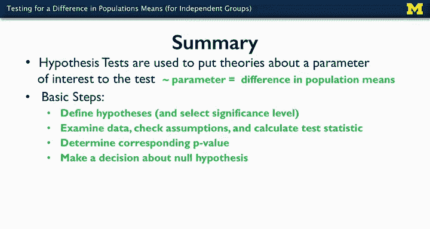

# 课程23：独立组别总体均值差异检验 🧪

在本节课中，我们将学习如何对两个独立组别的总体均值差异进行假设检验。我们已经学习过对单个总体均值和单个总体比例进行检验的方法，现在我们将比较两个独立的组别，并判断它们之间是否存在显著差异。

---

## 概述

我们将通过一个具体的研究问题来学习整个流程：针对生活在美国的18至29岁墨西哥裔成年人，男性的平均身体质量指数是否显著高于女性？我们将定义假设、检查数据与假设条件、计算检验统计量、确定P值，并最终做出统计决策。

---

## 第一步：定义假设

首先，我们需要明确零假设和备择假设。

*   **零假设 (H₀)**：对于生活在美国的18至29岁墨西哥裔成年人，男性和女性群体的平均BMI没有差异。
*   **备择假设 (H₁)**：男性和女性群体的平均BMI存在显著差异。

我们可以用公式来表示这些假设。令 μ₁ 代表男性群体的总体平均BMI，μ₂ 代表女性群体的总体平均BMI。

*   **H₀**: μ₁ = μ₂ 或 μ₁ - μ₂ = 0
*   **H₁**: μ₁ ≠ μ₂ 或 μ₁ - μ₂ ≠ 0

在本检验中，我们将使用 **5%** 的显著性水平（α = 0.05）。

---

## 第二步：检查数据与假设条件

在计算检验统计量之前，我们必须确保数据满足进行两样本t检验的前提条件。

以下是需要检查的关键假设：

1.  **简单随机样本**：两组数据都应来自简单随机抽样。在本例中，我们假设此条件成立。
2.  **样本独立性**：两个样本必须相互独立。由于我们仅根据性别对数据进行分组，没有理由认为它们是相关的。
3.  **正态性**：两个群体的响应数据应近似服从正态分布。

为了评估正态性，我们可以观察数据的直方图和Q-Q图。在本例数据中，女性组的Q-Q图显示与正态分布存在一定偏差。然而，由于两个组的样本量都很大（均超过200），根据中心极限定理，我们可以放宽对正态性的严格要求。对于大样本量的两均值假设检验，结果具有相当的稳健性。

因此，我们可以继续进行检验。

---

## 第三步：计算检验统计量

检验统计量用于衡量样本统计量（此处为样本均值差）与零假设设定的总体参数（此处假设差异为0）之间的距离，这个距离以估计标准误为单位。

计算公式如下：

`t = (样本统计量 - 假设参数值) / 估计标准误`

对于两个独立组别的均值差异，估计标准误的计算取决于我们是否假设两个总体方差相等，这引出了两种方法：

*   **合并方差法**：当假设两个总体方差相等时使用。
*   **非合并方差法**：当不假设两个总体方差相等时使用。

我们需要根据数据决定使用哪种方法。观察两组数据的标准差（非常接近）和箱线图（中位数50%数据的分布高度相似），可以认为两个总体的方差近似相等。因此，我们选择**合并方差法**。

合并方差法的检验统计量计算公式为：

`t = (x̄₁ - x̄₂) / √[ s_p² * (1/n₁ + 1/n₂) ]`

其中，`s_p²` 是合并方差，计算公式为：
`s_p² = [ (n₁ - 1)s₁² + (n₂ - 1)s₂² ] / (n₁ + n₂ - 2)`

将本例数据（男性与女性的样本均值、标准差和样本量）代入公式计算，得到检验统计量 **t ≈ 1.30**。

这个值意味着，观察到的样本均值差异（0.74 kg/m²）仅比假设的零差异（0 kg/m²）高出 **1.30个估计标准误**。

---

## 第四步：确定P值并做出决策

P值是在零假设为真的前提下，观察到当前检验统计量（t=1.30）或更极端情况的概率。

由于我们的备择假设是“不等于”（双尾检验），我们需要计算t分布中大于1.30和小于-1.30两侧尾部的总面积。此t分布的自由度为 `n₁ + n₂ - 2 = 495`。

计算得到的 **P值 ≈ 0.1942**。

**解读**：如果男性和女性群体的总体平均BMI真的没有差异（即零假设为真），那么观察到样本均值差为0.74或更极端情况的概率约为19.42%。这是一个相当高的概率。

**决策**：由于P值 (0.1942) 大于我们设定的显著性水平 (α = 0.05)，我们没有足够的证据拒绝零假设。

**结论**：基于现有样本数据，我们不能支持“生活在美国的18至29岁墨西哥裔成年人中，男性和女性的平均BMI存在显著差异”这一结论。

---

## 与置信区间的联系

回顾之前为同一数据构建95%置信区间的课程，我们得到的区间是 **(-0.385， 1.865)**。零假设值 **0** 包含在这个区间内。

置信区间给出了总体参数真实差异的合理范围。因为0在这个范围内，它是一个合理的可能值。这再次与我们的假设检验结果一致：没有足够证据表明差异不为0。

---

## 总结

本节课我们一起学习了如何对两个独立组别的总体均值差异进行假设检验。

*   **核心步骤**：
    1.  定义零假设和备择假设。
    2.  检查数据并验证假设条件（随机性、独立性、正态性或大样本）。
    3.  根据方差是否相等的判断，选择合并或非合并方法计算检验统计量。
    4.  根据检验统计量和自由度确定P值。
    5.  比较P值与显著性水平，做出拒绝或无法拒绝零假设的决策，并给出最终结论。

*   **关键概念**：
    *   检验统计量 `t` 衡量了样本证据与零假设的距离。
    *   **P值** 是零假设为真时，得到当前或更极端结果的概率。
    *   决策基于P值与显著性水平α的比较：若 P ≤ α，拒绝H₀；若 P > α，则无法拒绝H₀。
    *   假设检验的结果应与相应参数的置信区间结论一致。

掌握这些步骤和概念，你就能对两个独立群体的均值差异进行科学的统计推断。