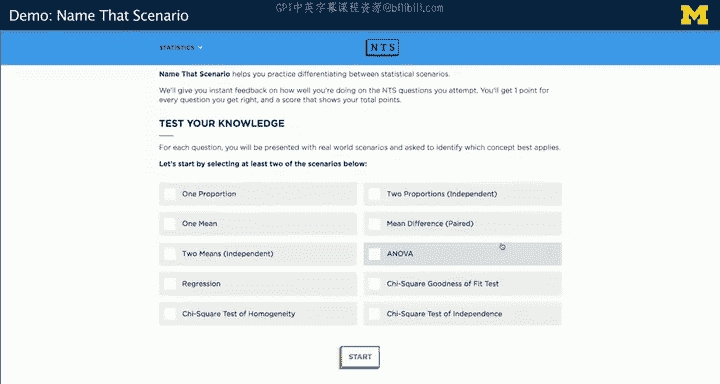

# 课程名称：密歇根大学《使用Python的统计学》 - P58：情景识别演示 🎯

## 概述

在本节课中，我们将学习如何使用一个名为“Name that scenario”的在线工具。这个工具旨在帮助你练习区分不同的统计场景，例如单比例检验与双比例检验。我们将通过一个演示来了解其基本功能和使用流程。

## 工具介绍与访问

“Name that scenario”是一个开放访问的网站，你可以通过课程补充材料页面找到它。

网站首页会要求你输入电子邮件地址和密码来创建账户。

接着，你需要为你的账户设置一个名称。在本次演示中，我们将使用我的账户。

## 选择练习场景

进入后，点击“Statistics”选项，这是唯一可用的类别。

你会看到一系列不同的统计场景。你需要至少选择两个场景进行练习，当然也可以选择更多。本次演示，我将选择“单比例”和“双比例”这两个场景。

## 练习流程说明

以下是练习的基本流程：

*   每一轮练习包含10个问题。
*   系统会全程记录你的总得分。

让我们一起来完成前几个问题。

## 示例问题解析

**问题一：**
一个新的SEATS布局正在被考虑。一个调查被发布在SEATS网页上，询问用户是否想要新布局。如果至少40%的受访者想要新布局，开发团队将实施更改。这是单比例还是双比例问题？

我认为这是单比例问题，因为我们只考虑一件事（想要新布局的用户比例）。很好，答对了。

你可以看到，无论回答正确与否，页面底部都会给出解释，以便你核对推理过程。

**问题二：**
一所大学有两个校区。他们想知道一个校区的学生是否比另一个校区的学生更可能参与学生组织。他们从每个校区随机抽取了本科生样本，并询问他们是否参与了学生组织。

因为这个问题涉及两个不同的校区，我认为这是双比例问题。很好，又答对了。

## 练习机制与总结

我不会让你陪我做完所有问题，因为你需要自己练习。但我们会快速跳转到结尾，以便向你展示完成后会得到的总结统计信息。

每一轮的10个问题都是从题库中无放回地抽取的，因此在同一轮中你不会遇到重复的问题。

现在我们已经完成了一轮练习，可以看到一个会话总结。在我的单比例问题中，4题答对了2题。在双比例问题中，6题答对了5题。总计，我在这一轮10题中答对了7题，获得了7分。如果你持续使用这个网站，它会累计记录你获得的所有分数。

## 总结

本节课中，我们一起学习了“Name that scenario”工具的使用方法。我们了解了如何访问网站、选择统计场景进行练习、回答具体问题以及查看练习后的总结反馈。现在，你已经准备好可以自己尝试使用这个工具来提升区分统计场景的能力了。