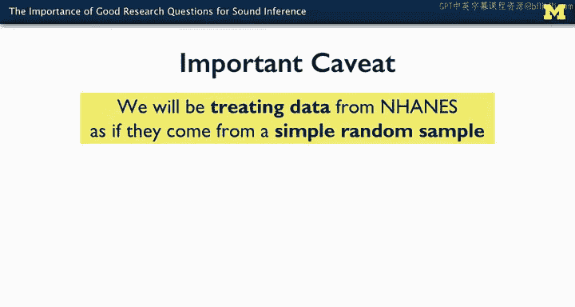

# 60：优质研究问题对可靠推断的重要性 🔍


在本节课中，我们将探讨如何定义优质的研究问题，以及这对进行可靠的统计推断为何至关重要。我们将通过具体示例，学习如何构建清晰的研究问题，并了解如何根据问题选择合适的统计方法。

---

上一节我们强调了研究问题的重要性，本节中我们来看看如何构建一个优质的研究问题。一个定义良好的研究问题是所有高质量统计分析的基础。如果缺乏清晰的问题，即使拥有数据并运行了分析，得出的推断也可能偏离目标，导致错误的见解和决策。

以下是构建优质研究问题时需要考虑的四个关键方面：

1.  **明确目标总体**：清晰、简洁地陈述研究关注的目标总体是谁、是什么、在何时何地。
2.  **区分描述性与分析性问题**：描述性问题旨在估计一个参数（如均值），而分析性问题旨在量化变量之间的关系。
3.  **评估问题的新颖性与知识增量**：明确该问题是否已被研究过，以及新的研究将为现有知识体系增添什么新内容。
4.  **确保变量的可测性与测量恰当性**：确认感兴趣的变量是否易于获取或测量，以及所使用的测量工具是否能准确捕捉我们想要衡量的概念。

---

上一节我们列出了优质研究问题的标准，本节中我们通过一个具体例子来看看它们的应用。让我们比较一个“差”的问题和一个“好”的问题。

**一个差的研究问题示例**：
“学业表现与暑期实习成功之间有什么关系？”

这个问题表面上看似是分析性问题，但根据我们刚讨论的标准来剖析，它存在严重缺陷：
*   **目标总体**：未明确。
*   **问题类型**：分析性（这是其唯一明确的方面）。
*   **知识增量**：未说明。
*   **变量测量**：“学业表现”和“实习成功”的定义与测量方式完全模糊。

这个问题只满足了四个关键属性中的一个，因此无法指导有效的统计分析。

**一个好的研究问题示例**：
“对于2015-2016年美国18岁及以上的西班牙裔成年人，男性和女性在平均收缩压上是否存在差异？”

让我们用四个标准来评估这个问题：
*   **目标总体**：明确为“2015-2016年美国18岁及以上的西班牙裔成年人”。
*   **问题类型**：清晰的描述性比较（比较两组的均值）。
*   **知识增量**：虽未直接说明，但通过限定年份和人群，暗示了可能产生针对特定时期的新知识。
*   **变量测量**：“性别”（男/女）和“收缩压”都是定义清晰、可测量的变量。

额外的细节使研究目标非常明确，这是一个我们可以在此基础上选择合适统计程序的优质问题。

---

上一节我们定义了一个优质的研究问题，本节中我们来看看如何根据它来选择统计方法。优质的问题能让我们轻松地选择合适的推断程序。

假设我们拥有从目标总体（2015-2016年美国18岁及以上西班牙裔成年人）中抽取的一个样本数据（例如NHANES 2015-2016数据）。我们的研究问题是比较男性和女性在连续变量“收缩压”上的平均值。

给定这些信息，我们很可能选择的推断程序是**独立样本T检验**。这种检验允许我们在两个独立组之间比较一个连续变量的均值。

**代码示例：独立样本T检验的基本思路**
```python
# 假设 df 是包含‘gender’和‘systolic_bp’列的数据框
# 将数据分为男性组和女性组
male_bp = df[df[‘gender‘] == ‘Male‘][‘systolic_bp‘]
female_bp = df[df[‘gender‘] == ‘Female‘][‘systolic_bp‘]

# 使用统计库（如scipy）执行独立样本t检验
from scipy import stats
t_statistic, p_value = stats.ttest_ind(male_bp, female_bp, nan_policy=‘omit‘)
```



**一个重要说明**：在本课程介绍统计程序应用基础时，为简化起见，我们将假设NHANES数据来自一个简单随机样本。然而，在实际中，像NHANES这样的概率样本具有复杂的抽样设计（如分层、聚类），在推断程序中通常需要考虑这些特征。我们将在后续课程中重新讨论这些例子，并纳入复杂抽样设计特征进行分析。

---

本节课中我们一起学习了定义优质研究问题的重要性及其核心要素。我们了解到，一个清晰、具体的研究问题需要明确目标总体、区分问题类型、考虑知识增量并确保变量可测。通过对比“差”与“好”的问题示例，我们看到了具体细节如何提升问题的质量。最后，我们了解到优质的研究问题能直接引导我们选择合适的统计方法（如独立样本T检验），并为获得可靠的统计推断奠定坚实基础。记住，在将任何统计程序应用于数据之前，首先确保你正在回答一个精心构建的研究问题。