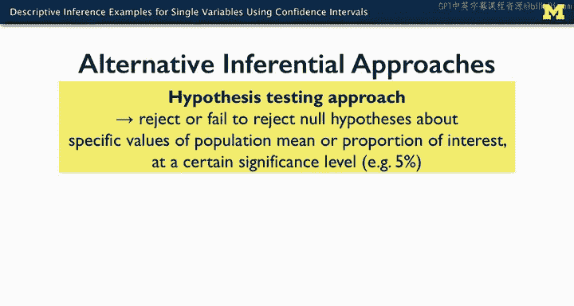

# 课程名称：密歇根大学《使用Python的统计学》第27讲：单变量描述性推断——置信区间实例 📊

在本节课中，我们将学习如何为单变量构建置信区间，以进行描述性推断。我们将通过两个具体实例，分别演示如何为总体比例和总体均值计算95%置信区间。

---

## 概述

上一节我们介绍了描述性推断的基本概念。本节中，我们来看看如何应用这些概念，通过置信区间对总体参数进行推断。我们将遵循清晰的步骤：首先计算点估计，然后计算标准误，最后构建置信区间。

---

## 实例一：为比例构建置信区间

我们的研究问题是：在2015-2016年，美国18岁及以上非西班牙裔非洲裔美国人中，收缩压大于130毫米汞柱的比例是多少？这个比例可以量化高血压的患病情况。

我们将演示的推断方法是：计算该总体比例的95%置信区间估计。请记住，置信区间是针对总体参数（即我们试图估计的量），而不是针对估计值本身。

以下是构建置信区间的三个步骤：

**第一步：估计总体比例**
我们需要计算用于构建置信区间的点估计。在NHANES数据中，拥有有效收缩压数据的非西班牙裔非洲裔受访者样本量为1135人。其中，有465人的收缩压大于等于130毫米汞柱。
因此，样本比例 `p̂` 的计算公式为：
`p̂ = 465 / 1135 ≈ 0.4097`
我们的点估计是，在2015-2016年，所有此类非洲裔成年人中约有40.97%的人收缩压大于130毫米汞柱。

**第二步：计算点估计的标准误**
标准误衡量了抽样分布的变异性。我们使用以下公式计算比例的标准误 `SE(p̂)`：
`SE(p̂) = sqrt( p̂ * (1 - p̂) / n )`
代入我们的值：
`SE(p̂) = sqrt( 0.4097 * (1 - 0.4097) / 1135 ) ≈ 0.0146`
这个值0.0146是我们对抽样分布标准差的估计。

**第三步：构建置信区间**
对于大样本的95%置信区间，我们使用乘数1.96。置信区间的下限和上限计算公式为：
`下限 = p̂ - 1.96 * SE(p̂)`
`上限 = p̂ + 1.96 * SE(p̂)`
代入计算：
`下限 = 0.4097 - 1.96 * 0.0146 ≈ 0.3811`
`上限 = 0.4097 + 1.96 * 0.0146 ≈ 0.4383`
因此，总体比例的95%置信区间为 (0.3811, 0.4383)。

**关于置信区间的说明**
“95%置信”的含义是：如果我们用相同的方法（点估计±边际误差）从同一总体中反复抽取样本并构建区间，那么有95%的区间会包含真实的总体比例。

**推断示例**
如果假设的总体比例为0.35，由于该值不在我们的置信区间(0.3811, 0.4383)内，我们可以认为0.35不是一个合理的值。这提供了证据表明，非洲裔成年人中收缩压大于130的比例实际上高于0.35。

---

## 实例二：为均值构建置信区间

在了解了比例的推断后，现在我们来看如何为均值构建置信区间。

我们的新研究问题是：在2015-2016年，美国18岁及以上非西班牙裔非洲裔美国人收缩压的均值是多少？我们将同样提供一个95%的置信区间估计。

以下是构建均值置信区间的步骤：

**第一步：估计总体均值**
样本量同样为1135人。我们计算样本中所有收缩压测量值的均值。
样本均值 `x̄` 的计算结果为128.252毫米汞柱。
因此，我们对总体均值的点估计是128.252毫米汞柱。

**第二步：计算点估计的标准误**
首先，我们计算样本中1135个血压测量值的标准差 `s`，结果为19.958。这是原始数据的标准差。
然后，我们使用以下公式计算均值 `x̄` 的标准误 `SE(x̄)`：
`SE(x̄) = s / sqrt(n)`
代入计算：
`SE(x̄) = 19.958 / sqrt(1135) ≈ 0.592 毫米汞柱`
这个0.592就是我们估计的抽样分布的标准差。

**第三步：构建置信区间**
再次使用乘数1.96来构建95%置信区间。计算公式为：
`下限 = x̄ - 1.96 * SE(x̄)`
`上限 = x̄ + 1.96 * SE(x̄)`
代入计算：
`下限 = 128.252 - 1.96 * 0.592 ≈ 127.091`
`上限 = 128.252 + 1.96 * 0.592 ≈ 129.413`
因此，总体均值的95%置信区间为 (127.091, 129.413)。

**推断示例**
如果假设的总体均值为128毫米汞柱，由于128这个值落在我们的置信区间(127.091, 129.413)之内，我们认为128是一个合理的值，考虑到抽样变异性。

---

## 总结

本节课中我们一起学习了如何为单变量（比例和均值）构建置信区间。置信区间的优势在于，它能在给定的置信水平下，为我们感兴趣的描述性统计量（如总体均值或比例）提供一个合理的取值范围，而不仅仅是接受或拒绝某个特定的假设值。在后续课程中，我们将探讨另一种推断方法——假设检验。