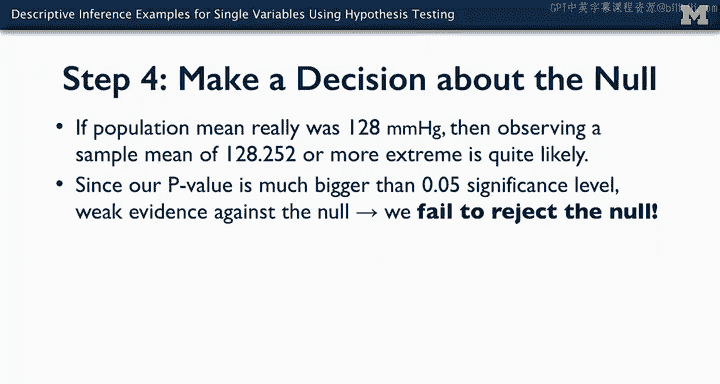

# 课程28：单变量描述性推断：假设检验实例 📊

在本节课中，我们将学习如何使用假设检验方法，基于单个变量的描述性统计量（如比例和均值）对总体参数进行推断。我们将通过两个具体实例——检验总体比例和检验总体均值——来详细讲解假设检验的四个标准步骤。

---

## 概述

上一节我们介绍了使用**置信区间**对总体参数进行描述性推断。本节中，我们来看看如何使用**假设检验**来完成类似的任务。我们将通过两个研究问题来演示：一个是关于总体比例的单样本检验，另一个是关于总体均值的单样本检验。

---

## 实例一：单样本比例检验

我们的第一个研究问题是：在2015-2016年，美国18岁及以上非西班牙裔非洲裔美国人中，收缩压大于130 mmHg的比例是否为33%（即三分之一）？或者说，总体比例是否与三分之一不同？

我们的推断方法是：执行一个**双尾**的单样本假设检验，以决定是拒绝还是无法拒绝“总体比例等于0.33”这个零假设。

### 步骤一：设定假设与显著性水平

首先，我们必须明确定义零假设和备择假设。
*   **零假设 (H₀)**：总体比例 **P = 0.33**。
*   **备择假设 (H₁)**：总体比例 **P ≠ 0.33**（即可能大于或小于0.33）。

我们还需要设定显著性水平（即第一类错误率）。我们将其设定为 **α = 0.05**。这意味着，如果零假设实际上为真，我们错误地拒绝它的概率是5%。

### 步骤二：计算检验统计量

假设我们有一个简单的随机样本。根据上节课的数据，样本比例的点估计值为 **p̂ = 465 / 1135 ≈ 0.4097**。

为了检验我们的零假设，我们构造一个Z统计量。其公式如下：

`Z = (p̂ - P₀) / √[P₀(1 - P₀) / n]`

其中，`P₀` 是零假设中的比例值（0.33），`n` 是样本量。请注意，我们在计算标准误时使用的是零假设下的值（0.33）。

将数值代入公式，我们得到 **Z ≈ 5.71**。这意味着，我们的点估计值距离零假设值（0.33）超过了5个标准误，这是一个相当大的距离。

### 步骤三：确定P值

P值是在零假设为真的前提下，观察到当前检验统计量（Z=5.71）或更极端情况的概率。

由于我们的备择假设是双尾的（P ≠ 0.33），我们需要计算Z统计量大于5.71或小于-5.71的概率。在标准正态分布下，这个概率**几乎为0**。

### 步骤四：做出决策

由于计算出的P值（≈0）远小于我们预先设定的显著性水平（α=0.05），我们拥有足够的证据反对零假设。

**因此，我们拒绝零假设。** 基于0.4097的样本比例，我们支持总体比例不等于0.33的结论，并且实际总体比例很可能远大于0.33。

---

## 实例二：单样本均值检验

现在，我们将相同的假设检验基本思路应用于均值。我们的研究问题是：2015-2016年，美国18岁及以上非西班牙裔非洲裔美国人的收缩压均值是否等于128 mmHg？或者说，总体均值是否与128不同？

### 步骤一：设定假设与显著性水平

首先，明确定义假设。
*   **零假设 (H₀)**：总体均值 **μ = 128 mmHg**。
*   **备择假设 (H₁)**：总体均值 **μ ≠ 128 mmHg**。

同样，我们选择显著性水平 **α = 0.05**。

### 步骤二：计算检验统计量

根据上节课，样本均值的点估计值为 **x̄ = 128.252 mmHg**，样本标准差 **s = 19.958**，样本量 **n = 1135**。

我们使用t统计量，其公式如下：

`t = (x̄ - μ₀) / (s / √n)`

其中，`μ₀` 是零假设中的均值（128）。计算得到的 **t ≈ 0.425**。这意味着我们的点估计值距离零假设值（128）不到半个标准误，非常接近。

### 步骤三：确定P值

P值是在零假设为真的前提下，观察到t=0.425或更极端情况的概率。

这是一个双尾检验，我们需要计算自由度为 `n-1 = 1134` 的t分布中，统计量大于0.425或小于-0.425的概率。计算得到的 **P值 ≈ 0.671**。

### 步骤四：做出决策

由于计算出的P值（≈0.671）远大于显著性水平（α=0.05），我们没有足够的证据反对零假设。

**因此，我们无法拒绝零假设。** 请注意，我们并不是“接受”零假设，而是基于当前数据，没有发现足以拒绝它的证据。128 mmHg仍然是总体均值一个合理的可能值。

---

## 总结

本节课中，我们一起学习了如何对单个变量的描述性统计量（比例和均值）进行假设检验。我们通过两个实例，完整演练了假设检验的四个核心步骤：
1.  设定零假设、备择假设和显著性水平。
2.  根据样本数据计算检验统计量（Z统计量或t统计量）。
3.  确定P值，即当前证据的极端程度。
4.  比较P值与显著性水平α，做出拒绝或无法拒绝零假设的决策。

我们看到了比例检验的结果是拒绝零假设，而均值检验的结果是无法拒绝零假设，这体现了假设检验如何根据数据对研究问题给出量化的答案。

---

## 后续内容预告

我们已经讨论了针对描述性参数的置信区间法和假设检验法。接下来，我们将探讨如何对**不同亚组之间的差异**进行推断，例如比较两个组的均值差或比例差。我们将学习如何为这些差异构建置信区间，以及如何进行相应的假设检验。