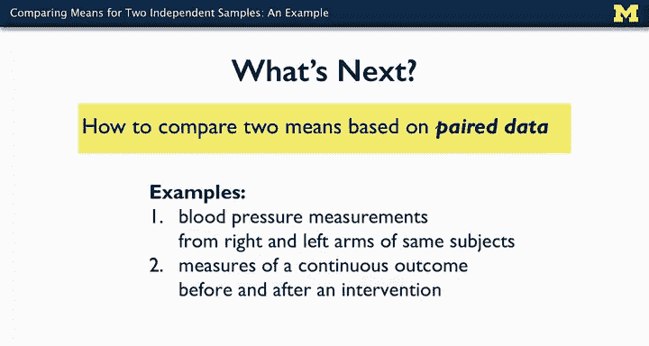

# 课程 29：两独立样本均值比较实例 📊

在本节课中，我们将学习如何比较两个独立子组的均值。我们将通过一个具体的实例，介绍如何构建置信区间和进行假设检验，以判断两个群体的均值是否存在显著差异。课程将涵盖核心概念、假设检验步骤，并讨论如何检查分析中的关键假设。

---

## 概述

上一节我们介绍了总体参数的估计。本节中，我们来看看如何比较两个独立子组的均值。我们将以2015-2016年美国非裔成年人的收缩压数据为例，比较男性和女性的平均收缩压是否存在显著差异。

我们将采用两种推断方法：为两个均值的差异构建置信区间，以及进行双样本T检验。同时，我们会重点检查分析背后的关键假设。

---

## 研究问题与数据

我们的研究问题是：在2015-2016年居住在美国的非裔成年人中，男性和女性的平均收缩压是否存在显著差异？

我们假设NHANES数据是从目标人群中抽取的一个简单随机样本。

以下是样本数据的描述性统计：
*   男性样本：均值 = 131.01，标准差 = 20.59，样本量 = 536。
*   女性样本：均值 = 125.79，标准差 = 19.15，样本量 = 599。

我们得到的点估计是样本均值的差异：`131.01 - 125.79 = 5.22 mmHg`。据此估计，男性非裔成年人的平均收缩压比女性高5.22 mmHg。但我们需要判断这个差异是否具有统计显著性。

---

## 检查分析假设

在进行正式推断前，我们需要检查数据是否满足所用统计方法的关键假设。

以下是需要检查的方面：

1.  **正态性假设**：我们假设每个子组中的收缩压测量值服从正态分布。通过观察直方图和正态Q-Q图，我们发现男性和女性的数据都存在右偏，不完全符合正态分布。但由于样本量较大，中心极限定理可以保证我们的检验方法对此具有一定的稳健性。
2.  **等方差假设**：我们假设两个子组（男性和女性）的收缩压方差相同。通过并排箱线图观察，男性的数据似乎有稍高的变异性。因此，等方差的假设可能存疑，我们需要在分析中检验结果的稳健性。

---

## 方法一：构建均值差异的置信区间

我们首先为两个总体均值的差异构建一个95%的置信区间。置信区间的通用公式为：
`点估计值 ± 乘数 × 差异的标准误`

根据是否假设两个子组的标准差相同（即合并方差），标准误的计算方式不同。

以下是两种假设下的结果：

*   **假设等方差（合并标准差）**：95%置信区间为 (2.91, 7.53) mmHg。
*   **假设异方差（不合并标准差）**：95%置信区间为 (2.90, 7.54) mmHg。

两个区间都非常接近，且都不包含0。0代表两个均值无差异。因此，我们有证据表明男性和女性的平均收缩压存在显著差异，男性更高。这个结论对可能的异方差情况是稳健的。

---

## 方法二：进行双样本T检验

接下来，我们使用假设检验的方法来推断均值差异。

**第一步：设定假设**
*   零假设 (H₀)：男性与女性的总体均值相等。
*   备择假设 (H₁)：男性与女性的总体均值不相等（双尾检验）。
我们设定显著性水平 α = 0.05。

**第二步：计算检验统计量与P值**
检验统计量 T 的计算公式为：
`T = (样本均值差 - 零假设下的差值) / 均值差的标准误`

以下是两种方差假设下的检验结果：

*   **假设等方差**：T = 4.436，自由度 = 1133，P值 < 0.001。
*   **假设异方差**：T = 4.417，P值 < 0.001。

两种情况下，P值都远小于0.05。因此，我们拒绝零假设，得出结论：男性和女性的平均收缩压存在显著差异。检验结果对等方差假设的潜在违反是稳健的。

---

## 关于正态性假设的进一步探讨

由于我们的数据存在偏态，我们担心违背正态性假设会影响T检验的结果。为此，我们可以使用一种不依赖正态分布假设的非参数检验——**曼-惠特尼U检验**。

该检验比较的是两个子组数据分布的中位数（或更广义的“位置”），而非均值。

对同一数据执行曼-惠特尼U检验，得到的P值同样小于0.001。这为我们提供了非常强的证据，拒绝“两个分布位置相同”的零假设。这表明，我们关于“两组中心趋势存在差异”的结论，对正态性假设的违反也是稳健的。

---

## 总结

本节课中，我们一起学习了如何比较两个独立样本的均值。

我们通过一个实例，演示了两种推断方法：构建置信区间和进行假设检验（双样本T检验）。我们了解到，在分析前检查数据是否满足**正态性**和**等方差**等关键假设非常重要。在本例中，尽管数据略有偏离正态，且方差可能不等，但得益于较大的样本量，我们的主要结论（男性平均收缩压显著高于女性）在不同假设和不同检验方法下均保持稳健。

最后，我们介绍了当正态性假设存疑时，可以使用非参数的曼-惠特尼U检验作为替代方案。

---

下一节，我们将探讨如何基于**配对数据**（例如同一个体的左右臂测量值、干预前后的测量值）来比较两个均值。