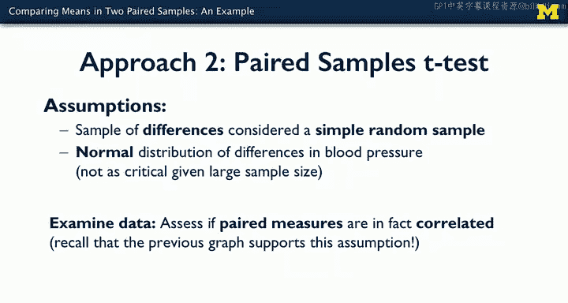

# 课程 30：两配对样本均值比较实例 📊

在本节课中，我们将学习如何比较两个配对样本的均值。我们将通过一个具体的实例，使用置信区间和配对样本T检验等方法，来探究两个相关的测量值之间是否存在显著差异。

---

## 概述

我们将分析一个来自NHANES（美国国家健康与营养调查）数据集的实际案例。研究人员希望验证数据集中收集的血压测量值在不同亚组中是否可靠。具体而言，我们将关注2015-2016年间居住在美国的西班牙裔成年女性，探究她们两次测量的收缩压是否存在显著差异。

---

## 研究问题与数据

我们的研究问题是：对于2015-2016年间居住在美国的西班牙裔成年女性，两次测量的收缩压是否彼此存在显著差异？

我们的预期是，如果这两次测量来自同一个体且是可靠的，那么它们不应该存在系统性差异。

我们将采用以下三种推断方法来解答这个问题：
1.  为均值差异构建一个置信区间。
2.  对均值差异进行配对样本T检验。
3.  检查这些方法背后的假设是否成立。

---

## 方法一：构建均值差异的置信区间

首先，我们需要计算该亚组中每位女性两次收缩压测量值的差异。我们将差异定义为第二次测量值（BP2）减去第一次测量值（BP1）。

以下是计算步骤：
*   计算每位女性的差异值。
*   计算所有差异值的平均值（样本均值差）。
*   计算所有差异值的标准差（样本标准差）。

对于我们的数据，计算结果如下：
*   样本均值差 = **-0.977 mmHg**
*   样本标准差 = **4.848 mmHg**
*   样本量 = **911**

这意味着，我们的最佳点估计表明，平均而言，第一次收缩压测量值比第二次高出约0.977 mmHg。这个差异在医学上可能具有意义。

---

### 检查数据与假设

在继续之前，我们需要检查数据是否符合所用方法的假设。

以下是两个关键的诊断图：
*   **差异值的直方图**：显示差异值的分布。我们的数据大致以0为中心，但整体趋势略向左偏（负值更多）。
*   **正态Q-Q图**：用于评估差异值是否服从正态分布。我们的数据点略微偏离45度参考线，表明存在轻微偏离正态分布的情况。

然而，由于我们的样本量很大（n=911），根据中心极限定理，我们可以放宽对正态分布的严格要求。尽管如此，我们仍将在后续分析中检验结果的稳健性。

此外，我们还需要确认两次测量值是相关的（这是使用配对样本方法的前提）。通过绘制BP2与BP1的散点图，我们发现两者存在强线性相关，皮尔逊相关系数高达 **0.966**。这强有力地支持了使用配对样本程序（如配对样本T检验）的合理性。

---

### 计算置信区间

现在，我们基于点估计和标准误来构建总体均值差的95%置信区间。

计算公式如下：
`置信区间 = 样本均值差 ± (临界值 * 标准误)`

其中：
*   标准误 = 样本标准差 / √样本量 = 4.848 / √911 ≈ **0.161 mmHg**
*   对于95%置信区间，临界值（t值）约为 **1.96**

代入计算：
`置信区间 = -0.977 ± (1.96 * 0.161) = (-1.292, -0.662) mmHg`

**结果解读**：这个95%置信区间为(-1.292, -0.662)，不包含0。这意味着，在考虑了抽样变异后，总体均值差的合理取值范围在-1.292到-0.662之间。由于0不在这个区间内，我们有证据表明，对于这个特定亚组，第一次测量值系统地高于第二次测量值。

---

## 方法二：执行配对样本T检验

上一节我们通过置信区间得出了初步结论，本节我们将使用正式的假设检验——配对样本T检验来验证这个结论。

我们的假设是：
*   **零假设 (H₀)**：总体均值差 = 0（两次测量值平均而言相同）。
*   **备择假设 (H₁)**：总体均值差 ≠ 0（两次测量值平均而言不同）。这是一个双尾检验。

我们设定显著性水平 α = 0.05。

检验结果如下：
*   **t 统计量** = -6.082
*   **自由度** = 910 (样本量 - 1)
*   **p 值** < 0.001

由于p值远小于0.05，我们拒绝零假设。这为“两次收缩压测量值的总体均值存在显著差异”提供了强有力的统计证据，与置信区间的结论一致。

---

## 方法三：考虑非参数检验（稳健性检查）

之前我们注意到数据有轻微偏离正态分布。虽然大样本下T检验相对稳健，但作为严谨的分析，我们可以使用不依赖于正态分布假设的非参数检验。

配对样本T检验的非参数对应方法是 **Wilcoxon 符号秩检验**。它检验的是差异值的中位数是否为0，而非均值。

以下是该检验的结果：
*   **p 值** < 0.001

Wilcoxon检验同样给出了极显著的p值，导致我们拒绝“两次测量值中位数相同”的零假设。

**结论**：无论我们使用参数方法（配对T检验）还是非参数方法（Wilcoxon检验），都得到了一致的结论。这表明，我们关于“两次测量值存在显著差异”的发现，对于正态性假设的潜在违反是稳健的。

---

## 总结与下节预告

在本节课中，我们一起学习了如何比较两个配对样本的均值。我们通过一个血压测量的实例，逐步演示了：
1.  计算差异并检查数据（散点图、直方图、Q-Q图）。
2.  为均值差异构建置信区间并进行解读。
3.  执行配对样本T检验。
4.  使用Wilcoxon符号秩检验来验证结论对分布假设的稳健性。

所有分析都一致表明，对于所研究的西班牙裔成年女性群体，第一次收缩压测量值显著高于第二次。这提示在NHANES数据收集中可能存在需要探究的系统性因素。

在下一讲中，我们将把焦点从**均值**比较转向**比例**比较，学习如何基于两个独立样本比较其比例。