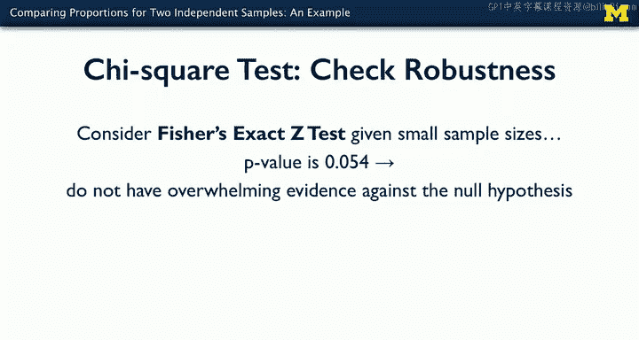

# 课程31：两独立样本比例比较实例 📊

在本节课中，我们将学习如何比较两个独立样本的比例，而不是均值。我们将通过一个具体的实例，来演示如何构建比例差异的置信区间、执行卡方检验，并讨论在小样本情况下的注意事项。

---

## 概述

我们将分析一个研究问题：在2015-2016年期间，美国80岁及以上的西班牙裔老年人口中，男性和女性的吸烟比例是否存在显著差异。我们将使用置信区间和假设检验两种方法进行推断，并特别关注小样本对分析结果的影响。

---

## 数据与点估计

首先，我们来看一下数据。在这个特定的亚人群中，我们有以下样本信息：

*   **男性**：样本量 `n_male = 16`，吸烟比例 `p_male = 0.565` (56.5%)。
*   **女性**：样本量 `n_female = 32`，吸烟比例 `p_female = 0.25` (25%)。

我们的最佳点估计是样本比例之差：

**公式：** `p_male - p_female = 0.565 - 0.25 = 0.315`

这个结果可以解释为：我们估计在2015-2016年，所有西班牙裔老年男性中的吸烟者比例比女性高出**31.5个百分点**。请注意，这不是说高出31.5%，而是比例绝对值的差异。

---

## 方法一：构建比例差异的置信区间

上一节我们得到了点估计，本节中我们来看看如何围绕这个估计构建一个置信区间，以评估其不确定性。

在构建置信区间前，我们需要检查一些关键假设：

1.  **抽样分布的正态性**：由于两个组的样本量都很小（16和32），我们无法依赖中心极限定理来保证抽样分布的正态性。**这个假设很可能不成立**。
2.  **每组中成功与失败的次数**：理想情况下，每组中吸烟者和非吸烟者都应至少各有10人。由于样本量小，这个条件**不满足**，尤其是在男性组。
3.  **样本独立性**：男性和女性是两个互斥的群体，因此**两个样本是独立的**。
4.  **组内观测独立性**：我们暂时假设每组内的个体观测是相互独立的。

尽管存在假设问题，我们仍先按常规方法计算一个95%的置信区间。

以下是计算步骤：

1.  计算比例差异的标准误估计值：
    **公式：** `SE = sqrt( [p_male*(1-p_male)/n_male] + [p_female*(1-p_female)/n_female] )`
    代入数据：`SE ≈ 0.146`
2.  确定临界值（对于95%置信区间，使用 `z* = 1.96`）。
3.  计算置信区间：
    **公式：** `(p_male - p_female) ± (z* * SE)`
    代入数据：`0.315 ± (1.96 * 0.146)`
    得到区间：`(0.027, 0.598)`

这个95%置信区间不包含0（0意味着无差异），这提示两个总体的吸烟比例可能存在差异。但请注意，区间的下限（0.027）非常接近0，表明证据并不十分强有力。

### 小样本的精确置信区间

考虑到小样本可能违反正态性假设，我们可以使用一种计算量更大、但不那么依赖该假设的“精确”方法。

运行相应的Python代码（此处不展示具体代码，课程中会提供）后，我们得到精确的95%置信区间为 `(0.015, 0.574)`。

这个结果与基于正态假设得到的区间非常相似，0仍然不在区间内，但下限同样接近0。这进一步证实了我们有证据表明存在差异，但证据强度有限。

---

## 方法二：卡方检验

除了置信区间，我们还可以使用卡方检验来直接检验两个比例是否相等。上一节我们评估了区间估计，本节中我们来看看假设检验的方法。

我们的假设是：
*   **零假设 (H₀)**：男性和女性的总体吸烟比例相等。
*   **备择假设 (H₁)**：男性和女性的总体吸烟比例不相等（双尾检验）。

我们设定显著性水平为 `α = 0.05`。

在进行卡方检验前，需要检查一个关键假设：在2x2列联表的每个单元格中，**零假设下的期望频数应至少为5**。

以下是计算期望频数的过程：
*   总样本量：`16 + 32 = 48`
*   总吸烟人数：`9（男）+ 8（女）= 17`
*   总吸烟比例：`17 / 48 ≈ 0.354`
*   男性期望吸烟人数：`16 * 0.354 ≈ 5.66`
*   女性期望吸烟人数：`32 * 0.354 ≈ 11.33`

所有四个单元格（男吸烟、男不吸烟、女吸烟、女不吸烟）的期望频数均大于5，因此**该假设勉强满足**。

运行卡方检验（通过Python代码）后，我们得到：
*   检验统计量：`χ² = 4.554`
*   自由度：`1` （对于2x2表，自由度为 `(行数-1)*(列数-1) = 1*1`）
*   **P值：`0.033`**

由于P值 (`0.033`) 小于显著性水平 (`0.05`)，我们在5%的水平上**拒绝零假设**，认为两个比例存在显著差异。然而，如果我们将显著性水平设定为更严格的1% (`α=0.01`)，则不会拒绝零假设。这再次说明证据的强度是有限的。

### 小样本的精确检验：费希尔精确检验

为了应对小样本问题，我们可以使用费希尔精确检验作为卡方检验的替代方案。

运行费希尔精确检验后，得到的**P值为 `0.054`**。

这个P值略高于0.05的常规阈值。如果我们严格遵循5%的显著性水平，**将无法拒绝零假设**。这凸显了小样本分析中结论对检验方法选择的敏感性。

---

## 结论与讨论

本节课中我们一起学习了如何比较两个独立样本的比例。结合本案例，我们可以得出以下结论：

在2015-2016年美国80岁及以上的西班牙裔老年人口中，我们有**微弱的证据**表明男性和女性的吸烟比例存在差异。但必须强调，这个结论是基于非常小的样本得出的，我们进行统计推断的**把握度（统计功效）很低**。

以下是需要牢记的几点：

*   **效应大小 vs. 统计显著性**：31.5个百分点的差异在实践中是一个**非常大的效应**。如果这个差异在更大的样本中依然存在，它几乎肯定会被判定为统计显著。这提醒我们要区分**统计显著性**和**实际意义**。
*   **小样本的影响**：小样本导致了我们分析中的**不确定性大大增加**。这就是为什么我们使用了精确置信区间和费希尔精确检验等稳健方法，并且最终得到的证据强度较弱。
*   **样本量的作用**：如果未来能在更大的样本中观察到类似的比例差异，那么得出存在显著差异的结论将会有力得多。

总之，虽然本案例中统计证据的强度有限，但观察到的差异本身具有重要的实际意义，值得在可能的情况下通过更大规模的研究进一步验证。