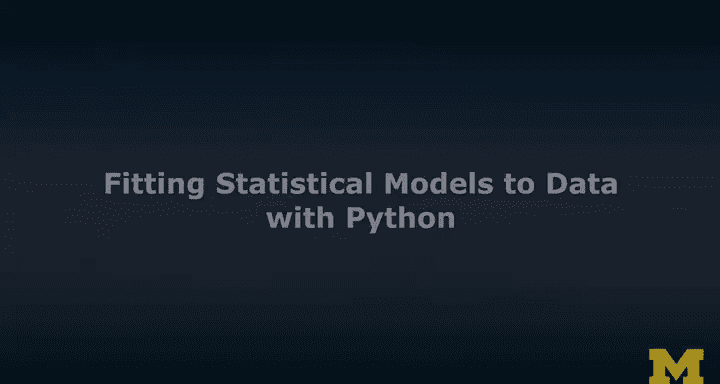
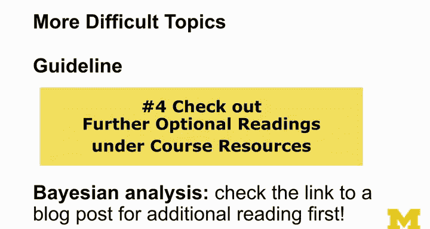
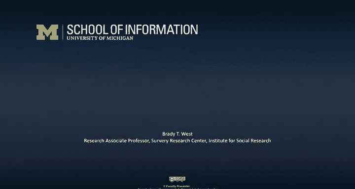

# 📊 课程一：使用Python拟合统计模型指南

在本课程中，我们将学习如何使用Python软件将统计模型拟合到数据集。课程内容基于专项课程前两门课的知识，假设你已熟悉使用Python进行数据可视化和管理，了解数据来源的重要性，并能使用Python进行假设检验和基本描述性分析。我们将在此基础上，进一步学习如何基于拟合到数据的统计模型，对变量间关系进行推断。

---

## 🎯 课程概述与学习指南

上一节我们介绍了本课程的目标，本节中我们来看看如何高效学习这门课程。本课程将大量使用Jupyter Notebook来演示和练习模型拟合概念。

以下是成功学习本课程的三条核心指南：

*   **指南一：边看边练**。我们强烈建议你在观看视频讲座的同时，在Jupyter Notebook中练习Python模型拟合示例。你应该频繁暂停视频，在Notebook中尝试拟合模型，以巩固所学概念。例如，你可以在笔记本电脑上播放讲座视频，同时在台式机上打开Jupyter Notebook进行练习。
*   **指南二：善用互动问题**。我们准备了多种视频内问题（IvyQs）来强化视频讲座中的概念。这些问题能为你提供额外的输出结果解读练习，并巩固讲座中强调的许多概念点。请仔细阅读为你准备的详细答案。
*   **指南三：积极参与讨论**。请确保在遇到问题时及时发帖，并经常查看常见问题存档和讨论论坛。有很多人乐于帮助你学习这些不同的建模概念。

---

## 📚 课程资源与进阶内容

上一节我们介绍了核心学习指南，本节中我们来看看课程提供的具体资源以及最后的进阶主题。

本课程为你准备了多种学习资源：

*   **案例研究Notebook**：逐步讲解示例。
*   **练习Notebook**：让你实际练习使用Python拟合模型。

在本课程的最后一周，我们将介绍贝叶斯统计分析。这是你在本专项课程中将遇到的最进阶的内容。贝叶斯分析是一种流行且强大的统计分析方法，但它与前两门课程中讨论的方法有所不同。我们强烈建议你在开始学习这部分内容之前，先阅读一篇提供简单入门概述的博客文章。

我们也欢迎你提出关于本课程的问题、评论和反馈。我们始终致力于让这些材料更具吸引力和更易于理解。请不要犹豫在讨论论坛中提问，或向讲师提出任何更复杂的问题。

---

## 🏁 总结

在本节课中，我们一起学习了“使用Python拟合统计模型”课程的指南和资源。我们明确了课程目标，即基于统计模型对变量关系进行推断。我们掌握了三条核心学习指南：边看边练、善用互动问题以及积极参与讨论。最后，我们了解了课程提供的案例与练习Notebook，并预告了最后关于贝叶斯统计分析的进阶内容。

现在，请开始你的Python统计模型拟合之旅，并享受学习的乐趣。