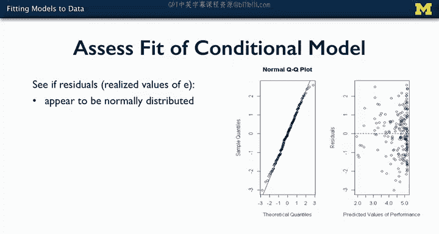

# 课程3：使用Python的统计学（统计建模与数据拟合）｜P68：2_拟合模型至数据的含义解析 📊

在本节课中，我们将学习“拟合模型至数据”这一核心概念。我们将探讨为何要拟合模型、如何指定和拟合参数模型，并通过一个具体示例来演示整个过程。课程最后，我们还将讨论如何评估模型拟合的好坏。

---

## 概述：什么是拟合模型至数据？ 🤔

当我们说“拟合模型至数据”时，我们的目标是将统计模型应用于我们收集的数据，以帮助回答研究问题。

需要明确的是，我们不是将数据强行塞入模型，而是根据理论或专业知识指定模型，然后将这些模型拟合到我们收集的数据上。我们数据中的变量遵循特定的分布或关系，而我们拟合的模型旨在描述这些分布或关系。

---

## 为何要拟合模型？ 🎯

拟合模型通常出于以下几个目的：

1.  **估计分布特性**：我们可能希望估计不同变量的分布特性（可能以其他变量为条件）。例如，估计分布的均值、方差或分位数。
2.  **总结变量关系**：我们可能希望简洁地总结变量之间的关系，并对这些关系做出推断性陈述。
3.  **进行预测**：我们可能希望基于预测变量的值，来预测我们感兴趣的变量的值，并描述这些预测的不确定性。

---

## 本课程重点：参数模型 📈

本课程的重点是**参数模型**。这意味着我们估计的是描述我们感兴趣变量分布的参数。

例如，我们可能假设一个连续变量（如血压或考试成绩）的值服从正态分布。正态分布由**均值**和**方差**这两个参数定义。拟合模型的过程，就是根据收集的数据来估计这些参数的值。

我们估计模型参数及其相关的抽样方差，结合这些信息，我们可以对定义模型的参数进行推断（如假设检验、构建置信区间）。

---

## 示例：考试成绩与年龄的关系 📚

为了说明如何将统计模型拟合到数据，我们来看一个例子。

假设我们感兴趣的是大学生的某项考试成绩，以及成绩与年龄的关系。

*   **结果变量**：考试成绩（范围0-8分）。
*   **预测变量**：年龄（已根据均值和标准差进行了标准化）。
*   **研究问题**：年龄是否能预测考试成绩？我们有一个理论，认为年龄与成绩之间存在**曲线关系**（例如，倒U型关系）：中等年龄的学生成绩最好，年龄偏小或偏大的学生成绩较差。

我们的目标有两个：
1.  估计所有年龄段的**边际平均成绩**（描述性目标）。
2.  估计**以年龄为条件的平均成绩**，即年龄与平均成绩的关系。

---

## 建模方法一：仅均值模型 📉

首先，我们考虑一个**仅均值模型**。我们假设考试成绩整体上服从一个正态分布，由一个特定的均值（μ）和方差（σ²）定义。

在这个模型中，我们估计两个参数：总体均值 μ 和方差 σ²。我们只对建模整体均值感兴趣。

我们通过一个回归模型来拟合它：
`performance = μ + e`
其中，`e` 是随机误差，我们假设 `e ~ N(0, σ²)`。

**模型拟合结果**：
*   估计的总体均值 μ = 4.57 分。
*   估计的方差 σ² = 1.82。

**评估模型拟合**：
我们需要检查误差项服从正态分布的假设。通过绘制残差（观测值减去预测均值）的直方图和正态Q-Q图，我们发现该假设是合理的，正态模型对数据拟合良好。

---

上一节我们介绍了简单的仅均值模型，本节中我们来看看更复杂的、包含预测变量的条件模型。

## 建模方法二：条件模型（二次模型） 🔄

对于第二个目标（以年龄为条件），我们相信成绩再次服从正态分布，但其均值由年龄的二次函数定义：
`performance = A + B*age + C*age² + e`
其中，`e ~ N(0, σ²)`。

这里有四个待估参数：A, B, C 以及条件方差 σ²。这个二次函数捕捉了我们关于年龄与成绩之间曲线关系的理论。

**模型拟合结果**：
*   A（截距）估计值 = 5.11
*   B（一次项系数）估计值 = 0.24
*   C（二次项系数）估计值 = -0.26
*   条件方差 σ² 估计值 = 1.29

参数估计值与其标准误的比值（可视为检验统计量）表明这些系数可能都不为零。拟合的二次曲线（图中红色虚线）在散点图上直观地看与数据吻合得很好。

**评估模型拟合**：
再次检查残差。残差的Q-Q图显示其近似正态分布，且残差与预测值的散点图中，残差大致对称地分布在0附近，方差看起来也相对恒定。这表明模型假设是合理的，模型拟合良好。

不过，我们注意到残差图中仍存在相当程度的变异。这引出一个问题：我们能否做得更好？是否可以加入其他预测变量（如种族、教育背景、社会经济地位）来解释这部分剩余的变异？

---

## 反面教材：误设的模型 ❌

现在，让我们思考一个拟合不好的模型。如果我们不依据理论仔细指定模型，错误地假设成绩与年龄是**线性关系**，会发生什么？

拟合的直线（红色虚线）明显无法捕捉数据中倒U型的趋势。模型拟合看起来很差。

检查其残差与预测值的散点图，会发现残差并非随机对称分布在0周围，而是呈现出明显的曲线模式。这明确指示我们**误设了模型关系**，未能捕捉数据中真实的曲线关系。当标准化年龄值很低或很高时，模型的预测效果会非常差。

---

## 总结 📝

本节课中，我们一起学习了“拟合模型至数据”的核心思想：

*   我们介绍了为数据拟合**参数模型**并**评估模型拟合度**的概念。
*   通过一个考试成绩与年龄关系的示例，我们演示了从指定模型（仅均值模型、二次条件模型）到估计参数，再到通过检查残差评估模型拟合的完整流程。
*   我们看到了一个**良好拟合的模型**（二次模型）其残差应满足模型假设（如正态性、方差齐性），而一个**误设的模型**（线性模型）会在残差图中表现出明显的系统性问题。

在接下来的课程中，我们将深入探讨不同类型的变量和数据集、不同研究设计对建模的影响，以及拟合模型时各种估计和推断的方法。我们将通过大量具体示例来详细讨论建模的各个方面。