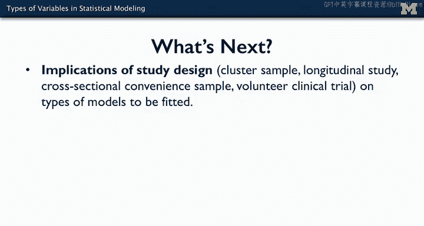

#  69：统计建模中的变量类型 📊

在本节课中，我们将探讨统计建模中的变量类型。我们将继续概述如何将模型拟合到数据，重点思考我们可能感兴趣的建模变量类型，以及变量类型对我们所拟合模型的影响。作为本讲座的一部分，我们将讨论模型设定中的一些关键概念，并思考在处理不同类型变量时应采取的策略。

---

## 🔍 变量类型回顾

在开始之前，我们先回顾一下本系列课程之前学到的概念。在总结数据时，我们需要仔细考虑所收集变量的类型。

我们讨论过**分类变量**，这类变量取少量离散值。例如性别、种族、政党偏好、地区、事件的二元指标等。对于这类变量，我们需要问：这些变量的类别是否有任何顺序？数字类别是否有有意义的排序，还是它们仅仅是像种族或国家地区这样的离散值？

我们还讨论过**连续变量**。这类变量可以取许多可能的值。例如身高、年龄、收入、血压。对于这类变量，我们提出的问题是：分布看起来如何？分布的形状是什么？分布的中心在哪里？分布的离散程度如何？该变量是否服从正态分布，或者是否有其他分布可能更适合该连续变量？这些是我们对研究中可能收集到的这两大类变量需要提出的重要问题。

---

## 🎯 因变量与自变量

现在，当我们讨论将模型拟合到数据时，我们可以考虑变量的其他分类。在模型拟合中，一个重要的二分法是**因变量**和**自变量**。

### 因变量

因变量，根据你所在领域的不同，也可能被称为结果变量、响应变量、内生变量，或者更一般地称为**感兴趣变量**。这些是我们想要建模的变量。我们的主要目标是，根据其他自变量，对这些感兴趣变量的分布特征进行建模。换句话说，因变量的分布取决于这些自变量的取值。

### 自变量

自变量，你可能听到的其他名称包括预测变量、协变量、回归量或外生变量。这些术语都指向同一概念：当我们拟合模型时，用于预测感兴趣因变量取值的变量。我们的目标是，在给定这些自变量取值的条件下，检查我们感兴趣的因变量的分布。

---

## 📈 深入理解因变量

我们想要将因变量（作为主要兴趣变量）建模为其他理论上相关的自变量的函数。我们决定在定义因变量的条件分布时包含哪些自变量，这都受到我们的理论和研究问题的指导。我们的研究问题定义了什么是因变量，什么是自变量。

这涉及为因变量选择一个合理的分布。例如，我们可以说，在给定自变量取值的条件下，因变量服从正态分布。这只是一种可能的选择，并非唯一选择。然后，我们将该分布的参数（例如均值或方差）定义为自变量的函数，或条件于自变量。我们在开篇讲座中已经看到了一个例子。

因变量可以是连续的、分类的或二元的。我们根据所收集因变量的类型选择一个合理的分布，然后将该分布的特征建模为自变量取值的函数。

**示例**：我们可能假设血压服从正态分布，其中平均血压取决于一个人的年龄、身体质量指数和性别。年龄、BMI和性别就是三个自变量。

---

## 🧩 深入理解自变量

自变量是理论上与因变量相关的预测因子。我们感兴趣的是估计自变量与因变量之间的关系。在本课程中，我们将重点强调，自变量的选择应基于我们的理论和专业知识。

自变量可能由研究者操纵。例如，在随机实验中，我们可能将被研究的个案随机分配到接受干预或治疗的组，或分配到对照组。在这种情况下，“组别”就是我们为数据考虑的模型中的一个预测变量。

或者，自变量可能只是被观察到的，而非由研究者操纵。在这些类型的观察性研究中，所有变量值都只是被观察到的。在这种情况下，对变量之间的因果关系（即一个变量导致另一个变量）进行推断更加困难。在许多观察性研究中，我们的主要焦点只是描述关系。而在随机实验中，我们更有能力对预测因子（如组别）与感兴趣的因变量之间的关系进行因果推断。

如果自变量是连续的，我们可以估计这些自变量与因变量分布特征之间的函数关系。回想第一讲，我们估计了测试成绩的正态分布特征作为年龄的函数，并拟合了测试成绩随年龄变化的曲线线性模型。

另一方面，如果自变量是分类的，我们可以比较由这些自变量类别定义的组在因变量分布上的差异。我们也将看到一些如何做到这一点的例子。

在处理分类自变量时，最佳实践是避免估计分类变量（例如种族）与我们的感兴趣因变量之间的函数关系。为什么？因为分类自变量的实际数值可能没有任何数值意义。例如，如果我们在数据集中将种族编码为1、2、3、4、5，我们无法真正查看散点图并观察“数值化种族”与“测试成绩”之类的关系，因为这些数字没有意义，它们只是指代种族的独特类别。对于大多数分类自变量，我们的目标是比较各组在因变量分布特性上的差异。

---

## 🛡️ 控制变量与缺失数据

### 控制变量

当我们讨论拟合模型时，可能还会谈到**控制变量**。我们的目标是估计描述自变量与因变量之间关系的参数。

在随机研究设计中，我们试图确保随机分组（例如，一组是治疗组，另一组是对照组）在其他可能对估计“组别”与因变量关系产生负面影响的混杂变量上是平衡的。

在非随机或观察性设计中，定义自变量的组可能不平衡。随机化是研究设计中使用的一种工具，旨在确保所有可能与因变量相关的其他感兴趣变量在两个随机组（治疗组和对照组）之间是等效的。而在观察性设计中，我们失去了这种控制。

**示例**：在观察性研究中，男性通常比女性体重更重。一项分析如果研究性别（作为自变量）与另一个与体重相关的因变量之间的关系，可能无法清晰地估计性别与因变量的关系，因为存在其他混杂变量（本例中是体重）可能影响性别与因变量之间的关系。在观察性研究中，控制这种混杂问题更加困难，而随机化是避免这种混杂问题的一种工具。

因此，当我们拟合模型时，我们会包含几个不同的自变量。在上面的例子中，除了性别，我们可能还将体重作为因变量的预测因子，以有效调整这种混杂问题。我们通过包含混杂变量与因变量的关系，来更好地理解在调整了混杂变量取值后，性别与结果之间的关系。

**示例**：如果我们感兴趣比较男性和女性之间血压（作为因变量）的分布，并且基于我们的专业知识知道体重与血压相关，我们可以在拟合模型中将体重作为控制变量包含进来。从理论角度看，它是一个控制变量，因为这意味着在讨论性别与血压之间的关系时，我们可以控制体重的取值。然后，在模型中包含这个控制变量的情况下，我们可以对给定体重值时的性别-血压关系进行推断。也就是说，在给定相同体重的条件下，男性和女性之间的均值差异是多少？这就是包含这些控制变量以调整混杂的思路，我们将在后续课程中看到许多这样的例子。

### 缺失数据

在考虑拟合模型中的变量时，另一个关键点是**缺失数据**。在我们开始将模型拟合到数据之前，对因变量和自变量的分布进行简单的描述性和双变量分析非常重要，其中一个关键方面是检查因变量和自变量上的缺失数据。

**列表删除**是一个概念，指的是数据集中任何分析单元，只要在任何自变量或因变量上有缺失数据，都将从分析中删除。这通常是我们用于拟合模型的软件（如Python）中的默认设置。这意味着，我们可能有10个不同的自变量和1个因变量，只要这10个自变量中有一个出现一个缺失值，整个分析单元就会被从模型拟合分析中删除。

如果由于这个缺失数据问题而被删除的个案，在某种程度上与最终用于拟合模型的个案存在系统性差异，我们可能会在关系估计中引入偏差，这当然是我们不希望看到的。因此，我们需要仔细考虑，因缺失数据而被删除的单元是否在某种程度上与最终保留下来拟合模型的单元存在系统性差异。

如果在描述性分析中识别出有缺失数据的单元，我们可以比较那些在列表删除中会被删除的缺失数据单元，与那些拥有完整数据、会被保留的单元，在完全观测到的变量上的分布。例如，如果我们对整个收集的样本完全观测到了性别，我们可以比较个案在性别分布上的差异，看看是否有任何明显的不同。这很简单，我们可以使用在课程2中学到的技术，例如使用卡方检验来比较缺失和非缺失个案在性别分布上是否有明显差异。

如果有证据表明存在差异，我们可能需要考虑其他技术来解决这个缺失数据问题。**插补**是一种可能的方法，我们可以根据数据集中其他变量的值来预测那些有缺失数据的变量的缺失值。这是一种可能的方法，我们将在接下来的系列讲座中重新讨论这个问题。

---

## 🔮 下一步：研究设计的影响

在下一讲中，我们将讨论研究设计对我们所拟合模型的影响。回想前两门课程，我们可能有整群抽样、纵向研究、横截面方便样本、志愿者临床试验等。我们使用各种研究设计来收集数据，我们需要思考研究设计对我们所拟合模型的影响。

我们需要认识到，研究设计会影响我们收集数据的特性，而我们为数据拟合的模型需要反映这些特性。举个简单的例子，如果我们随时间从同一个人身上收集同一个因变量的重复测量值，那么同一个体内的这些因变量的重复测量值将是彼此相关的，我们需要在为给定数据集指定的模型中考虑这种相关性。

---

## 📝 总结

在本节课中，我们一起学习了统计建模中的变量类型。我们回顾了分类变量和连续变量的基本概念，并深入探讨了因变量和自变量在模型设定中的核心角色。我们了解了如何根据变量类型选择合适的分布，以及如何将分布参数建模为其他变量的函数。我们还讨论了控制变量在调整混杂效应中的重要性，以及处理缺失数据时需要注意的问题，特别是列表删除可能带来的偏差。最后，我们预告了下一讲将探讨研究设计对模型拟合的影响。理解这些变量类型及其在建模中的含义，是构建有效统计模型的基础。