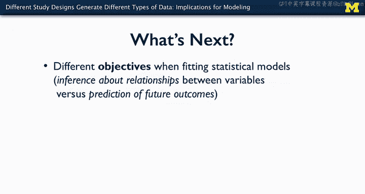

# 课程4：不同研究设计生成的数据类型及其影响 📊

在本节课中，我们将学习不同研究设计如何生成不同类型的数据，以及这些设计特征对我们最终拟合的统计模型有何影响。理解数据的来源和生成方式是构建有效模型的关键前提。

---

上一节我们介绍了理解数据来源的重要性，本节中我们来看看几种常见的研究设计及其对数据特征的影响。

在将统计模型拟合到数据时，理解数据是如何生成的至关重要。数据可能来自精心设计的概率抽样（如整群抽样），也可能来自方便抽样或非概率抽样。数据可能来自纵向研究、简单随机样本，也可能来自自然或有机过程。在开始考虑拟合模型之前，我们必须充分了解数据的来源，并考虑这些研究设计的特征在为我们感兴趣的变量指定模型时是否需要被考虑进去。

那么，当我们将模型拟合到一组数据中的某个特定变量时，为什么这很重要？我们的目标是估计最能描述该变量分布的参数。到目前为止，我们已经介绍了估计因变量（可能以其他自变量的值为条件）的均值和方差的简单例子。但估计感兴趣变量分布的另一个关键方面是：因变量的不同取值可能由于某种原因而彼此相关。通常，不同类型的研究设计会在同一因变量的不同取值之间引入相关性。这可能是我们在指定模型时需要加以考虑的数据特征。

因此，如果生成这些数据的研究设计方面影响了这些参数，我们在拟合模型时就需要考虑这些设计方面。

---

## 简单随机样本 📝

我们首先回顾简单随机样本。在课程1讨论不同类型的抽样计划时，我们谈到了这个概念。

从明确定义的总体中进行的简单随机样本（SRS）通常会产生关于感兴趣变量的独立同分布观测值。我们引入的术语IID（独立同分布）意味着：在简单随机样本中收集的所有不同值都彼此独立，并且我们假设感兴趣变量上的这些值来自相同的分布。这就是IID的概念。

当我们为来自简单随机样本的数据拟合模型时，我们为感兴趣的变量选择分布，其重要特性是：我们拥有的该变量数据中的所有观测值都是独立的。因此，我们假设该因变量上的不同取值彼此无关——前提是数据确实来自简单随机样本。

以下是具体示例：

假设我们感兴趣的是测量个体的幸福感。我们在一个简单随机样本中收集了一系列幸福感量表的观测值。我们可能假设幸福感量表上的这些观测值来自一个具有某个均值μ和某个方差σ²的公共正态分布，并且任意两个随机选择的观测值之间的相关性为零。因此，幸福感量表上的所有观测值彼此完全独立，并且遵循相同的正态分布。

如果我们想估计平均幸福感的估计值的标准误，回顾早期课程中的一些例子，我们会计算该标准误，并假设观测值彼此独立。因此，如果确实选择了简单随机样本且这些观测值彼此独立，那么该估计平均幸福感的抽样分布将具有特定的预期形态。

在简单随机样本中，我们最终拥有更多独特的统计信息。因为所有这些观测值都是独立的，所以我们拥有的独特统计信息越多，标准误就越小，抽样分布就越集中。这对我们来说意味着我们有更精确的估计。这无疑是简单随机抽样的一个优点。

根据研究问题的不同，如果我们对建模男性和女性之间平均幸福感的差异感兴趣，我们可能会为数据拟合一个不假设所有观测值都来自同一分布的模型。例如，我们可能会说幸福感得分的正态分布的均值取决于性别。因此，根据我们是男性还是女性，均值会有所不同。正态分布的均值随性别而变化。

但在我们的模型中，一旦以性别为条件，幸福感量表上的所有观测值都是独立的，并且具有相同的方差——这可能是我们模型的一个属性。

---

## 整群样本 🏘️

另一种常见的研究设计是整群样本。整群样本产生于生成相关观测值集群的研究设计。这些集群可以是医院、诊所、学校或社区。

因为来自同一自然发生集群的观测值往往彼此相似，所以在为数据拟合模型时，我们需要考虑这种相关性。这与简单随机样本的模型不同。在处理整群样本时，感兴趣因变量的不同取值可能彼此相关，因为这些值来自研究设计中同一集群的个体。

以下是具体示例：

如果研究设计从选定的社区中产生了多个幸福感观测值，那么同一社区内的观测值很可能彼此相关。我们为幸福感指定的模型可能会包含额外的参数，以捕捉这种社区内的相关性。因此，在我们目前考虑的例子模型中，我们允许同一社区内的幸福感观测值彼此相关。在我们之前的例子中，我们只是假设所有观测值都是独立的。但我们将讨论如何为这类相关数据拟合模型。

当我们考虑估计均值μ的标准误时，该标准误将反映这种相关性。回顾我们对复杂样本的讨论，当我们确实有一个整群样本时，我们拥有的独特独立信息较少，因为我们的一些观测值彼此相关。我们没有像在简单随机样本中那样多的独立信息。因此，因为我们拥有的独特信息较少，这导致了更高的标准误，抽样分布有更大的变异性，具体取决于最终为研究抽样的集群。

---

## 纵向数据 📈

另一种常见的研究设计是纵向研究。在纵向数据中，我们随时间从同一单元收集同一变量的重复测量值。因为我们在不同时间测量同一分析单元，这些观测值很可能彼此相关。

因此，与整群抽样非常相似，我们为纵向研究中重复测量的变量拟合的模型需要考虑这种单元内的相关性。我们在该模型中估计描述单元内相关性的额外参数，并且我们将讨论如何做到这一点。

---

## 独立数据与相关数据 🔄

区分相关数据和独立数据非常重要，我们将在本课程中不断回顾这一点。区分以下两种情况很重要：
*   **相关数据的模型**：由于研究设计的某些特征（例如，整群抽样或纵向测量），观测值之间存在相关性。
*   **独立数据的模型**：观测值彼此完全独立，它们可能来自也可能不来自同一分布。

当我们考虑适合数据的模型时，我们将不断回顾这种二分法。这里的核心要点是，我们希望为给定变量找到尽可能好的模型，而那个尽可能好的模型应该反映影响我们感兴趣变量分布特性的重要研究设计特征。

---

## 下一步：模型拟合的目标与方法 🎯

接下来，我们将讨论拟合统计模型时的不同目标。我们将介绍，我们拟合模型可能是为了推断变量之间的关系，也可能是为了预测未来的结果，我们将讨论这种目标差异。我们还将介绍拟合模型以及对定义观测变量模型的参数进行推断的替代方法。回顾一下，我们在课程2中介绍了频率推断和贝叶斯推断的思想，当我们讨论模型拟合方法时，我们将回到这个思想。

---

## 总结 📝

本节课中，我们一起学习了不同研究设计（如简单随机样本、整群样本和纵向研究）如何生成具有不同特征的数据。关键区别在于观测值是**独立**的还是**相关**的。简单随机样本通常产生独立同分布的数据，而整群样本和纵向数据则会在观测值之间引入相关性。在为数据选择或构建统计模型时，必须考虑这些研究设计特征，以确保模型能准确反映数据的真实结构，从而得到有效的推断和精确的估计。理解数据的生成过程是进行任何有意义的数据分析的第一步。