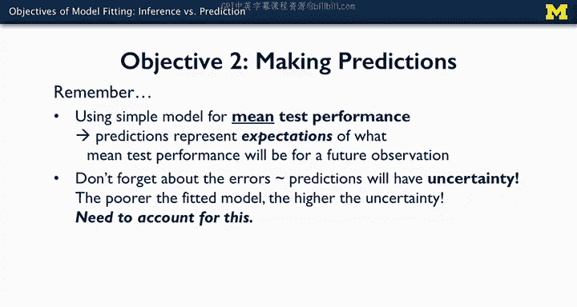

#  71：模型拟合目标：推断与预测 📊➡️🔮

在本节课中，我们将概述使用Python拟合统计模型的两个主要目标：推断变量间的关系，以及基于模型预测未来结果。

## 概述：模型拟合的两大目标

当我们希望将统计模型拟合到数据时，主要有两个目标。首先，我们可能对推断给定数据集中变量之间的关系感兴趣。其次，我们的目标可能是基于历史数据估计的模型来预测或预报未来的结果。

---

## 目标一：进行推断 🔍

上一节我们介绍了模型拟合的总体目标，本节中我们来看看第一个具体目标：推断。我们将回顾本周早些时候的一个例子，该例子研究了年龄（或其标准化版本）作为测试成绩的潜在预测因素。测试成绩的范围在0到8分之间。

我们拟合了一个允许年龄与测试成绩呈非线性关系的模型。对于中等年龄值，我们看到了最高的预期测试成绩。

### 核心模型

我们用于描述这种关系的回归模型表明，成绩是年龄和年龄平方的函数。我们感兴趣的是估计参数 **A**、**B** 和 **C**。

**公式**：
`performance = A + B * age + C * age^2 + E`

其中，**E** 是误差，即实际成绩减去基于模型的预测成绩。该回归函数定义了成绩的期望均值作为年龄的函数。误差服从均值为0、方差恒定的正态分布。

### 参数估计与假设检验

如果我们的目标是推断年龄与成绩之间的关系，我们需要检查回归参数 **A**、**B** 和 **C** 的估计值。

以下是使用Python拟合模型后得到的参数估计值：
*   **A** = 5.11
*   **B** = 0.24
*   **C** = -0.26

获得这些参数估计值及其标准误后，我们可以检验参数是否等于0的假设，或为这些参数构建置信区间，以推断预测变量“年龄”是否重要。

以下是检验每个参数显著性的方法：

**公式**：
`T统计量 = (参数估计值 - 0) / 参数标准误`

对于参数 **B**，其T统计量为 `0.24 / 0.06 = 4`。这表明估计的系数比零假设值高出4个标准误，是一个非常大的差异。因此，我们拒绝参数 **B** 等于0的原假设，认为这是一个显著的结果。

同样地，我们可以计算参数 **A** 和 **C** 的检验统计量。所有参数的检验统计量都很大，这强烈表明年龄与成绩之间的关系是显著的。

### 参数解释

*   **参数 A (5.11)**：代表数据集中年龄为总体均值时的平均测试成绩。这个平均值显著不为零。
*   **参数 B (0.24)**：代表当标准化年龄为0时，测试成绩的预期初始增长率。由于模型中包含了年龄平方项，这个参数是正值且显著，表明初始增长是显著正向的。
*   **参数 C (-0.26)**：代表作为年龄函数的成绩非线性加速度。负值意味着在初始加速后，年龄的进一步增加会降低测试成绩。这个非线性方面也显著不为零。

如果参数 **C** 的估计值不显著异于零，那么成绩与年龄之间的关系实际上是线性的。但在本例中，显然不是这种情况。

---

## 目标二：进行预测 📈

现在，让我们转向第二个主要目标：基于拟合的模型进行预测。右侧的散点图显示了基于拟合回归模型的、作为年龄函数的测试成绩预测值。

### 预测模型

我们可以将回归模型写为：

**公式**：
`performance = 5.11 + 0.24 * age - 0.26 * age^2 + error`

给定这个模型，我们可以代入年龄值来计算测试成绩的预测值。图中的红色虚线代表了基于拟合模型的、作为年龄函数的成绩期望值。

例如，要预测当标准化年龄等于1时的成绩，我们进行如下计算：

**代码**：
`predicted_performance = 5.11 + 0.24 * 1 - 0.26 * (1**2) = 5.09`

计算得到的预测值为5.09分，这与右侧可视化关系图中的位置相符。

### 预测的不确定性

重要的是，我们不能忽略误差。所有的预测都伴随着不确定性。拟合的模型越差（即描述年龄与测试成绩关系的能力越差），不确定性就越大。

如果我们拟合一个非常简单的模型（例如，不包括年龄作为预测变量），我们会对所有人做出相同的预测（即因变量的总体均值），但与此类预测相关的不确定性会更大。当我们加入预测变量来定义均值时，我们减少了这种不确定性，从而得到更精确的预测。

无论如何，在进行预测时，我们都需要在描述这些预测时考虑到这种不确定性。我们不仅可以预测均值，还可以预测其他值（例如第95百分位数）。关键在于，无论我们基于拟合模型做出何种预测，都必须描述与该预测相关的不确定性，因为实际观测值会围绕预测值波动。

---

## 总结与展望 🎯

本节课中，我们一起学习了拟合统计模型到数据的两个主要目标：推断定义模型的参数以描述变量间的关系，以及基于拟合模型预测未来的观测值。

接下来，我们将深入探讨如何为不同的因变量计算这些参数估计值。我们还将详细讨论如何进行假设检验、构建置信区间、做出推断以及进行预测。此外，我们始终需要评估模型拟合的整体质量，并讨论基于模型推断的不同学派思想，这主要归结于频率主义推断与贝叶斯推断之间的区别。我们将在后续课程中详细讨论所有这些主题。