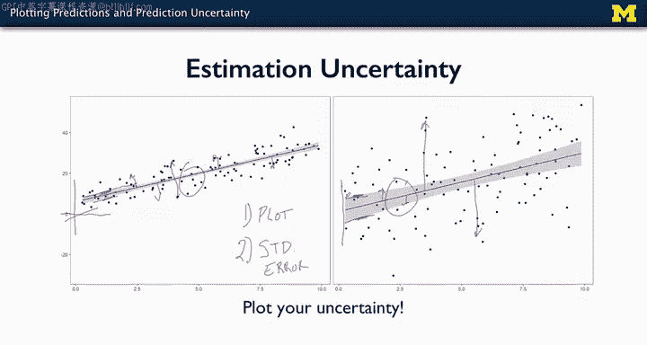

#  72：📊 预测值与预测不确定性绘图

在本节课中，我们将学习如何绘制模型的预测值及其不确定性。核心在于理解，除了关注模型给出的“最佳”预测（点估计），评估预测的可靠性（不确定性）同样甚至更为重要。我们将通过一个案例，直观地展示忽略不确定性可能带来的问题，并介绍如何利用标准误和可视化来评估模型。

---

上一节我们强调了可视化不确定性的重要性。本节中，我们通过一个具体的案例来深入理解这一点。

想象你是一名数据分析师。你的老板给你一份数据，其散点图如下所示。他要求你拟合一个线性模型，以便对新数据进行预测。

老板认为线性模型是合适的。于是你拟合了一个形式为 **`y = a + b*x`** 的模型，得到斜率约为 **2.97**，截距约为 **5.43**。你准备用这个模型进行预测。

然而，在你下班前，老板又给了你另一组数据。这组数据可能来自不同的来源或传感器。

你同样为这组新数据拟合了一个线性模型，得到了图中蓝色的回归线。这时你会发现一个关键问题：这个新模型的方程 **`y = 5.43 + 2.97*x`** 与第一个模型完全一致。

如果只看点估计（斜率和截距），这两个模型没有区别。但哪个模型更可靠呢？假设老板告诉你，预测误差在 **±10** 的范围内是可以接受的。面对这两组数据，你对哪个模型的预测更有信心？

虽然回归线相同，但两组数据的方差（波动程度）差异巨大。第一组数据点紧密地分布在回归线周围，而第二组数据则非常分散。这直接影响了我们对模型预测的信心。

---

这个案例引出了一个非常重要的原则：**务必在图表中绘制预测的不确定性**。

以下是评估不确定性的两种主要方式：

**1. 绘制数据与置信区间**
通过可视化，我们可以直观地看到不确定性。在第一张图中，回归线周围的灰色置信带很窄，表明我们对斜率估计的把握很大。在第二张图中，置信带非常宽，说明斜率参数存在很大的不确定性，我们对它的真实值了解甚少。

因此，在其他条件相同的情况下，使用第一个模型进行预测会比使用第二个模型自信得多。

**2. 查看标准误**
当无法直接绘图时，标准误是量化不确定性的关键指标。标准误衡量了参数估计值可能偏离真实值的程度。

假设模型假设都得到满足，我们可以通过标准误来判断估计的精度。以下是两个模型参数的标准误对比表：

| 参数 | 模型一标准误 | 模型二标准误 |
| :--- | :--- | :--- |
| 截距 (a) | 0.92 | 3.86 |
| 斜率 (b) | 0.15 | 0.63 |

从表中可以看出，尽管两个模型的点估计完全相同，但模型一的标准误远小于模型二。这意味着模型一的参数估计分辨率更高、更精确。因此，我们会更倾向于使用模型一进行预测。

---

需要记住的是，不同的统计模型计算标准误的方法各不相同。因此，在使用任何模型进行预测前，你都应该了解其不确定性的计算方式。

以下是本课的核心要点总结：

*   **尽可能绘制数据**：这是发现方差模式和问题的最直观方法。
*   **评估估计值的方差**：利用**标准误**这一概念至关重要。
*   **谨慎对待高方差估计**：如果参数估计的标准误很大（分辨率低），说明模型可能捕捉到了大量噪声而非真实信号。在这种情况下，使用该模型进行预测需要格外小心。

总之，在建模和预测时，我们不仅要看模型给出的“最佳答案”（点估计），更要评估这个答案的可靠程度（不确定性）。理想情况下，我们总是希望处于像第一个模型那样低不确定性的情境中。

---

本节课中，我们一起学习了预测不确定性的重要性，并通过案例对比了仅关注点估计与结合不确定性分析的区别。我们掌握了两种评估不确定性的方法：可视化置信区间和解读标准误。记住，一个可靠的预测不仅要知道“预测值是多少”，还要知道“这个预测值有多大的把握”。