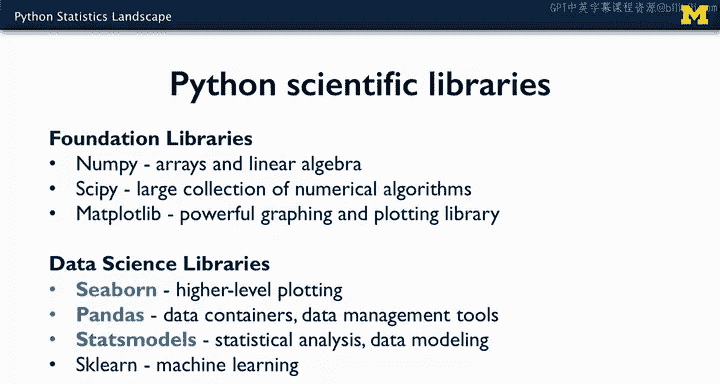

# 课程7：Python统计生态概览 🐍📊

在本节课中，我们将概览用于数据分析的Python工具生态。我们将了解Python为何适合数据分析，并介绍本课程将使用的核心库。

---

Python自1991年诞生，是一门易于学习的语言。其代码可读性强，语法清晰明了。Python拥有庞大的标准库，使得编写简短脚本来完成常见任务变得容易。

与R、Matlab和SAS等特定领域语言不同，Python是一门通用编程语言，并非专为数据分析设计。然而，通过结合使用一些功能强大的库，Python可以成为数据分析的理想环境。

虽然Python易于学习，但其运行速度并不特别快。而在进行数据分析时，速度是一个重要的考量因素。为了解决这个问题，用于数据分析的Python库实际上是用C语言编写的，但可以通过Python调用。普通Python用户无需了解任何C语言知识即可使用这些库，并能利用这些高度优化库的速度优势。

本课程将使用的库，是由开源社区的独立程序员团队在过去25年中开发的。这些库涵盖了数据管理、数值计算、绘图和统计建模等多个领域。它们相当成熟和稳定，可以信赖其在研究和工业工作中产生准确且有意义的成果。

上一节我们介绍了Python数据分析的背景，本节中我们来看看本课程将具体使用的核心库。

以下是本课程将使用的库列表：

*   **NumPy**：提供高效的数组运算和数学函数基础。
*   **SciPy**：建立在NumPy之上，提供科学计算工具（如优化、积分）。
*   **Matplotlib**：一个基础的绘图库，用于创建各种静态、交互式图表。

这三个库构成了数据分析的基础。其他库通常会调用它们，但在你自己的代码中，通常不会直接使用它们。

以下是你将在本课程所有工作中直接使用的库：

*   **Seaborn**：一个基于Matplotlib的高级数据可视化库，语法更简洁，能轻松创建美观的统计图形。
*   **Pandas**：一个强大的库，用于数据操作和管理，提供了`DataFrame`这一核心数据结构，方便进行数据清洗、转换和分析。
*   **Statsmodels**：提供了广泛的统计建模工具，用于执行统计分析、假设检验和探索性数据分析。

此外，我们还列出了另一个库：

*   **Scikit-learn (sklearn)**：这是你完成本课程后可能想要探索的众多库之一。它提供了许多用于机器学习和预测分析的工具。

---

在本课程中，你将看到许多使用Python进行数据分析的示例。我们将详细讲解核心Python语言以及上述讨论的库。通过在Jupyter Notebook中使用这些工具，你将能够专注于语言和工具本身，而无需担心安装和配置问题。

---

本节课中我们一起学习了Python数据分析的生态概览，了解了Python的优势、速度问题的解决方案，并认识了构成现代Python数据分析工作流的核心库：NumPy、SciPy、Matplotlib、Seaborn、Pandas和Statsmodels。我们还简单提及了用于机器学习的Scikit-learn库。