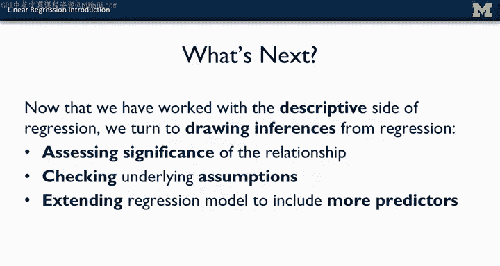

#  74：线性回归导论 📈

在本节课中，我们将学习线性回归的基本概念。我们将使用一个关于侧手翻距离的研究数据作为例子，探讨如何描述变量之间的关系、如何建立预测模型，并初步了解如何从模型中得出统计推断。

## 数据与研究目标

我们使用的数据来自一项对25名成年同事进行的侧手翻研究。记录了许多变量，但我们主要关注的**响应变量**是侧手翻的距离（以英寸为单位）。其他可能相关的变量包括参与者的身高和侧手翻是否成功完成。

一个可能的研究目标是：建立一个模型，用于预测此类成年人群的平均侧手翻距离。具体来说，我们想知道：
*   身高是否是侧手翻距离的有效预测因子？
*   知道侧手翻是否成功完成，是否会影响对平均距离的预测？

## 探索响应变量

首先，我们来看主要的结果变量——侧手翻距离。其直方图和QQ图显示数据大致服从正态分布。如果我们想预测下一个随机选择的成年人进行侧手翻的距离，很可能会使用样本均值 **82.48英寸** 作为估计值。

但我们知道，可能还有其他特征或变量会影响这个距离。特别是，我们想探究身高是否是一个有用的预测因子。一个合理的假设是：个子更高的人通常侧手翻距离更远。

## 可视化关系：散点图

为了检验身高与侧手翻距离之间是否存在显著的正向线性关系，我们首先绘制散点图进行可视化。
*   **Y轴**：响应变量，侧手翻距离。
*   **X轴**：解释变量或预测变量，身高。

在描述散点图时，我们通常关注**形态、方向、强度和异常值**。

观察身高与侧手翻距离的散点图，我们可以看到：
*   **形态**：大致呈线性关系。
*   **方向**：正向关系（身高增加，距离倾向于增加）。
*   **强度**：数据点围绕线性趋势有一定分散，强度为弱到中等。
*   **异常值**：没有明显远离整体线性模式的点。

## 量化关系强度：相关系数与R²

为了更精确地量化这种关系的强度，我们可以计算**相关系数 `r`**。`r` 的取值范围在 -1 到 1 之间。本例中 `r = 0.33`，证实了我们观察到的正向、弱到中等强度的关系。

回归分析中另一个重要的量是 **`R²`（决定系数）**。对于单个定量解释变量和响应变量的情况，`R²` 就是相关系数的平方：`R² = r²`。

`R²` 告诉我们，响应变量的变异中有多大比例可以由其与解释变量的线性关系来解释。在本例中，`R² ≈ 0.11`，意味着只有大约 **11%** 的侧手翻距离变异可以通过其与身高的线性关系来解释。侧手翻距离本身的变异范围很大（从低于70英寸到超过110英寸），其中仅有一小部分能用身高差异来解释。

## 建立预测模型：最小二乘回归线

既然存在线性趋势，我们希望能找到一条“最佳拟合”直线，用于根据身高预测侧手翻距离。直线的通用方程是 `y = mx + b`。

在回归模型中，我们通常使用以下符号表示：
`ŷ = b₀ + b₁x`
*   `ŷ`：表示预测的响应值。
*   `b₀`：**截距**，当 `x = 0` 时的预测响应值（其实际意义取决于上下文）。
*   `b₁`：**斜率**，表示 `x` 每增加一个单位，`y` 的**估计平均变化量**。公式为：`b₁ = Δy / Δx`。

如何定义“最佳拟合”？每个观测点与直线上对应预测值之间存在垂直距离，这个距离称为**观测误差**或**残差**。我们希望这些误差尽可能小。由于误差有正有负，直接相加会相互抵消，因此我们将其**平方**后再求和。

**最小二乘回归线**就是那条能使所有观测点的**残差平方和**达到最小的直线。

使用统计软件，我们可以得到针对本例数据的最佳拟合线。输出结果中的系数部分会给出直线方程：
*   截距 `b₀ = 7.55`
*   斜率 `b₁ = 1.1`

因此，回归方程为：`预测侧手翻距离 = 7.55 + 1.1 * 身高`

斜率 `b₁ = 1.1` 的解释是：我们估计，身高每增加一英寸，其侧手翻距离平均会增加约 **1.1 英寸**。

## 使用模型进行预测

现在我们可以用这条直线进行预测。例如，预测一个身高为64英寸的成年人的侧手翻距离：
`ŷ = 7.55 + 1.1 * 64 = 78.4 英寸`

进行预测时，必须确保用于预测的 `x` 值（此处为身高）处于我们建立模型时所依据的数据范围之内。在此范围之外进行预测称为**外推**，通常是不可靠的。64英寸正好在我们的身高数据范围内，因此这个预测是合理的。

这个预测值 `78.4英寸` 可以解释为：**所有身高64英寸的成年人，其平均侧手翻距离的估计值**。回归模型本质上就是在给出给定 `x` 值条件下，`y` 的**条件均值估计**。

## 计算残差

在我们的数据集中，恰好有一位身高64英寸的参与者，其实际侧手翻距离为 **87英寸**。现在我们可以计算这个观测点的残差。

**残差**定义为：`残差 = 观测响应值 - 预测响应值`
对于这个观测点：`残差 = 87 - 78.4 = 8.6 英寸`

我们可以为数据集中的每一个观测点计算残差。这些残差在后续的模型诊断中非常有用。

## 从描述到推断

到目前为止，我们主要进行了回归的描述性分析：可视化关系、建立最佳拟合模型。这个模型很好地拟合了我们的数据。

接下来，我们希望转向回归的**推断**部分：评估身高与侧手翻距离之间是否存在统计上显著的关系。为此，我们需要了解并检验线性回归模型的一些基本假设是否得到满足。此外，我们可能还会考虑扩展模型，纳入更多的预测变量。

## 总结

本节课我们一起学习了线性回归的基础知识。我们从一个具体的研究问题出发，通过散点图可视化两个定量变量（身高与侧手翻距离）之间的关系，并用相关系数 `r` 和决定系数 `R²` 量化了关系的强度和解释力。我们引入了最小二乘法的思想，找到了最佳拟合的回归直线，并学会了如何利用回归方程进行预测和计算残差。最后，我们指出了从描述性分析迈向统计推断（如显著性检验）和模型扩展的下一步方向。