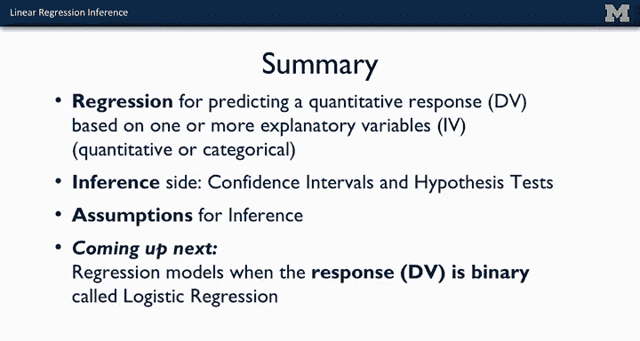

# 75：线性回归推断 📊

在本节课中，我们将学习线性回归的推断部分。我们将探讨如何检验变量间是否存在显著的线性关系，如何构建置信区间，以及进行这些推断所需满足的假设条件。

上一节我们介绍了如何使用最小二乘法拟合回归线来预测数据。本节中，我们来看看如何基于这条拟合的线进行统计推断。

## 斜率的重要性

我们关注的核心问题是：两个变量之间是否存在显著的正向线性关系？这本质上是在检验回归线的斜率。

如果回归线的斜率为零，这意味着无论解释变量取何值，我们预测的响应变量值都是相同的。换句话说，知道解释变量的值对预测没有帮助。

在我们的例子中，翻筋斗距离与身高之间的回归斜率估计值为1.1。然而，这只是基于样本数据的一个估计。如果我们用另一组25个成年人重复研究，很可能不会得到完全相同的斜率估计值。

我们可以想象存在一个关于翻筋斗距离和身高的完整总体数据。如果我们能获得所有数据并拟合回归线，就能得到真实的回归线，其截距和斜率是真实的总体参数。我们关心的就是这个真实的斜率β1（用希腊字母表示），并想评估它是否为零（或是否为正）。

## 假设检验

在回归输出中，系数旁边提供了用于检验真实截距和斜率假设的信息。

以下是关键信息：
*   **估计斜率 (Coefficient)**：我们的B1估计值为1.1。
*   **标准误 (Std Error)**：0.67，它估计了像我们这样的估计斜率平均而言与真实斜率之间的距离。
*   **t统计量 (t-statistic)**：计算公式为 `(估计斜率 - 假设值) / 标准误`。它衡量了我们的估计斜率（1.1）距离零假设值有多少个标准误单位。计算得约为1.65。
*   **P值 (P-value)**：对于“斜率不为零”的双侧检验，P值为0.112。

由于我们的研究问题是检验“显著的正向关系”，这对应的是单侧备择假设（真实斜率 > 0）。因此，我们需要将双侧P值除以2，得到单侧P值约为0.056。这个结果在10%的水平上显著，但在5%的水平上不显著，属于边缘显著。

## 置信区间

除了假设检验，我们可能还希望报告真实斜率的一个合理取值范围，即置信区间。

以下是95%置信区间的解读：
*   我们有95%的把握认为，身高每增加一英寸，翻筋斗距离的总体平均变化在缩短0.2英寸到增长2.5英寸之间。

## 均值响应与个体预测的区间估计

我们还可以为特定解释变量值下的**平均响应**构建置信区间。例如，我们估计所有64英寸高的成年人的平均翻筋斗距离为78.4英寸，可以围绕这个估计值构建一个区间。

如果为数据范围内的所有身高值都构建这样的区间，就会在散点图上形成**置信带**。这些置信带是弯曲的，在最接近样本平均身高（本例中为67.6英寸）处最窄。因为估计远离均值处的平均值风险更大、变异性更高。

我们可能还想为一个**个体**进行预测。例如，预测一个具体的身高64英寸的成年人的翻筋斗距离。围绕个体预测值构建的区间称为**预测区间**。

以下是两者的比较：
*   预测区间总是比相应均值的置信区间更宽。
*   预测个体比估计均值更困难，需要考虑更多的变异性。

## 模型假设

所有这些推断技术都需要一些基本假设得到合理满足。

我们拟合的回归模型表达式为：
`翻筋斗距离 = β0 + β1 * 身高 + ε`
其中，ε代表随机误差。

模型假设包括：
1.  误差ε应服从均值为零的正态分布。
2.  误差的方差应恒定，不随身高变化。

由于我们无法观测真实误差，只能使用观测到的误差——即**残差**（实际值与预测值之差）——来检查这些假设。

以下是检查方法：
*   **正态性检查**：绘制残差的Q-Q图。如果点大致落在一条斜线上，则正态性假设基本合理。我们的数据显示正态性基本合理。
*   **恒定方差检查**：绘制残差与身高的散点图（残差图）。我们希望看到点随机散布在零线周围，并且在低身高和高身高处，点的离散程度（带宽）大致相同。我们的残差图显示了这种随机散布和大致恒定的方差。

数据还可以用来估计那个恒定的误差标准差σ，它表示观测值平均偏离预测值多远。我们的估计值约为14.5英寸，说明模型中仍存在相当大的变异性。

## 引入更多变量

我们的模型拟合看起来不错，但能否做得更好？考虑添加另一个自变量：是否完成了翻筋斗（是/否，已编码为指示变量，1表示完成，0表示未完成）。

引入新变量后的回归结果给出了新的截距、更新的身高系数，以及一个针对“完成状态”的系数（约6）。

在包含多个解释变量的模型中，系数的解释至关重要。每个系数只有在保持其他所有变量相同的情况下进行比较时才有意义。

以下是系数的具体解释：
*   **身高系数 (1.26)**：比较两个完成状态相同的成年人，身高每相差1英寸，其翻筋斗距离平均相差约1.26英寸。
*   **完成状态系数 (~6)**：比较两个身高相同的成年人，完成翻筋斗者比未完成者的平均翻筋斗距离长约6英寸。

从可视化上看，这表现为两条平行的回归线，“完成者”的线整体比“未完成者”的线高出约6英寸。

我们仍需检查新模型的残差，以评估推断的合理性。残差图再次显示了围绕零线的随机散布和恒定方差，假设看起来是合理的。

## 调整后的推断

现在，我们的推断问题是：在调整了完成状态后，翻筋斗距离与身高之间是否仍存在显著的正向线性关系？

查看输出结果：
*   调整后的身高系数估计为1.26英寸，标准误约为0.7。
*   用于检验“调整后存在正向关联”的单侧P值，由双侧P值0.085除以2得到，约为0.0425。

因此，在调整了完成状态后，我们确实发现了身高与翻筋斗距离之间存在显著的正向关联。不过，预测的误差标准差估计仍约为14.5英寸。

---

本节课中我们一起学习了线性回归的推断方法。我们探讨了如何对斜率进行假设检验和构建置信区间，了解了为均值响应和个体预测构建区间的区别，并学习了检验模型正态性和恒定方差假设的方法。最后，我们还看到了如何在模型中引入另一个变量（包括分类变量），并正确解释在调整其他变量后的系数含义。

接下来，我们将学习当响应变量不是定量变量而是二元变量（例如成功/失败，是/否）时的回归模型，这被称为逻辑回归。