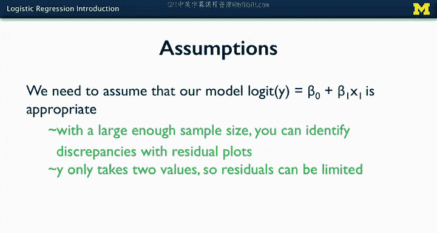

# 77：逻辑回归导论 📊

在本节课中，我们将学习逻辑回归。逻辑回归是线性回归的扩展，专门用于处理结果变量只有两个类别（例如“成功”或“失败”）的情况。我们将使用一个关于“侧手翻”的数据集，探索如何根据年龄来预测一个人成功完成侧手翻的概率。

---

## 从线性回归到逻辑回归

上一节我们介绍了线性回归。本节中我们来看看当结果变量只有两个值时，线性回归会遇到什么问题。

我们使用的数据来自对25名成年人的随机抽样，记录了他们的年龄以及是否成功完成了侧手翻。结果变量“完成侧手翻”只有两个值：0（失败）或1（成功）。

如果我们尝试用线性回归来拟合年龄与成功概率的关系，会得到如下模型：
`Y_hat = 0.34 + 0.015 * 年龄`
其中 `Y_hat` 代表预测的成功概率。

然而，这个模型存在明显问题。例如，它预测一个50岁的人成功概率约为110%，这在概率论中是不可能的，因为概率值必须介于0%和100%之间。因此，我们需要一种新的方法来处理这种二分类结果。

---

## 逻辑回归与Logit变换

为了解决概率超出[0,1]区间的问题，逻辑回归不直接预测概率 `P`，而是预测概率的一个变换值——**Logit**（或称**对数几率**）。

其变换公式为：
`logit(P) = ln( P / (1 - P) )`
其中，`P` 是成功的概率，`P/(1-P)` 称为**几率**（Odds）。

以下是Logit函数的一些关键特性：
*   当成功概率 `P = 0.5`（即成功与失败几率相等）时，`logit(P) = 0`。
*   Logit函数的值域是整个实数轴（从负无穷到正无穷），这完美避免了概率值超出边界的问题。
*   该函数是对称的。例如，`P=0.75` 和 `P=0.25` 的Logit值互为相反数。
*   **核心规律**：Logit值越高，对应的成功概率就越高；Logit值越低，对应的成功概率就越低。

在逻辑回归中，我们假设这个变换后的Logit值与自变量（如年龄）呈线性关系。

---

## 理解逻辑回归模型

基于Logit变换，我们构建的逻辑回归模型形式如下：
`logit(Y_hat) = β₀ + β₁ * 年龄`
其中，`Y_hat` 是预测的成功概率，`β₀` 是截距，`β₁` 是斜率。

当我们把这个模型的预测结果转换回概率尺度并绘图时，会得到一条**S形曲线**。这条曲线总是被限制在0和1之间，形状可以是上升的（像爬山），也可以是下降的（像滑雪），具体取决于斜率的方向。

**重要提示**：我们的数据中，年龄最小约为22岁。如果我们用这个模型去预测一个15岁的人的成功概率（这被称为**外推**），结果可能并不可靠，因为我们没有在这个年龄区间内的观测数据。

---

## 模型输出与解释

使用Python拟合逻辑回归模型后，我们得到以下关键输出（模型族为二项分布，连接函数为Logit）：
*   截距 `β₀` ≈ -4.42
*   年龄的斜率 `β₁` ≈ 0.2096

因此，我们的逻辑回归方程为：
`logit(Y_hat) = -4.42 + 0.2096 * 年龄`

**如何解释斜率 `β₁`？**
直接解释“对数几率”的变化并不直观。更常见的解释方式是：
对于年龄每增加一岁，成功完成侧手翻的**几率**平均变为原来的 `e^{0.2096} ≈ 1.23` 倍。
这意味着，年龄越大，成功的几率越高（因为倍数大于1）。如果倍数小于1，则意味着年龄越大，成功几率越低。

**示例计算**：对于一个36岁的人，其预测的对数几率为：
`logit(Y_hat) = -4.42 + 0.2096 * 36 ≈ 3.13`
根据Logit函数图，`logit=3.13` 对应的成功概率非常高，大约在95%左右。

---

## 预测不确定性

和线性回归一样，逻辑回归的拟合线也存在不确定性。我们可以绘制**预测区间**（图中灰色阴影区域）来量化这种不确定性。

观察预测区间，我们可以发现：
*   在数据密集的区域（例如年龄在26岁左右），预测区间较窄，说明我们对预测值比较有信心。
*   在数据稀少的区域（例如年龄较大时），预测区间很宽，说明预测的不确定性很大。
*   当我们把对数几率尺度的预测区间转换回概率尺度时，区间会变得不对称且不规则，这是因为变换是非线性的。

---

## 模型假设与诊断

逻辑回归有一个核心假设：**Logit(Y) 与自变量之间存在线性关系**。验证这个假设是否成立具有一定挑战性。

一种检查方法是使用**残差图**。残差是观测结果（0或1）与模型预测概率之间的差值。然而，由于结果变量Y只有两个可能值，在给定的X值下，残差也只能取两个值，这使得残差图的信息量有限。

在以下情况下，残差图会更有帮助：
1.  自变量X的取值范围很广。
2.  模型中有多个自变量（协变量），这样可以观察到更多不同的 `(X, Y_hat)` 组合。

在我们的例子中，年龄主要集中在22至35岁之间，范围较窄，因此残差图提供的信息不多。

---

## 总结

本节课中我们一起学习了逻辑回归的基础知识。我们了解到，当结果变量是二分类时，线性回归不再适用，因为它可能预测出无意义的概率值。逻辑回归通过**Logit变换**将概率映射到整个实数轴，从而解决了这个问题。我们学习了如何解释逻辑回归模型的系数，特别是如何理解斜率代表的**几率比**变化。最后，我们探讨了模型的预测不确定性以及其核心假设。在下一节中，我们将继续深入，学习如何对逻辑回归模型进行统计推断，包括置信区间和假设检验。